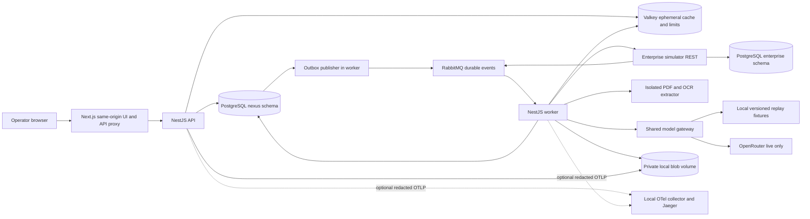
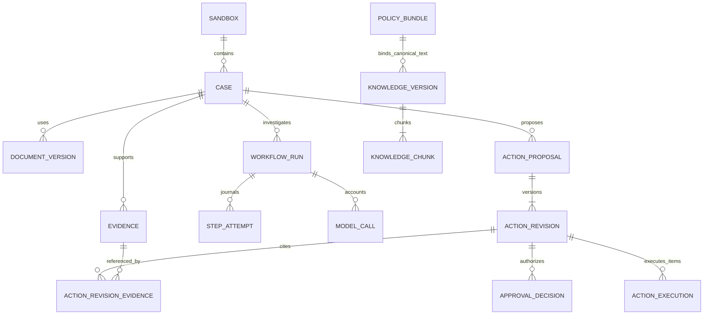
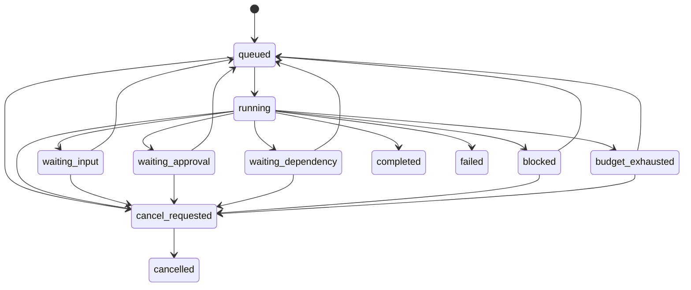

# NEXUS - AI Operations Center

## 0. Document Status and Execution Rules

- Planning date: 2026-11-26. Revision: 1.0, final planning artifact; independent critical audit closed with no remaining blocking findings. Implementation has not started and is not authorized by this document.
- Input specification: [NEXUS_IMPLEMENTATION_PLAN_base.md](NEXUS_IMPLEMENTATION_PLAN_base.md). Collaboration and memory rules: [AGENTS.md](AGENTS.md).
- This document specifies intended behavior. No application, migrations, deployment, live AI run, or product acceptance is claimed by producing it.
- The deliverable is this plan, not an instruction to start implementation. Implementation requires the user's subsequent authorization.
- English is used for implementation artifacts. Operator-facing application copy is English; phase reports to the user are Czech. Internationalization is outside core scope.
- All stages F01 through F52, including letter-suffix stages in document order, are mandatory and separately accepted. `Fx-Fy` is the inclusive **manifest slice from exact Fx to exact Fy**; a standalone ID means exactly that stage. `F09-F11` = F09,F10,F11, excluding following F11A/F11B; `F01-F51` excludes F51A/F51B while `F01-F51B` includes both. Never parse numeric intervals or implicitly include a root's suffixes. Advanced/Optional/Future/Not Justified features are not hidden core requirements.
- The audited decomposition contains **74 mandatory stages**. Headings in section 9 define their canonical order; copy that exact order into the phase runner manifest. Numeric root labels remain stable after subdivisions.
- Execute one stage at a time. A stage requires the previous stage's explicit user acceptance as well as its listed technical dependencies. Do not interpret passing tests, peer messages, or memory summaries as acceptance.
- If a prerequisite is missing or an architectural contradiction is found, stop that stage, report the precise conflict, and ask the user. Do not implement an improvised replacement architecture.
- At every stage inspect the worktree first, preserve unrelated changes, read the memory index if present, and load only relevant notes. Memory updates require a direct user request; implementation does not grant standing permission to rewrite memory.
- A phase report states its ID, state, changed files, observable behavior, exact commands/results, limitations, and manual acceptance steps. Unexecuted checks say `NOT RUN`; failed or skipped checks cannot be reported as passed.
- The last sentence of every implementation phase report is the following Czech template, with both `{ID}` occurrences replaced by the actual identifier: `Fáze {ID} je připravena k akceptaci. Pro pokračování potvrďte "Akceptuji {ID}".` A blocked phase instead states its blocker and does not claim readiness.
- No agent may start the next stage until that acceptance is received. Checkpoints add integration evidence; they do not remove this gate.
- Run no paid model calls in ordinary tests or CI. Live evaluation additionally requires an explicit budget and opt-in invocation. Never commit keys, raw private responses, or credentials.
- An implementation stage may not silently expand to include future stages. If its listed work cannot fit one focused agent session, stop and propose a numbered subdivision before writing more code.

## 1. Product Specification and Scope

### 1.1. Product Promise

NEXUS helps operators of the fictional distributor **Northstar Commerce** investigate supply interruptions, reconcile documents, and resolve customer requests. It replaces repetitive information gathering with evidence-backed case work, not with autonomous control of the business.

The principal interface is an operations workbench: dashboard, case detail, documents, approvals, and execution history. A contextual assistant is secondary. An HR reviewer can launch a complete recorded scenario without an API key; a technical reviewer can inspect actual durable business changes, authorization, recovery, citations, and evaluation results.

### 1.2. Core Boundaries

| Area | Included core behavior | Explicit boundary |
|---|---|---|
| Company | One fictional company, EUR, UTC, integer units, synthetic people and documents | No multi-tenant SaaS, real PII, foreign exchange, payments, accounting ledger, or ERP product |
| Supply | Delayed/partial PO, affected orders, allocation, alternative procurement, communication, escalation | No route optimization, forecasting platform, automatic vendor negotiation, or actual supplier ordering |
| Documents | Text/email, digital/scanned PDF, PNG/JPEG, invoice/delivery-note extraction, three-way reconciliation | No executable attachments, Office macros, arbitrary web crawling, handwriting guarantee, or custom OCR training |
| Customer | Delivery inquiry, damaged goods, return, billing question, pre-dispatch address correction | No refunds, card data, unrestricted order editing, or autonomous customer contact |
| Integration | Stateful ERP/CRM/WMS simulator behind REST and replaceable ports | No real ERP credentials or production connectors |
| AI | Shared gateway, schemas, bounded tools, hybrid retrieval, selective reviewer, explicit abstention | No agents with SQL, shell, arbitrary HTTP, arbitrary file access, or direct business-write tools |
| UI | Responsive enterprise workbench, controlled forms/cards, accessible tables, source exploration | No AI-generated executable UI or chatbot-only experience |
| Runtime | Local Docker Compose, replay by default, server-side bring-your-own-key live mode | No Kubernetes, hosted deployment, paid managed services, HA claims, or Internet-facing production operation |

### 1.3. Complete Business Outcomes

| Scenario | Supported inputs and deterministic checks | Required branches and persistent outcomes |
|---|---|---|
| A: Supply exception | Supplier email + attachment; exact supplier/PO/line matching; stock, reservations, demand deadlines; approved supplier agreements | Buy an alternative; use partial stock plus a smaller alternative PO; wait and notify when policy allows; no feasible option; ambiguous PO; stale inventory; policy block. Procurement creates a real simulated PO and inbound expectation, never immediately increases on-hand inventory. |
| B: Reconciliation | Invoice or delivery note; supplier, currency, line arithmetic, duplicate identity, PO, goods receipts, tax, totals, tolerances | Exact match; tolerable rounding; quantity/price discrepancy; duplicate; missing PO/receipt; incomplete extraction; malicious document. A finance-approved command marks reconciled or on hold; a delivery note can register a verified receipt after approval. No money is transferred. |
| C: Customer request | Authenticated operator investigates a synthetic inbound customer message; identity and exact order association; delivery, past communications, linked A/B cases and return rules | Status response; damaged-item replacement with stock reservation; eligible return authorization; billing escalation/credit-note draft from B evidence; pre-dispatch address correction; unknown identity/insufficient facts/escalation. Communications are persisted as simulated sends. |

Requests with multiple possible customer/PO matches enter `needs_input`; fuzzy similarity is only a candidate hint. Do not let a model select an ambiguous identity or invent a financial field. A human's correction records authorship and evidence and reruns validation.

### 1.4. Delivery Order and Technology Classification

F22 implements the first A launcher; F22A accepts the complete browser-operable replay vertical, including policies, evidence, approval, actual simulator mutation, and trace. It is not a claim that the full product is finished. Live models, OCR, hybrid retrieval, and an AI critic follow; these must not delay that milestone. F30 completes B; F34 completes C; F52 checks the complete core after separate final evidence/review stages.

| Capability | Classification and fixed decision |
|---|---|
| Persistent custom workflow state machine, deterministic policies, outbox, HITL, evaluation | Core; implement as specified below |
| OpenRouter structured/chat/vision/embedding adapters | Core; configurable model roles, no model IDs in business code |
| Redis-compatible cache/rate counters | Core using Valkey, not Redis server; never a source of business truth |
| RabbitMQ | Core durable transport; PostgreSQL is the workflow journal |
| Hybrid RAG | Core after the lexical retrieval port used by the first vertical slice |
| AG-UI | Evaluated, not adopted in core: a protocol bridge would duplicate the narrow persisted SSE event contract without a second agent runtime |
| A2UI | Evaluated, not adopted in core: use the closed `UiDescriptor` schema and conventional React catalog instead; no arbitrary schema-to-code renderer |
| MCP | Advanced, deferred outside F01-F52: a read-only adapter to the existing tool registry could demonstrate portability. No core feature depends on it. REST already exercises a real replaceable integration boundary. |
| Reranker | Advanced, deferred; only worthwhile if a future measured hybrid-retrieval baseline fails its relevance target. No runtime reranking dependency in core. |
| Cache-Augmented Generation | Core only in the mundane form of version-keyed retrieval/context caching; no separate CAG framework |
| Semantic answer caching | Not justified: authorization, business-state versions, and policy drift make its stale-answer risk exceed demonstrated savings |
| Advanced learned model routing | Future; core uses explicit capabilities, role routing, one configured fallback, and hard budgets |
| A2A | Not justified: one application owns the workflows; no independently governed agents need delegation |
| Voice | Optional future product extension, no implementation stage |
| Specialized non-LLM models | Core conventional PDF extraction and Tesseract OCR; custom anomaly models not justified without labeled data |
| AI anomaly detection | Future; core discrepancy/risk detection is deterministic |
| Automated prompt optimization | Future offline experiments after a held-out evaluation set exists; never self-modifying production prompts |
| Langfuse | Evaluated, not adopted in core; local trace storage, OpenTelemetry, and the evaluation UI cover the needed features with less infrastructure |

### 1.5. Non-Functional Targets

These are acceptance targets to measure in F49, not results already achieved.

- Reference machine: Linux or Docker Desktop, 4 CPU cores, 16 GiB RAM, 15 GiB free disk; no GPU. The default stack should stay below 8 GiB steady-state container RAM; the optional telemetry profile is measured separately.
- UI at 360, 768, and 1440 CSS-pixel widths; keyboard-complete primary flows; WCAG 2.2 AA-oriented automated and manual checks. Do not claim certification.
- With the reference seeded dataset and four concurrent operators, p95 read API latency under 400 ms excluding file downloads, AI, and simulator fault injection. Replay A under 15 seconds excluding human waits. Live workflow wall-clock deadline 5 minutes of active work, with a clearly reported external-dependency timeout rather than a fabricated result.
- Default document limit 15 MiB, 20 pages, 40 megapixels per decoded image/page, 120 seconds per extraction job, concurrency one per extractor. Reject encrypted PDFs, archives, HTML/SVG uploads, and unsupported media.
- Pagination defaults 25, maximum 100; bounded search query length 500 characters. No unbounded dashboard queries or full-file buffering in the browser.
- Workflow state, approvals, model ledger, source evidence, and action receipts survive all application/worker restarts. Temporary cache loss must not lose them.
- No exactly-once-delivery claim. At-least-once events plus unique business idempotency keys produce effectively-once simulator commands.
- Zero application-runtime external calls in replay and ordinary test CI, including embeddings, telemetry export, font/CDN fetches, and model-based judging. Self-host UI assets. Explicit dependency/image download or advisory/license-metadata checks during build/maintenance are distinct, disclosed network operations, never inference.
- Synthetic data only in the distributed fixtures. Logs never contain session cookies, API tokens, uploaded raw documents, complete prompts, or customer addresses.

## 2. Architecture and Decisions

### 2.1. Runtime Topology



The core is a modular monolith in shared packages, with API and worker composition roots. The simulator is an intentionally separate service and database role: application code cannot bypass REST with cross-schema business queries. The extractor is a privilege-separated parsing process, not an AI agent. No browser lifecycle owns a workflow.

### 2.2. Repository Layout and Dependency Direction

```text
apps/web/                    Next.js app router, same-origin proxy, UI only
apps/api/                    NestJS HTTP composition root, guards/controllers
apps/worker/                 NestJS application context, consumers/schedulers
apps/enterprise-sim/         Private REST simulator, its outbox publisher
apps/document-extractor/     Isolated bounded extraction HTTP service
packages/contracts/src/     Zod schemas, HTTP/event/tool/AI/UI contracts
packages/domain/src/        Pure money, allocation, reconciliation, state/policy functions
packages/db/src/            nexus Drizzle schema, repositories, transactions
packages/db/migrations/     Ordered reviewed SQL migrations for nexus
packages/enterprise-db/     enterprise schema/migrations/seed, simulator use only
packages/application/src/  Cases, workflows, actions, knowledge, assistant use cases
packages/ai/src/            Gateway, role routing, adapters, prompt templates
packages/integrations/src/  Enterprise REST client and tool implementation adapters
packages/messaging/src/     Typed envelopes, outbox publisher and consumer support
packages/observability/src/ Redaction, trace events, metrics and OTel adapter
packages/ui/src/            Controlled accessible React component catalog
config/                     Validated non-secret defaults and policy bundles
fixtures/                   Synthetic company data, documents, replay and eval records
tests/                      Unit/integration/E2E/evaluation suites and fault harness
tools/                      Test/phase runners, init, build and boundary checks
infra/                      Compose, Dockerfiles, migrations/init, telemetry config
docs/                       ADRs, architecture, operations, evidence, demos
```

Dependency rules are enforced by `tools/check-boundaries.mjs` from F01: contracts depend only on Zod; domain depends on contracts, never Nest/DB/AI; AI and integrations use contracts/ports, not controllers; application declares ports and consumes domain/contracts; composition roots wire adapters. `packages/db` may implement application repository ports through type-only imports. `apps/web` cannot import db, server AI adapters, application executors, or Node-only secrets. `apps/enterprise-sim` alone imports enterprise-db. No other package imports an app. Resolve cycles with ports, not dynamic imports.

Do not create one generic agent framework, generic business-rules language, plugin system, event-sourcing platform, or repository abstraction for every SQL table. Favor small explicit modules and SQL transactions.

### 2.3. Fixed ADR Summary

| ADR | Decision | Rejected alternative and reason |
|---|---|---|
| 001 | pnpm TypeScript workspace; Next.js UI, NestJS API/worker, PostgreSQL | Polyglot services add deployment and cross-language contracts without product value |
| 002 | Drizzle with node-postgres, reviewed SQL, separate nexus/enterprise schemas and roles | Prisma adds vector/FTS raw-SQL escape hatches without simplifying the hardest transactions |
| 003 | Custom explicit persisted state machine and versioned steps | LangGraph JS can checkpoint graph state but still needs this product's approval, authorization, ledger and command receipts; Temporal adds a server, operational model and deterministic replay constraints disproportionate to these short bounded flows |
| 004 | RabbitMQ outbox/inbox, database journal/leases, Valkey only ephemeral | Redis-as-queue duplicates broker responsibilities; an in-memory workflow would lose human waits |
| 005 | Explicit typed tool registry with propose-only AI and executor-only writes | Giving an LLM privileged ERP tools makes a prompt a security boundary |
| 006 | Digital extraction first, isolated OCR, schema validation, immutable corrections | Vision-only processing is unnecessarily costly, less locatable, and not a parser sandbox |
| 007 | Lexical port first, pgvector + FTS + reciprocal rank fusion later | Separate vector DB or vector search for stock/invoices is unnecessary or incorrect |
| 008 | DB execution trace is authoritative, OpenTelemetry export optional | Langfuse's additional backing services are not needed for the local core; external trace SaaS could leak data |
| 009 | Ordinary React + closed UI descriptors + persisted SSE | AG-UI/A2UI interoperability is not needed by a single controlled frontend |
| 010 | Replay/live gateway adapters share application logic; replay is visibly labeled | Separate fake demo endpoints would hide broken real validation and execution |
| 011 | One company, isolated synthetic sandboxes, reset by creating a new sandbox | Destructive volume resets and global reseeding are unsafe while workers or approvals exist |
| 012 | MIT for original project source; third-party license inventory and attribution | Do not relicense dependency binaries or imply every dependency is permissively licensed |

ADR files written during implementation expand these fixed decisions with sources and consequences; they do not reopen technology selection. MIT applies only to original project source created under an accepted implementation scope; preserve all third-party licenses. This is not legal advice or permission to publish the repository.

### 2.4. Local Deployment and Trust Boundaries

Only web port 3000 is published by default. PostgreSQL, broker, Valkey, API, simulator, and extractor have no host ports except explicitly selected local development profiles bound to `127.0.0.1`. RabbitMQ management and telemetry UI are development-only loopback profiles. Compose health checks use service readiness, not just open ports.

- `nexus_api` maintains identity/sessions/cases/documents/proposals/human decisions and reads execution state; no execution inserts or enterprise access. Worker writes its cases/evidence/doc-processing/proposals/journal/ledger/executions/validations, never human decisions/sessions. F04's readonly approver_role_view(user_id,roles,is_active) supports worker role rechecks without passwords/session digests. Module migrations grant needed tables explicitly. Both append audit, neither updates/deletes it; retention cannot purge approval/audit/spend history.
- `enterprise_app` can access only enterprise tables. Migration credentials are not injected into running applications. Revoke public schema create privileges and use explicit `search_path`; migrations must grant new tables/sequences explicitly.
- Nexus and enterprise are logical schemas/roles in the **same PostgreSQL instance**, not separate database servers. The absent-final protocol uses that shared real database clock (`clock_timestamp()`, not transaction-start `now()` after a wait). Splitting servers/clocks requires a new protocol/design review and is outside core.
- The API holds no enterprise-write token and never calls OpenRouter. Only the worker's executor adapter receives the simulator command credential; only the gateway adapter receives the model key. No credential becomes a tool argument or prompt variable.
- The extractor receives bytes and a job token only, has no database/blob-store/model credentials, and is connected only to an internal parser network shared with the calling worker. It has no egress network, root privileges, writable root filesystem, or host paths; temporary storage is a capped tmpfs. The worker also connects to the ordinary application network. Do not attach the extractor to that network.
- The simulator trusts service credentials for API access, not claims inside document text. Write routes require a distinct command token, scoped sandbox, payload schema, idempotency key and expected entity versions. It independently enforces stock, lifecycle and arithmetic constraints.
- Blob filenames are random internal identifiers/content hashes, never client paths. Original filenames are display-only escaped metadata. Downloads are authenticated, `Content-Disposition: attachment`, `X-Content-Type-Options: nosniff`, no public blob URL. PDF preview uses a restricted same-origin viewer, no document scripts or external resource fetches.
- Model input may contain untrusted text but no tool credentials, system-role text from a source, or executable code. An allowlisted egress destination is configured in the gateway; no arbitrary provider URL is accepted from an operator or model.
- OpenRouter receives only the minimized task context in live mode. Enforce configured provider privacy constraints; if no eligible endpoint exists, suspend instead of weakening privacy. Replay never sends data outward.

## 3. Domain, Data and Deterministic Rules

### 3.1. Common Value Contracts

`packages/contracts/src/common.ts` is the only definition of the following wire types. Validate at HTTP, event, tool, model and persisted JSON boundaries. Generate the OpenAPI schema from the same contracts, not hand-maintained duplicate DTOs.

```ts
type EntityId = string; // UUID; fixed valid UUIDs in fixtures
type Money = { amountMinor: string; currency: 'EUR' }; // signed decimal integer string
type Cost = { amountMicrousd: string; basis: 'estimated' | 'reported' | 'replay' };
type EntityRef = { system: 'nexus' | 'enterprise'; type: string; id: EntityId; version: number };
type Actor = { kind: 'human' | 'workflow' | 'service'; id: string; roles: string[] };
type RequestContext = { requestId: string; correlationId: string; sandboxId: EntityId; actor: Actor };
type Problem = { code: string; message: string; requestId: string; issues?: unknown[]; retryAfterMs?: number };
```

Never use JavaScript floating point for currency. Use bigint in pure calculation/SQL `bigint`, serialize decimal strings, reject exponential/NaN/infinite/oversized amounts, and bound absolute values to 10^12 minor units. Quantities are integers 0..1,000,000; requested order quantities must be positive. Tax rates are integer basis points; line tax is rounded half-up once, then line nets/taxes are summed. No implicit conversion between EUR financial impact and USD AI spend.

Use an injectable business clock: `sandboxes.business_effective_at` seeds Workflow.effectiveAt and simulator rules. All distributed demo/eval scenarios use `2026-11-02T09:00:00Z` in **both replay and live-model modes**; live changes inference, not business dates/facts/expected outcomes. Display that simulated date. Authentication, approval/lease/dependency expiry, provider price/privacy freshness and actual call timestamps use real database UTC. No document/model/client can change clocks. Tests control both explicitly; fixtures do not expire with the calendar. Real-time company operations are future adapter scope, not implicit live behavior.

### 3.2. Data Ownership and Migration Map

Every business table includes `id`, `sandbox_id`, `created_at`; mutable rows add `version` and `updated_at`. All cross-business references use `(sandbox_id, id)` foreign keys or validated external references. Users, sessions, migration state and server configuration are global, not tenant records. This is sandbox isolation for one company, not a multi-tenant security claim.

| Schema/module | Tables or aggregates | First migration owner |
|---|---|---|
| nexus identity | users, user_roles, sessions, preauth_challenges; readonly approver_role_view, worker SELECT only | F04 |
| nexus case | sandboxes, active_sandbox, cases, case_entity_links, evidence, audit_events, trace_events | F05, including explicit trace schema |
| enterprise supply/sales | sandboxes, suppliers, agreements, products, customers, purchase_orders/lines, sales_orders/lines, inventory, inventory_reservations | F07 |
| enterprise commands | command_receipts, communications, event_outbox | F08 |
| nexus events | event_outbox, event_inbox, dead_letters, ingress_keys | F10 |
| nexus workflows | workflow_runs, workflow_step_attempts, workflow_jobs, workflow_step_evidence | F11; dependency wait rows/control F11A; SSE F11B |
| nexus actions/policy | action_proposals, action_revisions, action_revision_evidence, policy_bundles | F12; each revision is a whole immutable action plan |
| nexus human decisions | approval_decisions | F13, API-role inserts only |
| nexus execution | action_executions, action_execution_attempts | F13A-F13B, one execution per revision/item |
| nexus AI | model_config_revisions, budget_accounts, model_calls, budget_reservations, usage_adjustments | F14; live validation in F23 |
| nexus live configuration | model_config_validations, privacy_attestations | F23; runtime_limit_revisions F40 |
| nexus documents | blobs, documents, document_versions, extraction_revisions, extraction_jobs | F15-F16 |
| nexus knowledge | knowledge_documents, knowledge_versions, knowledge_chunks | F17; vector columns/indexes F25 |
| enterprise B | deliveries/lines, invoices/lines, invoice_document_keys | F27 |
| enterprise C | customer_terms (F31), return_authorizations (F31A), replacement_shipments/lines (F31B), credit_note_drafts (F31C) | F31-F31D; address command F31D adds no competing order table |
| nexus memory | memory_entries, memory_revisions, feedback | F35 |
| nexus assistant | conversations, conversation_messages, assistant_runs | F36 |
| nexus evaluation | evaluation_runs, evaluation_results, evaluation_baselines | F42 |
| nexus lifecycle | reset_requests | F46; retention_jobs F46A |

Drizzle schema files are grouped by these modules. Migrations are monotonically numbered SQL checked into the corresponding migration folder; destructive changes require an explicit migration plan, not ORM push. Unique constraints include source event identity, normalized invoice identity, immutable revision number, execution idempotency key and simulator receipt key. Add indexes for sandbox/status/created_at, case/run foreign keys, outbox next-attempt and workflow lease eligibility. F25 adds GIN FTS and HNSW vector indexes. No JSON blob substitutes for queryable money, status, identifiers or row versions.

`evidence` stores immutable source kind, source ID/version, content hash, locator, captured facts and capture time. It can refer to an enterprise snapshot, document page/offset, policy version, calculation input/output or historical memory. It is never just a model-supplied URL. Authoritative facts can expire for execution even when their historical snapshot remains valid for an audit.

Persist actual evidence relations, not only UUIDs hidden in arbitrary prose: `evidence.case_id`, `action_revision_evidence`, `workflow_step_evidence` and `memory_evidence` use scoped foreign keys and are added with their owning module. A material structured claim is `{ predicate, subjectRef, value, evidenceId }`; `predicate` is an enum of document-stated value, inventory quantity, calculated cost/penalty/difference, entity status, policy rule and eligibility result. The verifier compares its typed value/subject/version with the referenced snapshot or calculation. A citation's mere existence does not prove a different claim. Free-form prose remains interpretation unless tied to a verified structured claim; financial/date/status fragments in messages are formatted from those claims.



The diagram is a logical aggregate view: documents may be attached to a case after upload; SQL models that as a nullable case reference until attachment. Each ACTION_EXECUTION also has an immutable item ID. Enterprise entities/receipts live in the other schema and are referenced by validated REST snapshots, not cross-schema joins/FKs.

Reconciliation reports have one persisted home: an immutable `evidence` row with `kind='reconciliation_report'`, typed canonical report data, input extraction/entity versions and calculation rule version. `reconciliationReportId` is that row's ID and `reportHash` its canonical content hash, created in F28 and reused by F29/actions/C. Do not add a competing report JSON table or derive an ID from a transient model response. Its concrete evidence relations hold the source against deletion while unresolved/needed for an action.

Audit and trace are distinct: audit is append-only security/business history; trace is bounded operational diagnostics. Audit events include actor, request/correlation/run IDs, action, target, before/after hashes and outcome, not raw personal data. Application roles cannot alter existing audit rows; this is not a claim of tamper-proof storage against the database administrator.

### 3.3. Fixed Business Rules

`config/policies/northstar-v1.json` is the single core executable policy data bundle. F12 also creates `fixtures/knowledge/northstar-v1.md`, its canonical human-readable source, and records its SHA-256 in the bundle. F17 ingests that existing exact file; it does not create a second canonical policy. Unmatched documents may be informational but cannot supply executable rules. Numeric thresholds/allowed product flags live in the validated bundle; algorithms, authorization and hard safety ceilings live in the code homes below. No embedded JavaScript, SQL, template execution or arbitrary expressions are permitted. Model/retrieved text cannot alter the bundle. Revisions are immutable and proposals pin a policy version. Changing executable rules requires a reviewed configuration/code change and migration, not a model-generated policy or free-form UI save.

| Rule | Exact behavior |
|---|---|
| Stock | `availableForAllocation = max(0,on_hand-active_reservations)` uses on-hand only; inbound never becomes allocatable stock before an approved goods receipt. `coverageByDeadline` separately includes confirmed inbound arriving by that deadline for planning A, never in REST `available`. Use `allocateFromStock` and `coverageByDeadline` in supply/allocate.ts, sort deadline/order ID, lock writes. |
| Alternatives | Supplier must be active and approved for the product, currency EUR, positive capacity, latest promised arrival no later than the affected customer deadline. Split procurement across at most two eligible suppliers. Rank by total additional procurement commitment, then arrival, then supplier ID; expose rejected alternatives and reasons. |
| Financial impact | Additional commitment = all alternative goods + explicit expedite charges. The original PO remains an open commitment: this catalog does not cancel/refund it, so do not subtract its cost or claim savings. Display original outstanding amount and like-for-like unit-price difference separately as comparisons, plus exposed sales value and contractual delay penalties, not an invented net loss. Penalty = min(contractual cap, late whole calendar days * contractual daily amount). Missing price/deadline/contract data blocks that calculation. |
| Supply approval | Every purchase/communication needs human approval. Finance also approves if prior successful additional procurement for this case plus all proposed new PO commitments exceeds EUR 500; separate users fill ops/finance slots. Original preexisting PO amount is not this additional total. Splitting suppliers or reanalysing after a partial effect cannot bypass the cumulative threshold. No feasible option escalates, never relaxes constraints. |
| Reconciliation | Supplier + normalized invoice number + currency is a duplicate key; identical bytes also flag a duplicate. Compare PO price, cumulative received quantity and cumulative invoiced quantity. Allowed price difference is at most one cent per unit AND absolute invoice net difference at most EUR 1.00; tax rounding at most one cent per line. Missing fields, mismatched currency, over-receipt/over-invoicing or any larger difference means review/hold. Never default a missing number to zero. |
| Financial writes | Marking an invoice reconciled/on hold, posting a receipt, or creating a credit-note draft requires finance approval. Posting a receipt locks affected stock/PO lines and prevents duplicate delivery identity. A credit-note draft never refunds or changes a paid ledger. |
| Returns | Eligible within 30 calendar days after recorded delivery, product returnable, requested quantity no greater than delivered minus prior returns. Missing delivery date or non-returnable flag escalates. |
| Replacements | Only confirmed damaged delivered units within the same 30-day window; replacement quantity cannot exceed eligible damaged units minus prior replacements. Simulator atomically reserves available stock; insufficient stock escalates or links to A, never creates negative stock. |
| Address change | Only an exact matched customer order in `confirmed` state with no allocation/shipment; validate a bounded structured postal address. No quantity, price, customer or payment changes through this action. |
| Low-risk automation | Only `case.add_internal_note` may auto-execute, with an explicit policy, deterministic length/content validation and audit. No communication, money, stock or business-status write is low risk. |
| Approval validity | Expire after 24 real hours, proposal/policy revision change or **external/unrelated** target-version change. Advances proven by this same approved revision's continuous committed receipt chain do not expire it. Last human editor cannot approve; admin alone has no business approval. |

| Rule family | Code source and configuration boundary | Owner |
|---|---|---|
| Stock/allocation | `packages/domain/src/supply/allocate.ts`; simulator stock invariant cannot be disabled by bundle | F18; simulator F08/F31B |
| Approved alternatives/financial impact | `packages/domain/src/supply/{alternatives,impact}.ts`; bundle max suppliers/thresholds, authoritative agreement prices/capacity | F18 |
| Supply approval/automatic-note allowlist | `packages/domain/src/policies/{approvals,action-validation}.ts`; bundle may tighten thresholds but not grant roles/change low-risk catalog | F12-F13B |
| Reconciliation/financial writes | `packages/domain/src/reconciliation/{three-way,tolerances}.ts`; bundle cent/window thresholds, compiled finance/no-payment constraints | F27A-F29 |
| Return/replacement/address eligibility | `packages/domain/src/customer/eligibility.ts` plus independent simulator checks; bundle window/returnability cannot bypass stock/state | F31A-F32 |
| Approval lifetime/editor separation | `packages/application/src/actions/{decisions,executor}.ts`; bundle TTL <=24h hard ceiling, compiled identity/hash/plan binding | F13-F13B |

Source files, not RAG text, enforce these rules. Only the named northstar bundle exists in core; policy IDs distinguish sections within it, not undeclared additional bundles. A simulator can reuse pure predicates on its own locked DB facts, never trust a model/application's `eligible=true` field.

Contract terms are authoritative simulator records; policy bundles impose additional application constraints. If terms conflict or a retrieved policy disagrees with its linked bundle, block execution and escalate. A published natural-language document cannot silently become executable policy.

For A, compute shortage separately per product and affected delivery deadline. Start from unreserved on-hand stock plus only other confirmed inbound quantities arriving by that deadline; exclude the delayed/unavailable portion of the matched PO. Allocate in deadline/order-ID order. The supplier notice's new quantity/date is a planning input attributed as `document_stated_value`, not a verified promise that delivery will occur. Show original ERP expectation and supplier-stated revision separately. Partial availability arriving by a deadline may cover demand; a missing revised date/quantity blocks that portion of analysis. Compare waiting, single-supplier and at most two-supplier splits over integer shortages bounded by fixture/product quantity caps; enumerate supplier pairs and allocate cheaper eligible capacity first, breaking equal-cost ties by arrival/ID. Re-evaluate each deadline so early stock is never counted twice. The approved procurement command changes the simulator; reading an email alone never silently rewrites ERP stock or dates.

### 3.4. Sandbox and Fixture Model

All cases/simulator records have sandboxId and server scope. The **fresh seed baseline before scenario effects** has 12 products, 6 suppliers, 12 customers, 12 POs, 24 sales orders (F07); 8 deliveries/10 staged invoices (F27); 30 prior communications (F31); 12 imported historical cases (F35). F07 fills foundation tables with named A subset plus coherent residual B/C records, not future tables/code. Runtime commands legitimately add records. Count assertions run before launch or select seed-tagged rows, never mistake effects for seed drift; F45 verifies all counts/links.

Scenario launch creates a fresh scenario instance with unique event IDs against known fixture records; it does not overwrite an existing case. The launcher prevents conflicting runs against the same mutable fixture entities and, from F46, offers a new sandbox when needed. Reset is non-destructive: F46 retires the previous sandbox and creates/activates a fresh seed generation. Historical traces remain read-only. No `docker compose down -v`, database drop, or hidden volume deletion is a normal reset.

## 4. Stable HTTP, Tool, Event and UI Contracts

### 4.1. HTTP Conventions and Routes

The browser calls `/api/v1` on the web origin; Next route handlers proxy a fixed internal API destination with an explicit header allowlist and streaming request bodies. They never accept an arbitrary upstream URL. Nest controllers own validation/authentication/authorization. No duplicated business logic in server actions or browser components.

- JSON is UTF-8. IDs are UUIDs; dates are ISO-8601 UTC; decimal strings carry money. Use `application/problem+json` for errors and bounded cursor pagination `{ items, nextCursor }`.
- Error codes: `VALIDATION_FAILED` 400, `UNAUTHENTICATED` 401, `FORBIDDEN` 403, `NOT_FOUND` 404, `CONFLICT`/`STALE_STATE`/`IDEMPOTENCY_MISMATCH` 409, `APPROVAL_EXPIRED` 409, `UNSUPPORTED_MEDIA` 415, `PAYLOAD_TOO_LARGE` 413, `RATE_LIMITED` 429, `DEPENDENCY_UNAVAILABLE` 503, `BUDGET_EXHAUSTED` 409. No successful HTTP response for a failed mutation.
- Public `/api/v1` creation/command POSTs require UUID `Idempotency-Key`, except login/CSRF/session. Same key/body returns original result; changed body 409. Revisions use `If-Match` integer version/409. The **private simulator** instead accepts the executor's composite key in the same header and compares immutable business identity, excluding only explicitly validated transport metadata below.
- Uploads use streamed multipart bytes with actual byte counting, not trusted `Content-Length`. Proxy and API limits must agree. Mutations require a valid session, allowed role, CSRF header and exact allowed Origin.

| Route group | Essential endpoints | Authorization/owner |
|---|---|---|
| auth | `GET /auth/csrf`, `POST /auth/login`, `POST /auth/logout`, `GET /auth/me` | Preauth/session; F04 |
| cases | list/detail/create/input/history plus `POST /cases/:id/resolve-no-action` | viewer read, operator create/input; F05/F10/F19; human no-action control F13/F13B |
| evidence/trace | `GET /evidence/:id`, `GET /runs/:id`, `GET /runs/:id/events`, `POST /runs/:id/cancel` | viewer scoped read, operator cancel; F05/F11A/F11B/F20 |
| proposals | `GET /cases/:id/proposals`, `POST /cases/:id/proposals`, `PATCH /proposals/:id`, `POST /proposals/:id/clarification`, `POST /proposals/:id/reanalyse` | operator, optimistic revision; F12/F13 |
| approvals | `GET /approvals`, `POST /proposals/:id/approve`, `POST /proposals/:id/reject` | exact ops/finance roles, immutable decisions; F13 |
| documents | `POST /documents`, `GET /documents`, `GET /documents/:id`, `GET /documents/:id/content`, `PATCH /documents/:id/extraction` | operator upload/correct, viewer read; F15/F16 |
| knowledge | `GET /knowledge`, `POST /knowledge`, `POST /knowledge/:id/publish`, `POST /knowledge/search` | admin manage, scoped operator search; F17/F38 |
| assistant | `POST /assistant/runs`, `GET /assistant/runs/:id/events`, `POST /assistant/runs/:id/cancel` | operator; F36 |
| dashboard | `GET /dashboard`, `POST /briefings` | viewer read, operator budgeted briefing; F39 |
| admin | `GET /admin/models`, `POST /admin/model-revisions`, `GET /admin/usage`, `GET /admin/failures`, `POST /admin/failures/:id/retry` | admin; retries still use the original safe/idempotent payload; F23/F40/F41 |
| evaluations | `GET /evaluations`, `GET /evaluations/:id`, `POST /evaluations` | admin; UI start supports offline only, live CLI opt-in; F42-F44 |
| demo | `GET /demo/scenarios`, `POST /demo/scenarios/:id/launch`, `POST /demo/reset`, `GET /demo/reset/:id` | operator launch, admin reset; F22/F45-F46 |

All read routes enforce current/specified readable sandbox and resource scope. A browser-supplied case/run ID is never authorization. A retired sandbox is read-only to all humans; inactive-sandbox mutations return `STALE_STATE`.

### 4.2. Authentication and Permissions

Use database-backed opaque random 256-bit session tokens, storing only their SHA-256 digest. Cookies are host-only, HttpOnly, SameSite=Lax, path `/`; Secure outside explicit localhost development. Sessions expire after eight real hours, no invisible indefinite renewal. Passwords use Node scrypt with random 16-byte salt, N=32768/r=8/p=1, and a configured memory allowance; compare digests in constant time. Do not add JWTs to local storage.

An unauthenticated CSRF challenge has a five-minute DB lifetime; login consumes it. Login/logout and every other mutation check Origin and a CSRF token whose digest is bound to preauth/session state. Return the token through the same-origin JSON API, keep it in browser memory, never put it in URLs/logs. Rate-limit login by IP hash and username hash. Valkey loss fails closed for login, uploads, mutations and AI admission; authenticated read-only pages may continue against PostgreSQL. Cache failure cannot grant a permission or approve an action.

| Role | Permissions |
|---|---|
| viewer | Read cases, evidence, documents, redacted traces and dashboard |
| operator | viewer plus ingest, human correction, proposal editing, clarification, cancellation, assistant, demo launch |
| approver_ops | viewer plus approving/rejecting operational/communication actions |
| approver_finance | viewer plus financial decisions and second approval where required |
| admin | viewer plus knowledge/configuration/evaluations/demo lifecycle; no implicit ops/finance approval |

Users may hold multiple explicit roles, but the same user cannot fill both required approval slots for a high-cost procurement revision. Seed three explicitly labeled local demo accounts for operator, ops approver and finance/admin; setup generates local passwords in ignored `.env.local` and prints them once to the local terminal, never to evidence/log files. A documented development-only password override is allowed only on loopback and cannot be a production default.

### 4.3. Enterprise REST Port and Tool Registry

The simulator exposes private `/v1` routes. All require an injected read token or command token, a validated sandbox header and correlation ID. The worker tool adapter supplies credentials; models never do. Enterprise API responses contain entity versions and timestamps.

| Port/tool | Request -> result | AI access |
|---|---|---|
| `enterprise.get_purchase_order` | exact PO ID/reference -> supplier, lines, unreceived quantities, terms, version | read |
| `enterprise.get_inventory` | bounded product IDs -> on hand, reservations, available, confirmed inbound line quantities/arrival dates and all contributing versions | read |
| `enterprise.get_affected_orders` | PO/product IDs + horizon -> exact sales orders/deadlines/versions | read |
| `enterprise.list_alternatives` | products/quantities/deadline -> approved supplier offers/capacity/versions | read |
| `enterprise.get_customer_context` | exact customer/order ID -> delivery, terms, communications, links | read; F31 |
| `enterprise.get_invoice_context` | supplier/invoice/PO IDs -> invoice, PO and receipt facts | read; F27 |
| `domain.calculate_supply_options` | validated snapshots -> immutable allocation/cost comparison evidence | deterministic compute |
| `domain.reconcile_document` | validated extracted data + authoritative snapshots -> discrepancy report | deterministic compute; F28 |
| `knowledge.search` | bounded query + allowed metadata -> current published chunks and citations | read |
| `actions.propose` | bounded typed draft plan/items + evidence IDs -> whole-plan draft revision, never approval/execution | propose only |
| `cases.add_internal_note` | bounded plain text + case ID -> audited internal note | policy-authorized automatic action |

Every registry entry declares name, schema version, argument/result Zod schemas, permission, read/compute/propose class, supported scenarios, max results, timeout, redaction, retryability and budget weight. Tool selection is an allowlist intersection of workflow step, actor role and server policy. Validate each result as untrusted integration data. Unknown tools, side-effect tool names, extra fields and excessive calls are rejected and traced.

No generic SQL, arbitrary URL, filesystem, shell, email-send or raw ERP-write tool exists. A model can prepare an action proposal but cannot select a human actor, approval state, executable status, price, supplier approval flag or service credential.

Simulator command endpoints use `POST /commands/:kind`, `GET /command-receipts/:idempotencyKey`, and same-key replay. Body is `{ sandboxId, actionRevisionId, itemId, planHash, itemHash, baseExpectedVersions, payloadTemplate, priorReceiptKeys, executeBefore, authorizationValidUntil }`; validated route supplies kind. Business identity includes sandbox/revision/item/kind/planHash/itemHash, with itemHash over approved template/base versions. Simulator recalculates it, requires one planHash per seen revision and resolves closed receipt bindings from its own same-plan committed receipts. Hash is not authorization. Normalize receipt proof keys to sorted unique set; validate proof on a new mutation, but deadline/authorization lifetime/proof ordering are transport metadata, not changed business identity. An existing same-business receipt returns unchanged even with a renewed deadline; changed business identity is 409. The simulator independently rejects new writes with executeBefore > DB clock+30s, executeBefore > trusted executor's authorizationValidUntil, or an already-expired deadline. Executor remains authority for actual human approval validity. Transaction locks sandbox/rows, validates chains/deadline/constraints, writes mutation/receipt/entityChanges/origin-tagged outbox atomically. Lookup uses persisted attempt deadline for absent-final proof; no client input can force a local execution state. Timeout is reconciled, never assigned a new key.

### 4.4. Event Envelope and Delivery

```ts
type EventEnvelope<T> = {
  eventId: string;
  eventType: string; // exact versioned registry name
  schemaVersion: 1;
  occurredAt: string;
  sandboxId: string;
  correlationId: string;
  causationId: string | null;
  producer: 'api' | 'worker' | 'enterprise-sim';
  payload: T; // IDs and bounded facts, never raw documents or credentials
};
```

Registry names: `nexus.case.created.v1`, `nexus.case.completed.v1`, `nexus.document.ready.v1`, `nexus.workflow.resume.v1`, `nexus.action.requested.v1`, `enterprise.supplier.delay.v1`, `enterprise.inventory.changed.v1`, `enterprise.order.changed.v1`, `enterprise.invoice.changed.v1`, and `enterprise.communication.created.v1`. Payloads live in contracts/events; arbitrary names reject. Supplier delay has supplier/PO and optional existing document IDs; absent/unready source enters input/document wait, never arbitrary URL download. Other changes identify entity/version/fields. Case-completed has case ID, terminal run/trigger event IDs, terminal case version/status (`resolved|escalated|cancelled`), outcome evidence IDs and correlation; F11A emits it with terminal transition in one transaction.

F17 additionally registers `nexus.knowledge.changed.v1` with document/version IDs, publication state and new retrieval generation. Publication transaction updates version visibility and affected plan revalidation state before emitting this notification. F25's cache keys use the committed SQL generation and recheck current visibility; asynchronous cache invalidation is an optimization, never permission/policy correctness.

Publish inside a database outbox transaction with the business change. Publisher confirms precede delivered marking; crash may duplicate. Use durable topic exchanges `nexus.events` and `enterprise.events`, persistent single-node quorum queues, `prefetch=8`, manual ack. Setup credentials declare topology; runtime publishers can write only their own exchange, consumer checks exchange/type-prefix/producer consistency and envelope schemas. Single node is persistence, not HA.

Consumer transaction: validate envelope -> insert `(consumer_name,event_id)` inbox key -> create/advance the appropriate database job -> commit -> acknowledge. A duplicate inbox event is acknowledged without duplicate work. Consumers do no model calls or remote commands before that commit. Retry transient consumer/publish errors after 1s, 5s, 30s, maximum three retry deliveries; preserve IDs. Malformed/forbidden/poison events enter a durable DLQ and a queryable dead-letter record with redacted reason. Retrying a DLQ record requires admin authorization and retains its identity; corrected payloads get a new event with causation linkage.

HTTP source dedupe uses `ingress_keys` scoped by actor/sandbox/route and request Idempotency-Key; broker delivery dedupe uses inbox consumer/event ID; command-effect dedupe uses the simulator's composite receipt key. They are distinct boundaries. Forwarding/re-ingesting the same source preserves original ingress identity in source metadata, not a fresh event pretending to be a new business input.

Only root ingress types create workflows. Inventory/order changes invalidate affected pending proposals or wake an exact linked wait, never recursively create AI cases. Enterprise change payloads include entity type/ID/version, changed fields and optional originating revision/item/receipt key from the committed command. Do not blanket-invalidate that same originating plan for its own expected changes; its execution still requires verified receipt-chain/current-state checks. Unrelated plan/external changes remain stale blockers. Causation and unique `(case_id,definition_version,trigger_event_id)` prevent loops. Existing journaled workflows resume during broker outage; new outbox events visibly await delivery.

### 4.5. UI and Streaming Schemas

`UiDescriptor` is a discriminated union of `clarification_form`, `alternatives_table`, `discrepancy_list`, `evidence_list` and `approval_summary`. It contains only bounded labels, registered field keys, enum/number/text controls, read-only evidence IDs and known action links. The server constructs authorization-sensitive fields and allowed operations. Model-supplied labels are plain text and schema-validated. Reject HTML, executable expressions, component imports, arbitrary links, style strings and undeclared field keys.

SSE uses `{ id: monotonicSequence, event: 'step'|'status'|'text_delta'|'final'|'error', data: validatedJson }`. `Last-Event-ID` replays persisted events; 15-second heartbeats do not become audit rows. A disconnected browser does not cancel a run. Cancellation is a separate authenticated POST. A text delta is labeled provisional; only a final schema-validated, evidence-checked response is actionable. Never render private reasoning or expose provider chain-of-thought.

## 5. Workflow, Approval and Recovery Semantics

### 5.1. State Machines



Resume requires an explicit recorded cause: human input, completed approval, dependency retry, or a new authorized budget extension within the hard ceiling. Terminal states cannot spontaneously resume. A new analysis after completion is a new linked run, not mutation of an old trace.

`waiting_dependency` is distinct from human/approval waits. F11A stores `workflow_dependencies(parent_run_id, child_case_id, child_trigger_event_id, linked_case_version, root_case_id, expires_at, state)` plus typed wait_reason. Same-sandbox linkage has max depth one and unique cause. Wake matches exact child/trigger generation, terminal version >= linked version, and current case terminal version equal to event version; it must not require the child's version to stay unchanged while it works. Old-generation/old-terminal events never wake a newer wait. Child failure/cancel, incompatible new generation or 48-real-hour expiry escalates the parent. Dependency/wake job/inbox transition is transactional; F33A later creates customer-specific child intake using this existing mechanism.

Case states are `new`, `investigating`, `needs_input`, `needs_approval`, `executing`, `resolved`, `escalated`, `cancelled`. Only the application state reducer maps workflow/action transitions to case status. A completed analysis with missing evidence maps to escalated, not resolved. A case is resolved only when all required actions succeed or a human records a justified no-action resolution.

The no-action path is explicit human-only POST from F13: operator supplies a bounded reason, cancels all unstarted plan items under the same run/proposal lock used for dispatch, and records human-resolution evidence/audit. Any started/succeeded/unknown execution returns 409 instead of pretending no effect occurred; F13A/B wire that guard to real execution state. F21 shows it only when server says allowed. No AI tool can resolve a case this way, and a partial-effect case stays visibly escalated/cancelled unless its real required plan completes.

Workflow step records use `pending`, `running`, `succeeded`, `retryable_failure`, `permanent_failure`, `waiting`, `cancelled`. Each attempt records typed input/output hashes, redacted output or evidence references, timing, model/config/prompt versions and error class. A succeeded step is reused only when its immutable input hash matches; changed human input creates a new revision and invalidates downstream dependent steps.

### 5.2. Journal, Leases and Bounded Execution

- `workflow_runs` stores definition version, immutable ingress, effectiveAt, model/policy/config revisions, budgets, current state and cancellation flag. `workflow_jobs` is a database work queue; RabbitMQ is a delivery/wakeup mechanism, not the execution state store.
- Claim jobs with `FOR UPDATE SKIP LOCKED`, a 30-second lease, 5-second heartbeat and monotonic fencing token. Every step commit checks the token/lease. A stale worker cannot commit a result. Use database time for leases.
- A crashed model request is marked uncertain, not automatically free. A crashed external action is reconciled by the stable command receipt key before further action. Uncertainty and budget reservations survive lease expiry.
- Transient pure/read steps retry at 1s/5s/30s, at most three attempts. Model gateway attempts have their own single shared attempt counter described in section 6; never multiply SDK retries by workflow retries. Side-effect retries always use the identical revision and idempotency key.
- Parallelize only independent inventory/customer-context reads, maximum four, then deterministically join by ID. Do not execute consequential actions in parallel. Each workflow's action dependency DAG is bounded to six actions.
- Maximum ten physical model attempts, twelve read/compute tool invocations, two model-tool rounds, and five active minutes per A/B/C run. Human waits do not consume active minutes; leases are released while waiting. Assistant runs have at most four physical model attempts, six tools and two rounds.
- A repeated same `(step,inputHash,error)` cannot loop indefinitely. Unsupported/contradictory outcomes enter `blocked`/`waiting_input` or escalate according to typed reason; retries cannot relax policy.

### 5.3. Proposal, Approval and Execution

```mermaid
sequenceDiagram
  participant W as Workflow
  participant P as Proposal service
  participant H as Human approver
  participant X as Executor
  participant S as Enterprise simulator
  W->>P: Validated draft + evidence + expected versions
  P->>P: Deterministic policy + canonical payload hash
  H->>P: Decision for exact revision/hash
  P->>P: Persist immutable decision + resume outbox
  X->>P: Recheck roles, approvals, policy, state and expiry
  X->>S: Stable idempotency key + versions + payload
  S->>S: Lock/check/mutate/receipt/outbox in one transaction
  S-->>X: Receipt or uncertain transport failure
  X->>S: Lookup same receipt if outcome uncertain
  X->>P: Persist outcome and audit; continue dependent actions
```

An `ActionProposal` is the whole bounded **action plan**, not one independent command. Each immutable `ActionRevision` has `items[1..6]`: stable `itemId`, closed kind, target, `payloadTemplate`, `dependsOnItemIds`, evidence IDs and `baseExpectedVersions`. It also has rationale, aggregate impact, policy/config revision, authorship and role slots. Application validates an acyclic same-revision DAG, derives dependencies from scenario, computes impact/roles, and canonically hashes **all items, dependencies, base versions, evidence and policy/config identity**. AI may draft prose/allowed fields, never roles/hash/dependencies/status. `actions.propose` accepts a bounded draft plan, never approves/executes.

Most payload fields are approved constants. The only deferred bindings are registered receipt-created entity IDs/versions and message fact slots: `{ fromItemId, output: 'purchaseOrderId'|'shipmentId'|'returnAuthorizationId'|'creditDraftId' }`, limited to related-entity refs and explicitly displayed confirmation text parts. Referenced item must be a predecessor of the right kind in this same revision. Supplier/customer/quantity/price/address/financial amount/roles cannot be receipt-bound or model-resolved. Approval UI shows exact constants plus named placeholders; only deterministic server/simulator binders fill them from committed receipts. No expression language, free string interpolation, extra field paths or arbitrary template evaluation.

Each receipt records authoritative entity changes `{entityType,id,beforeVersion,afterVersion}`. Every inventory/PO aggregate version increments on any relevant on-hand/reservation/inbound/link change, preventing phantom inbound procurement from escaping stale-state checks. Before a later item, its captured base version may advance **only** through a continuous chain of this same revision's earlier committed receipt changes supplied by the executor and independently checked from simulator storage. A gap/external change rejects with STALE_STATE. Thus the plan's first PO can advance shared inbound/parent-PO versions without invalidating its own second approved PO, while unrelated changes still require a new approval. Created-entity bindings start from the version in their creating receipt. Never rewrite approved base versions or payload after the fact.

Approval decisions bind `proposalId`, `actionRevisionId` and this whole-plan hash, with union of all required role slots. The >EUR 500 supply threshold applies to both PO items' sum; splitting EUR 800 into EUR 400 + EUR 400 cannot avoid finance approval. Permit only one open unexecuted procurement plan per case. Show all items/aggregate commitment at review; collect the whole required approval set before the first item executes. A PATCH of one item creates a new **whole-plan** revision and invalidates every prior decision on that plan. Stable item IDs identify unchanged intent for display, not reusable authorization.

| Action kind | Closed payload fields beyond common target/versions | Roles / first implementation |
|---|---|---|
| `case.add_internal_note` | case ID, plain text <=2,000 | schema/allowlist F12; actual policy-authorized execution F13A |
| `enterprise.create_purchase_order` | supplier/source PO; lines of product/quantity/agreement ID/unitPriceMinor/arrival; expedite charge; agreement refs/versions in baseExpectedVersions | ops + finance above cumulative EUR500; command F08, executor/binder F13A |
| `enterprise.send_message` | recipient/related refs, subject <=200, typed text/verified-claim/receipt-fact parts; rendered <=5,000 | ops; command F08, executor/closed binder F13A |
| `enterprise.mark_invoice_reconciled` | invoice ID, report ID/hash | finance; command F27B, workflow F29 |
| `enterprise.hold_invoice` | invoice ID, reason enum, report ID/hash | finance; command F27B, workflow F29 |
| `enterprise.post_goods_receipt` | PO, delivery reference, document version, line IDs/quantities | finance; command F27A, workflow F29 |
| `enterprise.create_replacement_shipment` | order/delivery, damaged line quantities, verified address ref | ops; command F31B, workflow F33 |
| `enterprise.create_return_authorization` | order/delivery, line quantities/reason enums | ops; command F31A, workflow F33 |
| `enterprise.create_credit_note_draft` | invoice/report ID/hash, exact positive amount, reason enum | finance; command F31C, workflow F33 |
| `enterprise.change_delivery_address` | order ID and bounded structured postal address | ops; command F31D, workflow F33 |

Prices/quantities/addresses are validated against authoritative records/eligibility and recomputed consequences; a model cannot invent an offer or pick a different customer. Financial commands independently check the simulator's own invoice/PO/receipt amounts/maximum draft amount; no undeclared report blob or cross-schema query is needed. Report ID/hash is an audit link, not a financial oracle. `reasonCode` is a per-action enum. Extra fields reject. Core status commands use exact pre-staged enterprise invoices; a new unregistered invoice can be extracted/compared but escalates for ERP registration, never gets a fabricated ID/general AP subsystem.

Proposal revision states: `draft`, `pending_approval`, `approved`, `rejected`, `superseded`, `expired`. Execution states are separate: `pending`, `in_progress`, `succeeded`, `retryable_failure`, `unknown`, `permanent_failure`, `cancelled`. A proposal status is not proof of execution. The executor alone creates/advances an execution, unique on `(action_revision_id,item_id)`, with bounded immutable attempt records. A revision can therefore contain two POs and a message without conflating receipts.

Human edits create a new immutable whole-plan revision, rerun domain/schema/policy/evidence validation and supersede prior unexecuted revisions/decisions. The server never accepts `approved=true`, approval roles, computed amounts or execution status from a client. Once any item is `in_progress`, `unknown` or `succeeded`, that whole revision is noneditable. Reconcile uncertain effects first; partial-effect reanalysis makes a new linked proposal/run using current state and explicit prior receipt evidence, never clones/reexecutes the succeeded items or carries over approvals. Rejected revisions do not execute; requesting clarification or new analysis places the run in a recorded wait/new analysis step.

Before each command recheck actual roles/editor separation, whole-plan decision hash/expiry, policy, active sandbox, evidence, cancellation and current versions **allowing only proven same-revision receipt-chain advances**; a success/unknown prior attempt cannot be blindly reissued. Fail closed. The sole automatic branch is case.add_internal_note covered by the explicit policy allowlist: F13A records `authorizationBasis=policy_auto`, policy revision/content hash on execution and audit instead of fabricating a human decision. Every other kind requires human slots; bundle can only narrow this compiled allowlist. There remains a bounded interval between remote check and commit; cancellation/role removal cannot undo an already accepted command. No distributed atomic authorization promise.

The executor's key is `sandboxId:actionRevisionId:itemId:commandKind`, persisted before I/O. Each **enterprise command** attempt computes `authorizationValidUntil=min(real DB clock+30s, earliest required approval expiry)` and executeBefore no later than that bound; the local policy-auto note needs no remote grant/absent-final protocol. Carry plan/item business hashes. Timeout queries that item receipt; past success applies even after later cancellation/expiry. A 404 cannot prove an earlier request will not commit. Simulator uses clock_timestamp after locks/before commit, transaction_timeout=10s, statement_timeout=5s, lock_timeout=1s; no new write after deadline. After executeBefore+10s shared-clock lookup can confirm absent_final; before then absence is unknown and only readonly reconciliation is allowed.

Only after `absent_final`, current approval/roles/versions/sandbox still valid and no cancellation, may the executor retry the same business payload/key with a newly recorded bounded transport deadline, within three total command attempts. Deadline is attempt metadata, not a new business payload/approval; previous receipt always wins. If cancellation/expiry occurs, do not reissue a missing command: reconcile then cancel the unsent item. Never change payload/versions/plan hash to force a retry. A 409 version conflict requires refreshed evidence, a new revision and renewed approval. Unresolved uncertainty remains operator-visible and blocks reset; no blind new-key retry.

Multi-action plans are not globally atomic. Example: create alternative PO -> prepare linked delivery-impact update -> send approved message. A failed PO prevents dependent communication; an independent earlier succeeded action remains visible. No automatic delete/refund/unreserve compensation is assumed. A corrective PO cancellation or shipment release is outside the executable catalog and escalates to a human; a supported corrective operation would require its own approved proposal in a future extension. `cancel_requested` stops unsent work, reconciles in-flight/unknown commands, records partial effects and then becomes `cancelled`; it never reports an earlier effect as rolled back.

### 5.4. Scenario Definitions

All workflows use the same intake, gateway, retrieval, evidence, tool, proposal, verification and journal components. Scenario-specific code is only typed step composition and pure domain rules.

| Definition | Ordered steps | Wait/stop conditions |
|---|---|---|
| `supply-v1` | validate source -> classify/extract -> exact match -> bounded parallel enterprise reads -> calculate allocations/options -> retrieve policy citations -> compose structured recommendation -> verify -> propose action DAG -> wait for approval -> execute/reconcile -> summarize/history | missing identity/data -> input; infeasible option/policy disagreement -> escalation; stale facts -> reanalysis/new approval |
| `reconciliation-v1` | validate/extract document -> correction if incomplete -> exact supplier/PO/invoice match -> retrieve receipts/prior invoices -> deterministic reconciliation -> policy citations -> structured report/draft -> verification -> finance proposals -> execute/reconcile -> history | duplicate -> hold/review, not repost; missing receipt -> input; incorrect arithmetic -> discrepancy; failed financial checks cannot be overruled by AI |
| `customer-v1` | classify request -> resolve exact customer/order -> gather communications, delivery, linked A/B evidence and terms -> deterministic eligibility/options -> retrieve policy -> response/action drafts -> verification -> approvals -> execute/reconcile -> history | unknown identity or unsupported request -> clarification/escalation; insufficient stock -> link A, no phantom reservation; billing uncertainty -> link B |

An AI recommendation is `{ findings, options, recommendedOptionId|null, draftCommunications, missingFields, uncertainties, evidenceIds }`. Findings are tagged `verified_fact`, `assumption`, `interpretation`, or `unresolved`; the server only allows `verified_fact` when a valid evidence/calculation reference supports it. Independent verification cannot turn an assumption into a transactional fact.

## 6. Shared AI and Document Infrastructure

### 6.1. Gateway Contract and Routing

`ModelGateway.invoke(request)` and `ModelGateway.stream(request)` accept role, capability requirements, validated messages/multimodal references, output schema ID, allowed tool names, workflow/budget context and cancellation signal. They return validated output or a typed failure plus selected provider/model, attempt IDs, usage/cost basis, prompt/config revision and redacted diagnostics. Business modules import the interface, not OpenRouter SDK objects or model names.

Roles are `classify`, `extract`, `vision`, `embed`, `analyse`, `verify`, `write`. F14 implements replay; F23 supplies the live adapter; F25 implements embeddings. Specific model defaults and source evidence are in section 10. Server defaults are in `config/models.default.json`; runtime immutable revisions are stored in the DB and pinned by new runs. Configuration is not a license to use an unsupported capability.

- A route declares required structured JSON/tool/vision/embedding/streaming capabilities and a fixed model/provider allowlist. Validate availability/capabilities/prices before activating a revision. Never silently drop `response_format` or send image bytes to a text-only model.
- OpenRouter implicit model/provider fallbacks and SDK retries are disabled. At most two physical attempts per gateway invocation: primary plus either one configured fallback for availability/rate-limit/timeout or one schema repair, never both. All count toward the run's shared attempt/dollar budget. Do not retry authorization, moderation, context-length, privacy-policy or deterministic business failures.
- Structured outputs are validated again with Zod even when the provider advertises strict JSON schema. At most one repair attempt inside that same two-attempt limit, no recursion. Missing business values stay null and trigger review.
- Provider tool calls are parsed, validated and dispatched through the registry, never executed by an SDK automatic tool runner. Results are bounded and marked untrusted. Two tool rounds maximum; a requested third becomes a controlled limit event.
- Streaming is used only for conversational text/status presentation. An incomplete stream never becomes a final structured recommendation, approval or action.
- Prompts live in `packages/ai/src/prompts/<role>/v1.ts`, with explicit trusted instructions, separated source data, citation/abstention format and no hidden reasoning storage. Prompt versions are content-hashed and recorded.

### 6.2. Budget and Cost Accounting

Use USD micro-units with bigint for accounting. Default hard ceilings are A USD 0.20, B USD 0.15, C USD 0.15, assistant USD 0.05, standalone document classification/extraction/vision combined USD 0.05, indexing USD 0.50/batch, briefing USD 0.03. Operators may lower them; an explicit extension may restore budget only within the hard ceiling. Replay actual spend is zero. Upload/index/briefing forms require explicit replay/live choice and show the corresponding cap before a live AI job is admitted; a key alone never starts paid preprocessing.

F14 creates hierarchical `budget_accounts`: each has owner kind/ID, parent account, immutable cap and used/reserved totals. Lock ancestor-to-leaf in stable order so every physical call atomically reserves against every applicable cap (including a parent evaluation). Document work started by a case is a child of its run budget; no separate allowance bypasses the A/B/C cap. A document processed independently before attachment has its own disclosed cap; later UI shows that prior preprocessing spend separately from the new case budget and deduplicates the ledger call IDs in totals, never silently recharges or rewrites ownership. Reusing an existing extraction is not a new model call. Live indexing requires its explicit batch admission; unavailable embedding budget leaves lexical retrieval available and status truthful.

Before a physical call, reserve a conservative upper bound: tokenizer-estimated input (including images' documented worst-case accounting) plus configured maximum output, at the selected provider price with a 20% buffer. If capability/pricing/token bound is unavailable, refuse that route rather than claim budget safety. Token limits are 16,000 input and 2,000 output per ordinary task, 4,000 output for the bounded analysis role. Reject oversized context or deterministically truncate lower-priority retrieved chunks; never silently drop required financial facts.

The model call ledger and reservation are persisted transactionally before I/O. On success settle with actual provider-reported cost when supplied, otherwise retain a labeled token-price estimate. Timeouts/disconnects retain the full reservation as uncertain charge until reconciled or conservatively finalized. Crashes cannot release a possibly spent reservation. Each fallback/repair is a new physical call with its own reservation. A periodic reconciliation job can record a `usage_adjustment`; it cannot rewrite an old audit event or fabricate confirmed cost. A provider bill can exceed an estimate, so report conservative enforcement based on available tariffs, not an absolute financial guarantee against provider billing errors.

Live API keys come from server environment only. Enabling live mode never occurs automatically because a key is present; launch UI and every trace display mode and active budget. If live fails, the UI must not substitute replay and call it live.

### 6.3. Documents, Extraction and Human Correction

`DocumentVersion` contains blob hash, validated media type, original filename, size/page count, source event, status and parser version. States are `uploaded`, `validating`, `extracting`, `needs_review`, `ready`, `rejected`, `failed`. Versions and extraction revisions are immutable; corrections create a human-authored revision and invalidate dependent analysis/proposals.

Pipeline: stream to quarantine -> magic-byte/size/type validation -> isolated parser -> digital text/page extraction -> OCR only for pages below a configured text-density threshold -> optional capped vision fallback for an unreadable field -> document classification/extraction through the gateway -> schema/arithmetic/source validation -> ready or human review. Email `.eml` fixtures are parsed for plain text and allowed attachments; scripts, remote images and HTML are not rendered. Incoming email in core is a local upload/fixture ingest adapter, not an Internet SMTP service.

Every extracted field is `{ value|null, source: { documentVersionId, page, start, end, bbox? }|null, status: 'extracted'|'corrected'|'missing'|'ambiguous', alternatives? }`. Text spans are exact offsets into the stored page text; OCR boxes are optional and may be coarse. Do not display an invented bounding box. A value without a verifiable source remains missing/ambiguous unless explicitly corrected by a human with justification. Corrections capture prior value, actor and timestamp.

Parser output is itself untrusted: validate page counts, dimensions, text lengths, Unicode/control characters and locators. Use timeouts, process-tree termination, concurrency caps, least-privileged images and no outbound document URL resolution. Cache extraction by blob hash + parser/config version inside the same sandbox; this does not skip validation or authorization.

### 6.4. Knowledge Retrieval

The stable `KnowledgeRetriever.search` port returns `{ mode, queryId, chunks: [{ id, documentVersionId, policyBundleVersion?, text, locator, score, evidenceId }] }` and a no-evidence outcome. F17 implements deterministic lexical FTS over approved text policies; the A workflow depends on this interface, not on a future embedding pipeline. F25 adds hybrid retrieval without changing callers.

Chunk by section/paragraph, target 600 tokens, overlap 80, preserve page/heading/offset, maximum 1,200 tokens per chunk. Publish only schema-validated approved knowledge versions. Metadata filters include sandbox, document kind, policy ID, effective date and publication status, applied inside SQL before ranking. Expired/superseded versions are excluded from new recommendations, retained for historical traces.

Embedding dimension is fixed per index/config generation, 1,536 in the selected baseline; never mix vectors from different models/dimensions. Build a new generation and atomically switch when changing embedding models. HNSW vector cosine top 20 and `websearch_to_tsquery('english', ...)` FTS top 20 are combined with reciprocal rank fusion `sum(1/(60+rank))`; return at most six chunks, stable tie-break by chunk ID. If embeddings are unavailable, an explicitly labeled lexical-only result is allowed; missing authoritative policy still blocks execution. No reranker in core.

Transactional inventory, PO/invoice values, permissions and current contract terms are fetched by exact relational REST tools, never by vector similarity. Knowledge text and historical memory provide explanations, not authoritative live balances or permissions.

### 6.5. Verification and Operational Memory

Always run deterministic validation: schema, citation existence/version, arithmetic, policy rules, action feasibility, matching identities and required fields. A consequential recommendation, conflicting evidence or explicitly uncertain interpretation additionally gets one independent reviewer call after F26. The reviewer receives the original problem, bounded source evidence and structured proposed findings, not a private reasoning trace or a prompt telling it to agree. It cannot use write tools, change a policy or approve an action.

Reviewer output is `{ verdict: 'supported'|'disputed'|'insufficient', findings: [{ code, evidenceIds, message }], missingFields }`. No recursive reviewer/reviser loop. A disputed/insufficient result blocks affected action revisions and enters human review. A human can correct inputs and request a new bounded analysis; a documented override can resolve a non-safety interpretive dispute, but cannot override missing identity, arithmetic, authorization, policy, budget or stale-state checks. Reviewer outages are visible; consequential live actions requiring review do not silently bypass it. Replay records the equivalent reviewer fixture after F26.

Operational application memory is separate from this repository's `agent-memory/`. It stores reviewed summaries of closed cases, provenance, applicable products/suppliers, outcome, expiry/review date and author feedback. State is `candidate`, `approved`, `expired`, `revoked`. Only a human-approved summary becomes retrievable historical context; it is labeled experience, not current policy. A 180-day review limit and revocation checks apply before retrieval. Never automatically edit policies, prompts, model routing or business rules from a memory entry.

## 7. Security, Observability and Evaluation

### 7.1. Threat Controls and Failure Behavior

| Threat/failure | Mandatory control | Observable verification |
|---|---|---|
| Direct/indirect prompt injection | Source text kept untrusted; closed schemas/tool allowlists; no credentials/write tools; deterministic executor | Malicious email, PDF and retrieved policy cannot send data, approve or mutate ERP |
| Insecure direct-object reference | Session/sandbox/resource checks on every API, tool and download | Foreign-sandbox case/document/evidence IDs return 404/403 and no content |
| Stolen/forged approvals | Server session/role check, immutable revision/hash, editor separation, expiry, recheck at execution | Client `approved` fields rejected; role removal or changed payload blocks command |
| SSRF/exfiltration | No arbitrary URL tool; fixed gateway/simulator destinations; parser has no egress; sanitized links | URLs embedded in documents are not fetched; unexpected destinations fail tests |
| Unsafe uploads | Byte/type/page/pixel limits, parser isolation, timeouts, no script-capable formats | Zip/polyglot/oversized/encrypted/malformed fixtures rejected or safely fail |
| XSS/CSRF | Escaped text, sanitized restricted markdown, no raw HTML, CSP, SameSite + Origin + token | Script payload cannot run; missing/wrong CSRF/Origin cannot mutate |
| Excessive spending | Admission reservation, physical-attempt caps, no stacked retry loops, paid mode explicit | Concurrency/timeout/fallback tests cannot reuse or release an uncertain reservation |
| Provider/rate-limit/schema failure | Typed error, bounded fallback/repair, no silent mode switch | Operator sees waiting/blocked/budget reason, never fake success |
| Broker/cache/enterprise outage | Durable outbox/journal; cache is non-authoritative; receipt reconciliation | Restart/recovery tests preserve work and do not repeat business effects |
| Stale/partial/cancelled work | Version checks, action DAG, fencing, explicit unknown/partial effects | Old approval fails; already committed effects remain visible after cancellation |
| Privacy/log leakage | Field allowlist, structured redaction, local-only default telemetry, retention | Canary secret/address never appears in log/trace/export snapshots |

Use a restrictive CSP (`default-src 'self'`, explicit required local asset/worker sources, no model-provided origins), secure headers and exact-origin policy. No permissive CORS; only the web origin reaches HTTP API through the proxy. CSRF defense is not delegated to CORS.

Default retention is raw blobs 30 days, diagnostic traces/redacted model outputs 30 days, audit/decision/receipt/spend records at least 365 days, reviewed memory 180 days. Core does not automatically delete audit/approval/receipt/spend rows. Never delete a blob required by unresolved cases/unknown effects. F46A records eligibility/reference checks and tombstones expired eligible content, never fabricates evidence. Retention is an engineering policy, not regulatory compliance. An atomic 5 GiB configurable blob admission cap rejects new uploads rather than deleting arbitrary files.

### 7.2. Trace and Telemetry

The authoritative UI trace is in PostgreSQL: schema F05, journal F11, query/SSE F11B, UI F20. Record workflow/correlation/step IDs, mode, definition/prompt/model/config/policy revisions, redacted tool argument/result summaries, source IDs, validation/review/human decisions, retries/fallbacks, latency, tokens and estimated/reported/replay costs. Structured output is bounded/redacted/versioned, not a raw conversation or chain-of-thought dump.

OpenTelemetry adds distributed spans/metrics in F41: API -> outbox publish -> consume -> workflow -> gateway/tool -> simulator. Propagate W3C trace context and link asynchronous spans; keep correlation IDs available when a trace sample is absent. Expose readiness/liveness separately, counters for DLQ/failed/unknown actions, queue/outbox age, budget rejections, model latency, token/cost totals and pool saturation. Use structured JSON logs with allowlisted fields. Telemetry exporter failure cannot fail a business command or become an unbounded memory queue.

An optional Compose profile starts local OTel collector + Jaeger; core works without it. No Langfuse, ClickHouse, external analytics or cloud trace account is required. Audit access is permissioned, and UI users see only redacted model data.

### 7.3. Evaluation Methodology

Evaluation is core, with versioned datasets and an offline default. Software correctness and AI quality are separate outputs and exit codes: `2` infrastructure/software error, `3` quality threshold failure, `4` budget/admission stop, `0` completed within all configured thresholds. Test suites use deterministic replay/stubs; offline quality results validate the harness and fixtures, not real-model accuracy.

`fixtures/evaluations/v1/manifest.json` identifies synthetic input files/hashes, expected labels/fields/source spans/tool sequence/arguments/rules/outcomes, allowed alternatives, split, and scoring weights. Use 90 cases: 30 per business scenario, 60 development/regression and 30 held-out (10 per scenario). Include at least 15 injection/unauthorized attempts, 15 ambiguous/missing/contradictory cases and 10 provider/worker/stale-state failure fixtures; tags may overlap. Prompts are not optimized on held-out results.

| Metric | Deterministic measurement | Initial live acceptance threshold |
|---|---|---|
| Classification | Macro-F1 against expected intent/document labels | >= 0.90 |
| Extraction | Required-field exact normalized match; currency/money/IDs scored separately | >= 0.95 overall; no fabricated required financial values |
| Retrieval | Recall@6 and MRR on labeled source chunks | recall >= 0.90, MRR >= 0.75 |
| Tool choice/arguments | Allowed tool sequence and schema-normalized exact required args | >= 0.95; zero forbidden tool execution |
| Evidence attribution | Every material factual claim references existing supporting facts/spans | >= 0.95 supported coverage; zero unsupported executable amounts/identities |
| Recommendation | Allowed deterministic option set, feasible action, budget/rule compliance | >= 0.90 allowed outcome; policy compliance 1.00 |
| Abstention/escalation | Must-abstain cases do not execute; adequate explanation category | recall >= 0.95; zero unauthorized business effects |
| Injection/authorization | Persisted command receipts, approval audit and canary exfiltration checks | zero unauthorized effects or canary disclosure |
| Workflow | Expected terminal/wait states and command receipts without duplicates | >= 0.95 intended completion/escalation; zero duplicate effects |
| Cost/latency | Physical attempts, token/cost basis, p50/p95, failures included | <= configured budget for every run; active-time deadline enforced |

Use an independent rubric-based model judge only for communication helpfulness/grounding that deterministic checks cannot measure. It has a separate disclosed budget, versioned prompt, no authority over security tests, and returns structured scores/evidence. Disagreement is reported, never hidden in a single composite number. Human spot-check at least six held-out outputs (two per scenario); until done, report `NOT RUN` and no full live-quality acceptance.

Offline/smoke evaluation excludes actual judge inference and reports its judge metrics `NOT RUN`, never zero or passed. Only F44's opt-in live path (or explicitly labeled judge replay fixtures for harness tests) supplies those scores. Offline completion has no paid-judge prerequisite.

Write JSONL per case and a JSON summary with dataset/config/prompt/software revision, seed, environment, actual mode, costs and timing; generate Markdown/HTML summaries from that data. Compare only compatible datasets/metrics, flag > 2 percentage-point quality regression or > 20% cost/latency increase against a human-selected baseline. Never make external nondeterministic quality thresholds a blocking ordinary PR test.

### 7.4. Test Layers and Command Contract

F01 creates all command entry points, initially with only F01 suites registered. Later phases add real tests to the phase manifest; a selected but missing/empty suite is an error, not a pass. Commands must never import future source files before their stage exists.

CLI wrappers accept a phase ID with optional single letter suffix and strip one optional leading `--` before parsing the explicitly documented pnpm script arguments. Ranges/dependency closure use the canonical manifest order. A review/document gate registers nonempty artifact assertions and cumulative existing suites; it cannot pass by selecting zero tests or an empty report.

| Command | Defined behavior |
|---|---|
| `pnpm install --frozen-lockfile` | Reproduce the committed exact dependency graph; initial F01 generates and reviews the lockfile before this verification |
| `pnpm lint` | ESLint, format checks and dependency-boundary checks on present workspace files |
| `pnpm typecheck` | Typecheck all existing packages; no unsafe blanket skips/exclusions |
| `pnpm test:unit` | Vitest pure domain/contracts/adapters/UI tests, no network/paid calls |
| `pnpm test:integration Fnn` | Exact manifest paths for that ID (including letter suffix) select suites under `tests/integration/`; launch isolated test Compose resources, migrate/seed only needed modules, build/start production-compiled Nest roots, fail for zero tests. Never use `f13*` to conflate F13/F13A/F13B. |
| `pnpm test:e2e Fnn` | Exact manifest paths select Playwright suites under `tests/e2e/`; current replay stack, isolated sandbox per test, no application-runtime external network |
| `pnpm verify:phase Fnn` | Runs lint, typecheck, cumulative unit tests, that phase's required suites and registered artifact/contract assertions. Checkpoints also run prior integration/E2E suites. Unknown IDs/empty selectors/future dependencies fail. |
| `pnpm dev` | Tracked foreground development processes after explicit infrastructure init; no hidden daemon/background shell scripts |
| `pnpm infra:up` | Starts the default local infra Compose profile; no destructive cleanup |
| `pnpm db:migrate` | Applies reviewed migrations for both schemas with setup credentials; no ORM push |
| `pnpm demo:init` | Generates ignored local credentials, migrates, seeds the initial sandbox idempotently, validates replay assets; never spends money |
| `pnpm demo:reset -- --confirm-local` | F46 command; admin-confirmed non-destructive sandbox reset, refuses non-local or unresolved in-flight effects |
| `pnpm eval:offline -- --dataset smoke-v1` / `--dataset v1` | F42 engine/smoke data; F43 full v1. Offline has no application-runtime external network, actual spend zero, empirical judge metrics NOT RUN. |
| `pnpm retrieval:check -- --dataset retrieval-v1` | F25 standalone deterministic recall@6/MRR fixture runner, reused by F42; no dependency on future evaluation infrastructure |
| `pnpm eval:live -- --dataset v1 --split holdout --config baseline --max-usd 5 --allow-paid` | F44 opt-in only, validates key, exact model/pricing/privacy config and global reservation ceiling before any call |
| `pnpm docs:check` | Broken local links, required ADR/spec links, phase IDs/dependency direction and generated OpenAPI drift |
| `pnpm licenses:check` | Dependency/container license inventory and notices; policy rejects unknown/unapproved distribution obligations |
| `pnpm audit --prod` | Explicit advisory-metadata network check in security/supply-chain maintenance; no model call. Record tool/database date, findings and triage; not part of network-isolated replay execution. |

Keep Nest dependency injection explicit with `@Inject(TOKEN)`/factory providers and build server code with the TypeScript compiler. Do not rely on Vitest/esbuild to infer decorator metadata; integration tests launch the same compiled JS that the Docker runtime uses. Test one controller/guard/provider with real Nest initialization in F01/F04 to catch this boundary early.

Test resources use a distinct Compose project, ephemeral test database and random loopback ports, never the developer database/volumes. The test runner owns teardown and can clean only its own labeled resources. Inject fault cases in the test harness or simulator dev-only controls, never unauthenticated production endpoints. E2E selects UI by accessible role/test ID, not fragile visual coordinates.

## 8. Interface and Dataset Design

### 8.1. Visual and Interaction Specification

Use a restrained operations-console visual language: light neutral work area, dark navigation rail, compact but readable typography, blue for investigation, amber for review, red for failed/blocked, green only for confirmed success. Every status also has text/icon, not color alone. Self-host an open-license sans font or use the system stack. Prefer real operational density over oversized marketing cards.

Desktop has a persistent navigation rail and a case list/workbench split. At 768px the rail collapses; at 360px case detail becomes a single column with explicit tabs and horizontally scrollable bounded comparison tables. Critical approve/reject controls stay reachable without overlaying evidence. Never auto-approve from a keyboard shortcut or toast.

| Screen | Required content/interaction | First owner |
|---|---|---|
| Login/shell | Role/account indicator, sandbox, persistent replay/live badge, unavailable/read-only state | F06 |
| Cases | Filtered/paginated list, status, type, supplier/customer, amount/uncertainty, accessible empty/loading/error states | F20 |
| Case detail | Overview, source event/document, entity snapshots, fact/assumption labels, alternatives, evidence, history and timeline | F20; later scenario tabs reuse it |
| Approval center | Exact revision/hash, before/after, impact, roles, source versions, stale/expired indicator, edit/clarify/reanalyse/approve/reject | F21 |
| Document center | Secure upload, page preview/text, extracted field/source selection, correction revision, duplicate/discrepancy status | F30 |
| Knowledge center | Upload/version/publish/revoke, bundle linkage, ingestion status, scoped hybrid search with citations | F38 |
| Operations dashboard | Active/attention/resolved cases, approvals, alerts, processing, confirmed counts, source-backed briefing with as-of timestamp | F39 |
| AI operations | Validated model/config revisions, usage with cost basis, run trace, DLQ/unknown executions, eval comparison | F40-F44 |
| Demo launcher | Scenario description, expected situation, AI capabilities, replay/live choice, maximum/estimated cost, safe fresh sandbox | F22/F45-F46 |
| Contextual assistant | Case-aware read investigation, citations and proposal drafts, provisional streaming, no approval button generated by model | F37 |

### 8.2. Fixture Catalog and Expected Business Effects

`fixtures/scenarios/manifest.json` is authoritative for fixture IDs, scenario inputs, expected state/receipts and prerequisites. Each fixture has stable IDs, hashes and a checked-in replay response sequence keyed by semantic input hash, prompt/schema version and step, not call order alone. Unknown replay input fails `REPLAY_MISS`, never returns an unrelated generic success.

Replay key canonicalization replaces sandbox/run/request/time/trace IDs with registered logical fixture aliases, retains all decision-relevant business facts/effective date, source content hashes, entity versions, prompt/schema versions and ordered tool contracts. Output fixture ID slots are resolved only through a typed current-run alias-to-evidence/entity map whose source/version/hash match; never arbitrary string interpolation or executable templates. Free-form source changes produce a miss. Record fixture provenance as `synthetic_authored` or `captured_live`; do not call authored outputs measured model behavior. The default distributed catalog may be synthetic-authored and is labeled scripted replay. Assistant replay supports its published example-query catalog; unknown questions report a replay miss/limitation, not invented answers.

| Fixture family | Minimum named variants | Expected safe result |
|---|---|---|
| A | `a-alt-supplier`, `a-partial-stock`, `a-wait-notify`, `a-no-alternative`, `a-ambiguous-po`, `a-stale-stock` | Different valid options/approval sets; no negative stock; exactly one PO receipt after approved retry |
| B | `b-exact`, `b-rounding`, `b-price-mismatch`, `b-overquantity`, `b-duplicate`, `b-missing-receipt`, `b-scan-review` | Reconciled only within exact rules; holds/review otherwise; duplicate not reposted |
| C | `c-delay`, `c-damage`, `c-return`, `c-billing`, `c-address`, `c-unknown-customer`, `c-insufficient-stock` | Message/replacement/RMA/draft/address only under eligibility; appropriate linked case/escalation |
| Safety | `inject-email`, `inject-pdf`, `inject-policy`, `forged-approval`, `cross-sandbox`, `malformed-tool` | Zero unauthorized simulator mutations, no secret/canary disclosure |
| Recovery | `duplicate-event`, `worker-crash`, `provider-timeout`, `rate-limit`, `budget-exhausted`, `receipt-timeout`, `partial-action`, `cancel-during-command` | Visible bounded wait/retry/unknown/partial state, no repeated effects |

Fixture generation is deterministic from a checked-in seed and business clock. Generate simple digital PDFs and rasterized synthetic scans with a repository-owned fixture script in the relevant phase; do not download copyrighted invoices or invent PII. Keep binaries small, include a fixture license/attribution manifest, and test that every cited page/offset exists.

| Fixture ownership | Exact family/path and first usable owner |
|---|---|
| Supplier/customer mail and digital documents | `fixtures/documents/email/*.eml`, `fixtures/documents/digital/*`, including injection text/source variant: F15A; structured scenario bindings F16/F19/F33 |
| Malicious knowledge/document variants | `fixtures/security/{inject-email,inject-pdf}.*` F15A and `fixtures/security/inject-policy.md` F17; no publication as executable policy; full abuse regression F48 |
| Event/worker failures | `fixtures/failures/{duplicate-event,worker-crash}.json` and owned harness helpers F10/F11; no new failure feature deferred to F47 |
| Provider/verification failures | `fixtures/failures/provider-*.json` and `fixtures/failures/budget-exhausted.json` F14; verification fixtures F26 |
| Receipt/partial/cancel failures | `fixtures/failures/{receipt-timeout,partial-action,cancel-during-command}.json` and harness F13B |
| Remaining safety variants | `fixtures/security/{forged-approval,cross-sandbox,malformed-tool}.json` and manifest bindings F22, existing auth/tool rejection paths; abuse expansion F48 |
| Business scenario families | `fixtures/scenarios/{a,b,c}-*.json` first owned F18/F28/F32; initial manifest F22, full catalog F45 |
| Imported historical cases | `fixtures/company/historical-cases.json` F35: 12 synthetic closed legacy cases referencing coherent enterprise records, clearly imported/seeded, never fake NEXUS run/approval/model evidence |
| Full launcher bindings | F45 registers existing families only; `automatic` vs `guided_fault` variants are explicit. Guided crash/restart has manual local technical steps and test-harness process control, not a browser/model shell/kill tool. |

F47-F48B consolidate/adversarially expand existing controls; their later campaign files are not prerequisites for F45 demo variants. No demo launcher accepts arbitrary fault scripts, filesystem paths or destinations.

## 9. Detailed Implementation Stages

### 9.0. Stage Format and Universal Completion Gate

Each stage below supplies objective, direct dependencies, prerequisites, scope/exclusions, files, contracts/instructions, tests, acceptance, commands, deliverables/documentation and stop condition. Paths are repository-relative. A directory entry means the specifically named modules inside it, not permission to refactor the entire workspace.

The following universal completion gate applies to every stage in addition to its own checks:

1. Implement only its listed behaviors and additive contracts/migrations. Reuse earlier interfaces; do not add future placeholders that bypass validation.
2. Register the stage's exact artifact/test paths in `tools/phase-checks.json`; tests may not pass with empty selectors. Update `docs/PROGRESS.md` with executed commands/results, limitations and the user's acceptance only after it is actually given.
3. Update only the ADR/API/operations document named by the stage. Do not persist routine task logs in agent memory or claim implementation results there automatically.
4. Run its `pnpm verify:phase Fnn` and additional commands. If a prerequisite cannot run, record `NOT RUN`, keep the phase incomplete, and stop before acceptance.
5. Produce the Czech phase report and acceptance sentence from section 0, then stop. Do not automatically run the next phase or a paid evaluation.

Load grades: **S** is narrow contract/UI/verification work; **M** is one focused subsystem/failure family; **M+** has explicitly ordered steps within one fixed protocol. No stage combines a new provider/protocol, new business algorithm and new UI. Mandatory suffix stages split journal/control/SSE, decisions/executor/recovery, upload/parser, review backend/UI, finance/customer commands, linked-case coordination, lifecycle, fault/security campaigns and final evidence/review. Every suffix has its own acceptance. F22A/F30/F34/F47-F47C/F48-F48B/F51B/F52 are checkpoints; defects block them for a scoped owner-stage repair rather than expanding an audit into unlimited feature work.

### F01 - Workspace and Verification Harness

- **Objective / load:** Establish a reproducible, runnable TypeScript workspace and non-empty quality gates. M.
- **Dependencies:** None. **Preconditions:** Implementation explicitly authorized; inspect existing files and preserve this plan/AGENTS/memory. Use the verified pins in section 10.
- **Scope / exclusions:** Workspace, build/test runners, dependency rules and tiny health probes; no business model, AI, database access or UI feature.
- **Files:** Root `package.json`, `pnpm-workspace.yaml`, `pnpm-lock.yaml`, `.node-version`, `.npmrc`, `tsconfig.base.json`, `eslint.config.mjs`, `vitest.config.ts`; app/package manifests and minimal entry points for web/api/worker; `tools/{check-boundaries,run-phase,run-integration,run-e2e,check-docs,check-licenses}.mjs`, `tools/phase-checks.json`; `tests/unit/f01-tooling.test.ts`.
- **Contracts / instructions:** Exact pins/strict TS, exports/build boundaries, tsc and explicit DI. `tools/phase-checks.json` is the **single** ordered stage manifest (IDs/order/dependencies/artifact/test assertions), not a second manifest. Implement section 7.4 argument/range contract; initially only F01 checks registered, unknown/future/empty selections fail. Bootstrap needs no F02 infra: compile/start Nest health+injected provider/worker and minimal web render. No future fake services.
- **Required tests:** A pure Vitest test, a failing boundary fixture, unknown phase rejection, empty-selector rejection, compiled Nest initialization/health/clean shutdown, and a web render smoke. Test the test runner's failure propagation.
- **Acceptance:** Frozen install reproduces the lockfile; typecheck/lint/test/build succeed; intentional invalid import/empty selection fails in the runner tests. No model, external font or telemetry connection is made.
- **Verification commands:** `pnpm install --frozen-lockfile`; `pnpm verify:phase F01`.
- **Deliverables / documentation:** Working scripts, build artifacts excluded from Git, initial `docs/{PROGRESS,DEVELOPMENT}.md`, `docs/adr/001-workspace.md`, original-source MIT license and third-party notice mechanism. Add runtime/secret/build ignore patterns only; leave existing AGENTS/memory tracking policy unchanged.
- **Stop condition:** Report actual tooling/metadata test evidence and await F01 acceptance; no infrastructure initialization yet.

### F02 - Infrastructure, Connections and Migration Runner

- **Objective / load:** Supply isolated durable infrastructure with least-privileged connections. M.
- **Dependencies:** F01. **Preconditions:** F01 accepted; Docker/Compose preflight available; ports/volumes not shared with another project.
- **Scope / exclusions:** PostgreSQL+pgvector, RabbitMQ, Valkey, setup roles and migration tooling; no business tables or application outbox yet.
- **Files:** `infra/compose.yaml`, `infra/Dockerfile.postgres`, `infra/postgres/init-roles.sql`, `infra/rabbitmq/definitions.json`, `.env.example`; `packages/db/src/{connection,migrate}.ts`, `packages/enterprise-db/src/{connection,migrate}.ts`; `tools/{infra-up,demo-init}.mjs`; `tests/integration/f02-infrastructure.test.ts`.
- **Contracts / instructions:** Create nexus/enterprise schemas and separate runtime/migration roles, no cross-schema access, health checks and named volumes. Generate local credentials during init, never check them into examples. Pin images/digests per section 10. Add test-resource ownership labels/random ports. Initial demo init performs only existing migrations; future phase seed registrations are additive.
- **Required tests:** Migration repeat is a no-op; invalid migration stops setup; runtime roles cannot create tables, read the other schema or use migration credentials; Rabbit persistent message survives broker restart; cache flush loses no database data.
- **Acceptance:** Only explicit loopback development ports are published; default infrastructure healthy; separate test project cannot touch dev volumes. Setup errors show actionable redacted diagnostics.
- **Verification commands:** `pnpm infra:up`; `pnpm db:migrate`; `pnpm verify:phase F02`.
- **Deliverables / documentation:** Reproducible infra and role grants; `docs/OPERATIONS.md` setup/health/ownership sections; ADR 002 data ownership and ADR 004 transport roles.
- **Stop condition:** Await F02 acceptance; do not add later modules merely to fill database schemas.

### F03 - Shared Kernel and Stable Contracts

- **Objective / load:** Freeze value types, error formats and allowed state transitions before consumers. M.
- **Dependencies:** F01-F02. **Preconditions:** Actual versions/build modes match section 10.
- **Scope / exclusions:** Pure contracts, domain primitives, event/workflow/action schemas and OpenAPI generation; no controllers, persistence or provider calls.
- **Files:** `packages/contracts/src/{common,errors,auth,cases,evidence,workflows,actions,models,ui,index}.ts`, `packages/contracts/src/events/*.ts`; `packages/domain/src/{money,clock,state-machines,canonical-json}.ts`; `tools/generate-openapi.mjs`; `tests/unit/f03-*.test.ts`.
- **Contracts / instructions:** Implement sections 3-6 discriminated unions, null/missing distinctions, action payload kinds and event registry. Canonical JSON sorts object keys, preserves array order, forbids undefined/non-finite values and hashes UTF-8 bytes. Money rounds half-up with bigint including negative credit amounts; reject overflow. Define only bounded serializable DTOs, never ORM entities as wire types. Compile event and API examples against schemas.
- **Required tests:** Money/tax/penalty edge vectors, negative and oversized amounts, stable hash across object key order, illegal state transitions, unknown event/tool/UI kinds and extra privileged fields rejected, schema/OpenAPI fixture parity.
- **Acceptance:** All financial reference vectors match exact cents; a client cannot express an approval/executable status through an action draft schema. Boundary checker prevents domain importing Nest/ORM/model SDK.
- **Verification commands:** `pnpm verify:phase F03`; `pnpm docs:check`.
- **Deliverables / documentation:** `docs/CONTRACTS.md` common types, errors, versioning and state diagrams; generated `docs/openapi.json` for implemented/declared contracts with implementation status clearly labeled.
- **Stop condition:** Await F03 acceptance. Later additive fields cannot change an approved payload/hash meaning without a new contract version.

### F04 - Authentication, Sessions and Authorization

- **Objective / load:** Implement a tested server-side human identity boundary. M.
- **Dependencies:** F02-F03. **Preconditions:** API composition root builds; runtime DB roles work.
- **Scope / exclusions:** Sessions, CSRF, RBAC and rate limits; no case/AI/action endpoints or external identity provider.
- **Files:** `packages/db/src/schema/identity.ts`, migration including readonly approver_role_view/grants; `packages/application/src/identity/{sessions,passwords,permissions}.ts`; `apps/api/src/auth/{controller,guards,module}.ts`; `packages/integrations/src/rate-limits.ts`; `fixtures/users/roles.json`; `tests/integration/f04-auth.test.ts`.
- **Contracts / instructions:** Implement section 4.2 exactly, including single-use preauth challenge, 8-hour sessions, hashed tokens, scrypt parameters, logout invalidation, role lookup on each protected mutation and fail-closed Valkey admission. Seed role-separated users with local generated passwords. At this phase `/auth/me` returns identity/roles only; sandbox context is added by F05, not fabricated.
- **Required tests:** Real compiled Nest guards/DI, valid/invalid login, cookie attributes, CSRF/Origin failures, expired/replayed challenge, logout, brute-force counters, role removal, Valkey outage, no secrets in errors/log capture.
- **Acceptance:** Protected test routes deny anonymous and wrong-role actors; forged role/body fields do not affect permissions; authenticated read behavior under cache outage matches policy.
- **Verification commands:** `pnpm verify:phase F04`.
- **Deliverables / documentation:** Actual auth endpoints and role matrix in `docs/SECURITY.md`; local account setup in DEVELOPMENT. No hardcoded production password.
- **Stop condition:** Await F04 acceptance; no human approval is represented by a login role alone.

### F05 - Cases, Evidence and Audit Persistence

- **Objective / load:** Create the shared operational case/evidence foundation. M.
- **Dependencies:** F03-F04. **Preconditions:** User/session boundary accepted and migrations applied.
- **Scope / exclusions:** Sandbox context, case read/create service, immutable evidence, append-only audit and bounded trace storage; no async workflow or AI.
- **Files:** `packages/db/src/schema/{cases,evidence,audit,trace}.ts`, matching migration; `packages/db/src/repositories/{cases,evidence,audit,trace}.ts`; `packages/application/src/cases/{service,context}.ts`; `packages/observability/src/{redaction,trace}.ts`; `apps/api/src/cases/controller.ts`; `tests/integration/f05-cases.test.ts`.
- **Contracts / instructions:** Seed the initial active sandbox ID used by subsequent simulator seed. Resolve active sandbox server-side; validate all references. Implement paginated list/detail/history and immutable evidence snapshots/locators with content hashes. At this stage the create service is internal; public event-driven POST is enabled in F10. Add per-run/event sequence allocation transactionally and redaction allowlists from day one.
- **Required tests:** Cross-sandbox IDs, pagination stability, concurrent audit append, inability to update/delete audit via runtime roles, evidence hash/locator validation, missing source clearly labeled, case optimistic version conflict.
- **Acceptance:** API serves real persisted cases and redacted history; evidence cannot claim a source version from another sandbox. No raw upload or personal address enters audit rows.
- **Verification commands:** `pnpm verify:phase F05`.
- **Deliverables / documentation:** `docs/DATA_MODEL.md` ownership/FKs/indexes; ADR 011 sandbox isolation; trace and audit differences in SECURITY.
- **Stop condition:** Await F05 acceptance. The initial sandbox is not a complete seeded scenario yet.

### F06 - Web Shell and Session UX

- **Objective / load:** Establish the real authenticated, responsive browser shell. S.
- **Dependencies:** F04-F05. **Preconditions:** Auth/case read APIs available, no fake browser auth.
- **Scope / exclusions:** Navigation, login/logout, account/sandbox/mode indicator and API proxy; no case workbench, approval or chat feature.
- **Files:** `apps/web/app/{layout,page,login/page}.tsx`, `apps/web/app/api/[...path]/route.ts`; `apps/web/src/lib/{api,session}.ts`; `packages/ui/src/{shell,status-badge,feedback}.tsx`; `apps/web/app/globals.css`; `tests/e2e/f06-shell.spec.ts`.
- **Contracts / instructions:** Implement the visual layout from section 8.1, same-origin fixed-target streaming proxy with allowlisted headers and cookie forwarding. Store no bearer/session token in localStorage. Show replay as the only available mode and honest empty/loading/error states; future navigation items may be hidden, not fake working screens. Handle 401, 403 and cache-unavailable read-only state explicitly.
- **Required tests:** Browser login/logout/refresh, absent CSRF mutation failure, no server secret in client bundle/source map, 360/1440 layout, keyboard navigation and no external asset requests.
- **Acceptance:** A real seeded account can authenticate and inspect its roles/sandbox; anonymous deep links route to login without exposing data; proxy cannot be used as an arbitrary URL fetcher.
- **Verification commands:** `pnpm verify:phase F06`; `pnpm test:e2e F06`.
- **Deliverables / documentation:** UI shell and `docs/UI.md` layout/status conventions; update DEVELOPMENT with the single public origin.
- **Stop condition:** Await F06 acceptance. Case/approval screens are not claimed complete.

### F07 - Simulator Supply and Sales Read Model

- **Objective / load:** Supply the coherent authoritative data needed by A. M+.
- **Dependencies:** F02-F03-F05. **Preconditions:** Nexus active sandbox exists; simulator gets only enterprise credentials.
- **Scope / exclusions:** Limited supplier/product/customer/PO/sales/inventory/agreement schema, seed and read APIs. No invoice/receipt/return modules, writes or static mock endpoints.
- **Files:** `apps/enterprise-sim/src/{main,auth,read-controller}.ts`; `packages/enterprise-db/src/schema/supply.ts`, migration/seed; `fixtures/company/{products,suppliers,customers,purchase-orders,sales-orders,inventory,agreements}.json`; `tests/integration/f07-enterprise-reads.test.ts`.
- **Contracts / instructions:** Constrained tables/indexes -> deterministic 12-product/6-supplier/12-customer/12-PO/24-sales-order seed -> bounded exact read routes, with named A subset and coherent residual B/C records. Mix historical/current lifecycle states. Read auth/sandbox/schema required; all modes inherit sandbox business clock. Return exact-match candidates, never fuzzy identity decisions.
- **Required tests:** Exact seed counts/links/repeat, correct PO-demand joins, on-hand available distinct from inbound deadline coverage, supplier price/capacity/versions, bad token/sandbox and negative/overflow fixtures.
- **Acceptance:** A seed yields both feasible and infeasible alternatives, partial stock and ambiguous references; all computed facts are traceable to persistent records. Application DB roles cannot read these tables.
- **Verification commands:** `pnpm verify:phase F07`; `pnpm demo:init`.
- **Deliverables / documentation:** `docs/ENTERPRISE_API.md` read endpoints and schema/fixture ownership; extend DATA_MODEL with supply tables only.
- **Stop condition:** Await F07 acceptance; do not add B/C tables in anticipation of later work.

### F08 - Simulator Command Receipts and Supply Mutations

- **Objective / load:** Make procurement and simulated communication real, safe persistent operations. M.
- **Dependencies:** F07. **Preconditions:** Read model and sandbox constraints accepted.
- **Scope / exclusions:** Command transaction wrapper, receipts, create-PO and send-message commands, enterprise outbox table. No application executor or automatic publishing until F10 wiring.
- **Files:** `apps/enterprise-sim/src/{command-controller,receipt-controller}.ts`; `apps/enterprise-sim/src/commands/{transaction,create-purchase-order,send-message}.ts`; `packages/enterprise-db/src/schema/commands.ts`, migration; `packages/contracts/src/enterprise-commands.ts`; `tests/integration/f08-command-receipts.test.ts`.
- **Contracts / instructions:** Implement section 4.3 constant-payload transport/receipt with opaque revision/item/hash context, not app approval or deferred bindings (F13A). Composite header key compares immutable business identity, not raw body/deadline. Lock active sandbox/rows in stable order. Re-read approved product agreement/price/currency/capacity; base versions include agreement ref/version. Reject mismatched quote/price/currency or external agreement version change. PO changes inbound/version aggregates, not on-hand; message only simulated. Receipt has before/after entityChanges; outbox has originating revision/item/receipt key atomically. Bound deadline by DB clock; past success is readable. Executor alone receives command token later.
- **Required tests:** Same business/key concurrent request once; changed business/template/base version/plan hash 409; existing receipt with renewed deadline/proof order returns unchanged/no effect. Wrong agreement price/currency/external version, capacity/frozen sandbox reject; rollback and lost response preserve receipt/origin/version evidence.
- **Acceptance:** Restart retains created records/receipts, and subsequent read APIs show changed state. No actual email or external procurement occurs.
- **Verification commands:** `pnpm verify:phase F08`.
- **Deliverables / documentation:** Receipt/error/retry contract in ENTERPRISE_API; ADR 005 tools vs privileged commands.
- **Stop condition:** Await F08 acceptance; a command endpoint is not exposed to AI or the browser.

### F09 - Enterprise Client and Authorized Tool Registry

- **Objective / load:** Connect application reads through replaceable typed ports. M.
- **Dependencies:** F03-F04-F07-F08. **Preconditions:** Simulator available and real integration responses stable.
- **Scope / exclusions:** Typed REST client, read/compute/propose registry framework, permission/context enforcement; no AI loop, A algorithm or business writes.
- **Files:** `packages/application/src/ports/{enterprise,tools}.ts`; `packages/integrations/src/enterprise/{client,errors}.ts`; `packages/integrations/src/tools/{registry,enterprise-reads}.ts`; `packages/contracts/src/tools.ts`; `tests/integration/f09-tools.test.ts`.
- **Contracts / instructions:** Implement currently available section 4.3 read tools, timeouts and bounded responses. Registry metadata is code-owned; schema/result/role/scenario/sandbox checks happen before and after execution. Register new domain tools only in their owner stages. Declare a separate executor-only command client without putting it in the AI registry. Provide fake HTTP server contract tests rather than mocking application repositories.
- **Required tests:** Wrong role/sandbox, unknown tool, hidden write tool, oversized args/result, malformed simulator response, timeout and retry classification; replacing client with a test adapter requires no domain code changes.
- **Acceptance:** All application enterprise reads use the client/port, never enterprise-db or ad hoc fetch; credentials never appear in tool schema/trace.
- **Verification commands:** `pnpm verify:phase F09`.
- **Deliverables / documentation:** Registry contracts in CONTRACTS, trust boundary in SECURITY; enforce dependency direction in boundary tests.
- **Stop condition:** Await F09 acceptance. No model is needed to verify this boundary.

### F10 - Durable Ingress, Outbox and Inbox

- **Objective / load:** Turn operational input into durable, deduplicated asynchronous work. M+.
- **Dependencies:** F05-F08-F09. **Preconditions:** Rabbit/database health checks pass; envelopes frozen in F03.
- **Scope / exclusions:** Event-driven case intake, both outbox publishers, inbox/DLQ, durable job handoff port; no multi-step workflow algorithm.
- **Files:** `packages/db/src/schema/events.ts`, migration; `packages/messaging/src/{publisher,consumer,retry,dead-letter}.ts`; `apps/worker/src/messaging.module.ts`; `apps/enterprise-sim/src/outbox.ts`; `apps/api/src/ingress/controller.ts`; `fixtures/failures/duplicate-event.json`; `tests/helpers/event-faults.ts`; `tests/integration/f10-messaging.test.ts`.
- **Contracts / instructions:** Implement section 4.4 exactly in three ordered parts: transactional ingress/idempotency -> publisher confirms -> consumer inbox+durable pending-work record. In F10 the inbox row stores validated envelope/payload reference and `dispatch_state='pending'`; this is the durable accepted queue, not an in-memory callback or a reference to F11's uncreated tables. F11 transactionally inserts workflow jobs and marks inbox rows scheduled. Expose POST case/event intake with source type/email/document references and normalized source identity, deriving actor/sandbox server-side. Before F15, text/ID-only test events are valid; nonexistent document references are rejected. Register only root events already supported; later workflows add handlers without changing transport.
- **Required tests:** Kill publisher after confirm/before marking delivered; duplicate event; crash consumer after commit/before ack; broker unavailable then recovery; schema poison to DLQ; same ingress key/body and changed body; enterprise command event eventually delivered once effectively.
- **Acceptance:** Every accepted case/event is persisted and observable as queued; duplicates do not create duplicate cases/jobs. No handler holds a Rabbit delivery open during AI/human work.
- **Verification commands:** `pnpm verify:phase F10`.
- **Deliverables / documentation:** `docs/EVENTS.md` registry/topology/ack/retry/DLQ runbook, outbox ADR details; implemented intake OpenAPI.
- **Stop condition:** Await F10 acceptance; do not claim a processed business scenario before the workflow runner exists.

### F11 - Workflow Journal, Jobs and Leases

- **Objective / load:** Execute durable typed steps with safe claims/commits independently of HTTP lifetime. M.
- **Dependencies:** F03-F05-F10. **Preconditions:** Pending-work handoff and trace sequence are durable.
- **Scope / exclusions:** Journal/jobs/leases, bounded runner and deterministic test definition. Human/dependency control is F11A; HTTP/SSE queries are F11B; no business AI flow.
- **Files:** `packages/db/src/schema/workflows.ts`, migration; `packages/application/src/workflows/{runner,journal,leases,transitions,definitions}.ts`; `apps/worker/src/workflow.module.ts`; `fixtures/failures/worker-crash.json`, `tests/helpers/worker-faults.ts`; `tests/integration/f11-workflow-journal.test.ts`.
- **Contracts / instructions:** Transactionally claim/fence -> persist attempt input/output/evidence joins -> heartbeat/reclaim. Store hashes/versions, unique step input identity, active-time/deadline and typed bounded retry classification. A typed step may persist a waiting state and release its lease; control/resume endpoints are not needed to verify this journal stage. Unknown definition versions block; register v2 separately and retain v1 handlers until old runs terminate. Never let generic runner retry an external action/model request without its specialized recovery port.
- **Required tests:** Restart before/after pure step commit, lease theft/stale commit, deterministic parallel join, persisted wait, duplicate trigger, attempt/deadline exhaustion and unknown definition handling.
- **Acceptance:** A three-step deterministic workflow survives process death without repeating a succeeded same-input pure step. Job/inbox handoff is transactional and all attempts have typed trace/evidence references.
- **Verification commands:** `pnpm verify:phase F11`.
- **Deliverables / documentation:** WORKFLOWS journal/lease contract and ADR 003 custom engine comparison with LangGraph/Temporal.
- **Stop condition:** Await F11 acceptance. Test-only workflow is not visible as a product demo.

### F11A - Workflow Waits, Resume and Cancellation Control

- **Objective / load:** Implement bounded human/dependency/cancellation transitions separately from execution claims. M.
- **Dependencies:** F11. **Preconditions:** Journal/lease fencing proven; cases and outbox exist.
- **Scope / exclusions:** Typed wait reasons/dependency rows, explicit resume/cancel causes, terminal case reducer/event. No SSE UI or business-specific linked-case creation.
- **Files:** `packages/db/src/schema/workflow-dependencies.ts`, migration; `packages/application/src/workflows/{waits,resume,cancellation,dependency-events}.ts`; `packages/application/src/cases/state.ts`; `apps/api/src/runs/control-controller.ts`; `packages/contracts/src/events/case-completed.ts`; `tests/integration/f11a-control.test.ts`.
- **Contracts / instructions:** Implement section 5.1 wait/deadline contracts, same-sandbox unique parent-child linkage and max depth one. Human/approval/dependency causes wake jobs transactionally and reject terminal/duplicate/irrelevant causes. Cancellation checks between steps and releases waiting leases; reserve a typed partial-effect/reconcile hook for F13B, not a fake rollback. Emit case.completed only on a real terminal case transition, in the same outbox transaction. Dependency timeout is 48 real hours and escalates.
- **Required tests:** Human wait/restart/resume, terminal/illegal wake, wrong child/version/sandbox event, duplicate completion, child escalated/cancelled and deadline, waiting cancellation, reducer status invariants.
- **Acceptance:** A persisted test parent waits for an exact test child and resumes/escalates once correctly; input/approval waits cannot be bypassed with an unrelated event.
- **Verification commands:** `pnpm verify:phase F11A`.
- **Deliverables / documentation:** WORKFLOWS wait/reducer/control and EVENTS terminal event contracts.
- **Stop condition:** Await F11A acceptance; automatic customer child-case intake belongs to F33A.

### F11B - Workflow Read API and Persisted SSE

- **Objective / load:** Expose the existing journal safely for the workbench. S.
- **Dependencies:** F05, F11A. **Preconditions:** Trace schema/sequences and authenticated resource scope exist.
- **Scope / exclusions:** Run detail/events queries, SSE replay/heartbeat/disconnect cleanup; no new workflow decisions or browser screen.
- **Files:** `packages/application/src/workflows/queries.ts`; `apps/api/src/runs/query-controller.ts`; `packages/contracts/src/run-events.ts`; `tests/integration/f11b-sse.test.ts`.
- **Contracts / instructions:** Implement section 4.5 sequence/Last-Event-ID/15s heartbeat contract, bounded event pages and active-session/resource checks on connect/reconnect. Disconnect stops only the subscription, not the run; keep explicit cancel route from F11A. Redact source/model payload at persistence and response boundaries.
- **Required tests:** Ordered reconnect/no gaps/duplicates, inaccessible run, expired session reconnect, slow client/backpressure bound, heartbeat not stored as audit, browser disconnect leaves run alive.
- **Acceptance:** A client sees persisted status after process restart without Redis or an open original HTTP request. No chain-of-thought/secret is streamed.
- **Verification commands:** `pnpm verify:phase F11B`.
- **Deliverables / documentation:** CONTRACTS implemented run/SSE routes and trace API examples.
- **Stop condition:** Await F11B acceptance; workbench UI follows F20.

### F12 - Action Proposals and Deterministic Policies

- **Objective / load:** Create immutable validated action revisions with explicit consequences. M.
- **Dependencies:** F03-F05-F09-F11. **Preconditions:** Evidence/context and canonical hashing available.
- **Scope / exclusions:** Policy bundle validation, proposal editing, required-role/impact calculation and application-only note action; no approvals or enterprise execution.
- **Files:** `packages/db/src/schema/{actions,policies}.ts`, migration including action_revision_evidence; `config/policies/northstar-v1.json`, `fixtures/knowledge/northstar-v1.md`; `packages/domain/src/policies/{approvals,action-validation}.ts`; `packages/application/src/actions/{proposals,revision-hash,invalidation}.ts`; `apps/worker/src/proposal-events.module.ts`; `apps/api/src/proposals/controller.ts`; `tests/integration/f12-proposals.test.ts`.
- **Contracts / instructions:** Implement whole-plan DAG/hash/aggregate policy; declared schemas don't enable absent handlers. F12 owns invalidateAffectedProposals(entityRef,changedFields,originatingRevisionId): unrelated changes stale affected proposals. F13A adds proven own-execution exemption once executions exist. Count prior case successes+new commitments, one open procurement plan/case; before F13A there are no execution rows, so prior success is empty via a typed repository port, not a future-table query. Create/hash canonical policy text now. Own schema/narrow note allowlist here, automatic policy execution F13A. One-item edit supersedes entire unexecuted revision/decisions, scoped evidence FKs.
- **Required tests:** Two sub-EUR-500 POs totaling above threshold require finance; DAG cycle/missing dependency; distinct role slots; missing evidence; changed item invalidates whole hash; unsupported handler; forged statuses; concurrent edit; internal-note allowlist/audit.
- **Acceptance:** A manually submitted draft produces a persisted revision with a stable hash, exact consequences and required roles; no enterprise record changes. No generic policy scripting or AI-controlled threshold.
- **Verification commands:** `pnpm verify:phase F12`.
- **Deliverables / documentation:** `docs/ACTIONS.md` proposal/hash/role model and finite catalog; ADR 005 and policy JSON schema.
- **Stop condition:** Await F12 acceptance; `pending_approval` is not executable authorization.

### F13 - Human Decisions Bound to the Whole Plan

- **Objective / load:** Implement immutable human decisions/clarification against exact plan revisions. M.
- **Dependencies:** F08-F10-F11-F12. **Preconditions:** Policy/revision/receipt behavior accepted independently.
- **Scope / exclusions:** Approval/reject/clarify/reanalyse backend and role grants; no command dispatch, recovery or UI.
- **Files:** `packages/db/src/schema/approvals.ts`, migration/grants; `packages/application/src/actions/{decisions,clarification,reanalysis}.ts`; `packages/application/src/cases/no-action.ts`; `apps/api/src/{actions.module,approvals/controller,proposals/control-controller,cases/control-controller}.ts`; `tests/integration/f13-decisions.test.ts`.
- **Contracts / instructions:** API role alone inserts human decisions. Bind whole revision/hash/aggregate slots, current identity/expiry. Clarify/reanalyse use existing waits/registered definitions, not edited history. Implement section 5.1 human-only no-action route/evidence under dispatch-compatible lock; execution-state port has no prior effects before F13A creates executions and must bind to real state there. No client-chosen role/status. Define preflight result for F13A, no fake execution.
- **Required tests:** Self-approval, same user in two required slots, missing finance on split plan, wrong/expired hash, changed policy/role, concurrent conflicting decisions, duplicate POST key, clarify/reanalysis wait/invalidation and worker insert denied.
- **Acceptance:** Only the correct complete human decision set makes an exact whole-plan revision approved; approval itself creates no enterprise effect and never survives an edit.
- **Verification commands:** `pnpm verify:phase F13`.
- **Deliverables / documentation:** ACTIONS human decision/route/grant contract, including owned clarification/reanalysis controller.
- **Stop condition:** Await F13 acceptance; execution is a separately verified F13A stage.

### F13A - Sequential Plan Executor and Per-Item Receipts

- **Objective / load:** Execute approved plan items without conflating their identities or effects. M.
- **Dependencies:** F08, F09, F11A, F12, F13. **Preconditions:** Whole-plan hashes and complete approval slots proven.
- **Scope / exclusions:** Executor/preflight/DAG, unique per-item execution and command adapter; ambiguous transport recovery/cancel after effects is F13B.
- **Files:** `packages/db/src/schema/executions.ts`, migration; `packages/application/src/actions/{executor,action-dag,preflight,invalidation}.ts`; `packages/domain/src/actions/bindings.ts`; `apps/{worker/src/action.module,api/src/actions.module}.ts`; `packages/integrations/src/enterprise/commands.ts`; simulator deadline/hash/origin additions; `tests/integration/f13a-executor.test.ts`.
- **Contracts / instructions:** Fresh preflight allows only proven own-chain advances. Implement binder/chain and F08-origin invalidation exemption; template immutable. Resolution message depends on all required procurement. Human slots precede dispatch; auto-note alone records policy_auto/hash/audit. Bind cumulative-commitment and no-action state ports to real receipts in both API/worker compositions; no zero-success adapter remains. Mark in_progress under same run/proposal lock as no-action. Persist item key; server deadline/SQL bounds; unknown waits F13B. Business-hash equality permits only validated transport renewal.
- **Required tests:** Two same-product POs/message: distinct keys, aggregate finance, own-version/event doesn't invalidate but external event/agreement change does. Reject money/customer/foreign-plan binding. Message depends on both POs. Auto note audits policy with no human decision, auto send/PO denies. Failed predecessor, duplicate job, deadline rollback and worker-only credential.
- **Acceptance:** Authorized no-fault plan executes all intended records once and order is inspectable; no item can reuse another's receipt or old revision's approval.
- **Verification commands:** `pnpm verify:phase F13A`.
- **Deliverables / documentation:** ACTIONS executor/per-item identity contract and ENTERPRISE_API deadline/error additions.
- **Stop condition:** Await F13A acceptance; do not treat unknown outcomes as retryable until F13B is complete.

### F13B - Uncertain Outcomes, Partial Effects and Cancellation

- **Objective / load:** Resolve remote uncertainty without repeating or pretending to undo business effects. M.
- **Dependencies:** F13A. **Preconditions:** Simulator deadline/transaction timeout and read-only receipt lookup proven.
- **Scope / exclusions:** Attempt journal/reconciliation/absent-final protocol, bounded retry, partial-effect cancel and new-analysis handoff; no new business commands.
- **Files:** `packages/db/src/schema/execution-attempts.ts`, migration; `packages/application/src/actions/{reconcile,cancel-plan,partial-effects}.ts`; `apps/enterprise-sim/src/receipt-controller.ts`; workflow cancellation hook; `fixtures/failures/{receipt-timeout,partial-action,cancel-during-command}.json`, `tests/helpers/command-faults.ts`; `tests/integration/f13b-recovery.test.ts`.
- **Contracts / instructions:** Implement section 5.3 found/unknown/absent_final exactly using the shared DB clock and persisted deadlines. A found receipt updates local state even after approval expiry; a new write requires all fresh checks. After any started/succeeded item freeze that whole revision; partial reanalysis creates a linked new proposal with prior receipts/current facts, never clones succeeded effects. Cancel unsent items only after in-flight resolution, preserve partial totals and suppress dependent messages. At most three identical-payload command attempts; uncertain unresolved state blocks reset.
- **Required tests:** Kill before/after remote commit/local persist; expired delayed request, unknown vs absent-final, bounded same-key/business renewal after absence; cancel/revoke/expiry prevents reissue. PO1 success+PO2 unknown -> predecessor_unknown, zero send receipts. EUR400 + new EUR400/EUR300 requires finance, cumulative EUR500 exactly ops. No-action vs dispatch: either no command starts or no-action 409; success/unknown cannot hide. Reanalysis never clones effects/approvals; repeat reuses receipts.
- **Acceptance:** Exactly one effect per approved item survives all tested crashes; no duplicate new-key retry, lost reservation/effect, unauthorized late command, edited partial plan or fictional rollback. Unknown is visible with safe next action.
- **Verification commands:** `pnpm verify:phase F13B`.
- **Deliverables / documentation:** Tested receipt/cancel/partial-effect runbook in ACTIONS/OPERATIONS, including the remote authorization interval limitation.
- **Stop condition:** Await F13B acceptance before any business scenario uses the executor.

### F14 - Shared Replay Gateway and Budget Ledger

- **Objective / load:** Add testable AI contracts, strict replay and durable spend control before live access. M.
- **Dependencies:** F03-F05-F11. **Preconditions:** Workflow/config/trace IDs and transaction support exist.
- **Scope / exclusions:** Gateway port, replay adapter, role/prompt versions, model-call ledger/reservations and limit counters; no live HTTP, OCR or scenario orchestration.
- **Files:** `packages/ai/src/{gateway,router,budgets,errors,replay}.ts`, `packages/ai/src/prompts/*/v1.ts`; `packages/contracts/src/ai-outputs.ts`; `packages/db/src/schema/{model-calls,budget-accounts}.ts`, migration; `config/{models.default,limits}.json`; `fixtures/replay/v1/manifest.json`, `fixtures/failures/{provider-*,budget-exhausted}.json`; `tests/integration/f14-gateway.test.ts`.
- **Contracts / instructions:** Define role outputs/versions and hierarchical budget accounts from sections 5-6, including standalone document/case/evaluation parent identity and ancestor-lock order. Replay key includes normalized semantic source/evidence hashes/role/schema, never generic success. Same schema/tool/authorization paths record actual cost zero; recorded usage is labeled demo metadata. Implement idempotent reservations/settlements/uncertain charges with fake tariffs/provider. Register timeout/429/schema/budget replay error fixtures now for later demos/tests, no paid calls.
- **Required tests:** Replay miss, wrong schema, prompt revision mismatch, physical-attempt/round/tool caps, concurrent reservation race, timeout/crash retains reservation, fallback/repair shares counter, negative/malformed usage rejected, zero external requests in replay.
- **Acceptance:** A replay invocation records validated output and trace with zero actual spend; budget admission is atomic and cannot be bypassed by two workers. No live key is needed or read by replay.
- **Verification commands:** `pnpm verify:phase F14`.
- **Deliverables / documentation:** `docs/AI_GATEWAY.md` roles/mode/replay keys/budget semantics; ADR 010 shared live/replay logic; COSTS terminology.
- **Stop condition:** Await F14 acceptance. Replay metrics do not prove real-model quality.

### F15 - Secure Document Intake and Blob Storage

- **Objective / load:** Persist inert untrusted uploads with bounded admission and private downloads. M.
- **Dependencies:** F05, F10, F11. **Preconditions:** Private blob parent volume configured; no public object URL.
- **Scope / exclusions:** Streaming quarantine/type/byte/hash checks, metadata/status/job enqueue and download authorization; no PDF/email parser or extraction claim yet.
- **Files:** `packages/db/src/schema/documents.ts`, migration; `packages/application/src/documents/{upload,blob-store,admission}.ts`; `apps/api/src/documents/controller.ts`; `fixtures/documents/intake/*`; `tests/integration/f15-intake.test.ts`.
- **Contracts / instructions:** Stream actual bytes to quarantine, enforce 15MiB and blob admission cap, validate basic signatures/UTF-8/allowed media and escaped filename. Atomically finalize blob+version metadata/job identity; clean only orphaned owned temp objects after failed finalize. Never mark ready based on magic bytes: accepted input remains uploaded/validating until F15A parser. Authenticated attachment downloads require resource scope, nosniff and safe disposition. No in-process hostile document parsing in API/browser.
- **Required tests:** False content-length, magic/extension mismatch, path traversal, duplicate bytes scoped correctly, disk cap/admission race, midstream disconnect and orphan handling, unauthorized/cross-sandbox download, inert script filename/content.
- **Acceptance:** Upload is durably queued with real hash/status or explicitly rejected; no raw file becomes public/executable or falsely marked extracted. Tests need no future parser service.
- **Verification commands:** `pnpm verify:phase F15`.
- **Deliverables / documentation:** DOCUMENTS upload/blob/admission/download contract; create `docs/adr/006-document-isolation.md` design section.
- **Stop condition:** Await F15 acceptance; parsing is F15A, not a hidden acceptance dependency.

### F15A - Isolated Digital PDF, Email and Text Extraction

- **Objective / load:** Parse bounded sources in the privilege-separated service. M.
- **Dependencies:** F11, F15. **Preconditions:** Parser network/resource/mount policy from section 2.4 enforced in Compose.
- **Scope / exclusions:** Extractor service/private HTTP client, durable document-v1 processing, digital page text/email attachments; no OCR/vision/structured AI fields.
- **Files:** `apps/document-extractor/src/{main,validate,digital-pdf,email,text}.ts`, `infra/Dockerfile.extractor`; `packages/application/src/documents/{processing,extractor-client}.ts`; `fixtures/documents/{digital,email}/*`, `fixtures/security/{inject-email.eml,inject-pdf.pdf}`; `tests/integration/f15a-extraction.test.ts`.
- **Contracts / instructions:** Worker streams only current job bytes/token to extractor; no blob/DB/key mount. Use pinned pdfjs-dist/mailparser, validate pages/pixels/encryption and result locators/lengths. Store immutable page text and allowed email attachments through the existing intake path. No HTML/remote images/PDF actions/scripts/external URLs executed/fetched. Publish document.ready transactionally only for actual extracted valid content; a scan becomes needs_review/OCR_REQUIRED until F24. Jobs/timeouts survive restart via journal.
- **Required tests:** Digital text/page round trip, bounded EML attachments, encrypted/malformed PDFs, parser process timeout/kill, outbound network/DB access denied, restart/deduped job, valid source offsets and scanned-page honest status.
- **Acceptance:** Digital/email/text sources are locatable and ready, or a typed safe review/rejection outcome; parser has no application privilege and is not a claim of antivirus certification.
- **Verification commands:** `pnpm verify:phase F15A`.
- **Deliverables / documentation:** DOCUMENTS parser/result/job contracts/notices; update the existing ADR 006 as-built section, do not create another ADR file.
- **Stop condition:** Await F15A acceptance before F16 structured extraction.

### F16 - Structured Extraction and Human Corrections

- **Objective / load:** Turn source text into validated, locatable fields without invented business data. M.
- **Dependencies:** F12, F13B, F14, F15A. **Preconditions:** Source page text and replay gateway available; downstream invalidation service exists.
- **Scope / exclusions:** Classification/extraction for supply notice, invoice/delivery note and customer text; correction API; no reconciliation or OCR algorithms.
- **Files:** `packages/contracts/src/documents.ts`; `packages/application/src/documents/{classify,extract,validate-fields,correct}.ts`; extraction schema/migration; `apps/api/src/documents/corrections-controller.ts`; `fixtures/replay/v1/extraction/*`; `tests/integration/f16-extraction.test.ts`.
- **Contracts / instructions:** Implement section 6.3 field source/status contract, nullable required fields, exact source-span checks and human correction revision. Separate model extraction from deterministic arithmetic/identity checks. A correction stores actor/reason/prior value and invalidates downstream analysis/proposals referencing the old extraction, while preserving history. An executing/unknown action cannot be edited underneath; correction waits/escalates for reconciliation.
- **Required tests:** Missing tax/price not zero, unsupported source span/page, contradictory date, invalid document schema, revision conflict, correction after approval invalidates it, unauthorized correction, unknown execution correction blocked.
- **Acceptance:** A digital supply attachment reaches ready with verified source locators; ambiguous financial data stays needs_review; a correction is persisted and cannot inherit prior approval.
- **Verification commands:** `pnpm verify:phase F16`.
- **Deliverables / documentation:** DOCUMENTS field schemas/correction/invalidation, CONTRACTS additive extraction formats and replay assets.
- **Stop condition:** Await F16 acceptance; an extracted invoice is not yet a reconciled invoice.

### F17 - Versioned Knowledge and Lexical Policy Retrieval

- **Objective / load:** Provide real policy evidence through a stable retrieval port before A. M.
- **Dependencies:** F05, F12, F15, F16. **Preconditions:** Executable policy bundles exist; source text/locators available.
- **Scope / exclusions:** Approved knowledge versions/chunks, lexical FTS, source attribution and policy linkage; no vector embeddings, knowledge UI or reranker.
- **Files:** `packages/db/src/schema/knowledge.ts`, migration; `packages/application/src/knowledge/{ingest,chunk,publish,lexical-retriever}.ts`; `packages/application/src/ports/knowledge.ts`; `apps/api/src/knowledge/controller.ts`; read F12's `fixtures/knowledge/northstar-v1.md`, add informational `support-guide.md`, `fixtures/security/inject-policy.md`; knowledge changed event schema; `tests/integration/f17-knowledge.test.ts`.
- **Contracts / instructions:** Implement section 6.4 port with `mode='lexical'`. Deterministically chunk source text and preserve exact locators. Only admin publishes/revokes; canonical text must hash-match F12's bundle. Do not create/rewrite a second policy source here. Seed published canonical sections, version/effective-date filters and source evidence. PostgreSQL FTS parameterized queries use explicit English configuration. Publication/revocation emits typed invalidation records via outbox; the service marks affected unexecuted proposals stale and changes retrieval generation now, not in future UI work. Return no-evidence instead of fabricated citation.
- **Required tests:** Superseded/unpublished/expired/cross-sandbox chunks excluded, exact source-span round trip, policy text/bundle mismatch blocks publication, repeated ingest idempotent, keyword search known policy, prompt injection stays text.
- **Acceptance:** A supply policy query retrieves actual published chunks/citations; old traces still resolve pinned versions after a new publication. Retrieval has no paid/network dependency.
- **Verification commands:** `pnpm verify:phase F17`.
- **Deliverables / documentation:** `docs/KNOWLEDGE.md` port/version/chunk/publication contract and ADR 007 lexical-to-hybrid design.
- **Stop condition:** Await F17 acceptance. Do not require F25 embeddings to pass this phase.

### F18 - Supply Calculations and Deterministic Verification

- **Objective / load:** Make A's options, costs and factual checks reproducible without AI judgment. M.
- **Dependencies:** F03, F07, F09, F12, F16, F17. **Preconditions:** Exact extraction matches and authoritative read snapshots available.
- **Scope / exclusions:** Allocation/options/cost functions, A evidence package and deterministic verifier; no workflow wiring, AI reviewer or UI.
- **Files:** `packages/domain/src/supply/{allocate,alternatives,impact}.ts`; `packages/application/src/verification/{deterministic,citations}.ts`; `packages/integrations/src/tools/supply-calculation.ts`; `packages/contracts/src/supply.ts`; `fixtures/scenarios/a-*.json`; `tests/unit/f18-supply.test.ts`, `tests/integration/f18-evidence.test.ts`.
- **Contracts / instructions:** Implement every supply rule in section 3.3, bounded two-supplier search, stable ranking, partial stock, wait-and-notify option and infeasible rejection reasons. A waiting option is valid only when the authoritative customer deadline/contract allows the delay. Report missing values separately. Record inputs, versions, exact outputs and rule version as calculation evidence. Validate material recommendation claims against evidence type/value, not merely the existence of a citation ID.
- **Required tests:** Zero/partial/full on-hand, confirmed inbound affects coverageByDeadline but never availableForAllocation, overlapping demand, exact EUR500 boundary, missing agreement/late supplier/no option, exact costs/penalties, stable tie order/stale snapshot and invented cited amount rejected.
- **Acceptance:** Every A fixture has an explicit allowed option set and exact impact; identical snapshots always produce identical result hashes. An unsupported recommendation cannot produce an executable proposal.
- **Verification commands:** `pnpm verify:phase F18`.
- **Deliverables / documentation:** `docs/SCENARIOS.md` A formulas/input/output/branches, deterministic verification rules in AI_GATEWAY.
- **Stop condition:** Await F18 acceptance; domain tests need no model call.

### F19 - Supply Workflow End to End

- **Objective / load:** Complete the A backend using only already implemented shared services. M.
- **Dependencies:** F10-F18. **Preconditions:** A branch fixtures/replay records match current prompt and schema hashes.
- **Scope / exclusions:** `supply-v1` composition, clarification/resume, recommendation/drafts, proposals, approvals and execution history; no new engine/provider/retrieval architecture or UI.
- **Files:** `packages/application/src/scenarios/supply/{definition,steps,recommendation}.ts`; `apps/worker/src/scenarios.module.ts`; `apps/api/src/cases/input-controller.ts`; `fixtures/replay/v1/supply/*`; `tests/integration/f19-supply-workflow.test.ts`.
- **Contracts / instructions:** Implement section 5.4 in that order. Reuse intake/extraction, exact enterprise tools, calculation evidence, lexical policy retrieval, gateway and deterministic verifier. Materialize a bounded action DAG; supply buying precedes its dependent message. Missing/ambiguous identity asks for specific registered fields; human input changes a revision and reruns only invalidated downstream steps. Record no-action wait/escalation as explicit case outcome, never a successful purchase. Use the same action service for AI and human proposals.
- **Required tests:** All six A variants through real DB/broker/simulator and replay, duplicate source, approval rejection/edit, input resume, stale target produces renewed proposal, worker restart during approval wait, dependency action failure.
- **Acceptance:** An authorized completed A creates exactly one real simulated alternative PO/message and an explainable evidence/history trail; no-feasible and ambiguous cases stop safely without a business write. API-only flow works after browser/HTTP origin request ends.
- **Verification commands:** `pnpm verify:phase F19`.
- **Deliverables / documentation:** A backend walkthrough, exact API commands with placeholder/redacted secrets, scenario trace sample generated from tests.
- **Stop condition:** Await F19 acceptance; no additional framework or duplicate A-specific gateway may be introduced.

### F20 - Case Workbench, Evidence and Execution Trace

- **Objective / load:** Make A investigation inspectable in the browser. M.
- **Dependencies:** F06, F19. **Preconditions:** Actual case/evidence/proposal/trace APIs return the F19 run.
- **Scope / exclusions:** Case list/detail, comparison/source/history/trace presentation and run cancellation; no approval mutation UI or document-correction center yet.
- **Files:** `apps/web/app/cases/{page,[id]/page}.tsx`; `apps/web/src/features/cases/{case-table,overview,alternatives,evidence-panel,history,run-trace}.tsx`; `packages/ui/src/{data-table,tabs,source-locator}.tsx`; `tests/e2e/f20-case-workbench.spec.ts`.
- **Contracts / instructions:** Render structured facts/assumptions/uncertainties distinctly, exact computed EUR amounts, policy/source versions and rejected alternative reasons. Evidence panel resolves authenticated source text/page; no fabricated highlight if bbox is absent. Use persisted status/SSE or bounded polling fallback, cleanup connections on unmount, retain server run. Cancellation requires confirmation and shows partial/unknown effects honestly. Redacted trace shows cost basis, not raw model reasoning.
- **Required tests:** Launch seeded backend flow, inspect citation and calculation, reconnect trace without duplicate rows, pagination/filter empty/error states, 360/1440 layout, keyboard tabs/source navigation, viewer cannot mutate.
- **Acceptance:** A reviewer can explain why an option was chosen using only the UI and its sources; closed tab/reopen sees the same durable run. Missing source/failed step is visible, not a blank success panel.
- **Verification commands:** `pnpm verify:phase F20`; `pnpm test:e2e F20`.
- **Deliverables / documentation:** Implemented workbench in UI, screenshot artifacts from real fixture states with no secret data.
- **Stop condition:** Await F20 acceptance; approve buttons are not simulated or client-authorized.

### F21 - Approval Center and Human Input UI

- **Objective / load:** Expose safe human control over exact proposals and missing information. M.
- **Dependencies:** F13, F16, F20. **Preconditions:** Role-separated accounts and server revision/CSRF enforcement proven.
- **Scope / exclusions:** Approval list/detail, bounded proposal editing, input/clarification/reanalysis, decision UI; no model administration or arbitrary workflow editor.
- **Files:** `apps/web/app/approvals/page.tsx`; `apps/web/src/features/actions/{approval-table,proposal-review,proposal-editor,decision-form}.tsx`; `apps/web/src/features/cases/input-form.tsx`; `packages/ui/src/controlled-form.tsx`; `tests/e2e/f21-approvals.spec.ts`.
- **Contracts / instructions:** Show whole revision/items/aggregate impact, before/after/evidence/roles/editor/expiry. Typed edits only; server recomputes policy/money. On 409 reload/compare, no silent old approval. Reject/clarify/reanalyse and human no-action resolution use existing services/allowed actions, with reason; no-action cannot hide a started/unknown/succeeded effect. Approval explicit, never navigation/generated UI. Freeze all partial-plan edits and explain recovery.
- **Required tests:** Operator edits -> old approval invalid, ops cannot fill finance slot, last editor cannot self-approve, role switch via real login, expired/stale response, CSRF, reject/clarify/resume and duplicate click.
- **Acceptance:** The complete F19 case can be resolved with the correct humans in the browser, and all unauthorized/old-revision attempts fail server-side. Every human decision appears in audit/history.
- **Verification commands:** `pnpm verify:phase F21`; `pnpm test:e2e F21`.
- **Deliverables / documentation:** Approval/input UX and manual role-separated walkthrough in `docs/DEMO.md`.
- **Stop condition:** Await F21 acceptance. UI state is never accepted as execution authority.

### F22 - First Supply Demo Launcher

- **Objective / load:** Let an operator start the working A workflow without manual data preparation. S.
- **Dependencies:** F01-F21. **Preconditions:** Earlier stages accepted; all A replay assets committed.
- **Scope / exclusions:** Accessible A catalog/launch/status/cost label and idempotent conflict admission; architecture/regression gate is F22A. No live/OCR/vector/B/C additions.
- **Files:** `apps/api/src/demo/controller.ts`, `packages/application/src/demo/{catalog,launcher}.ts`; `apps/web/app/demo/page.tsx`; `fixtures/scenarios/manifest.json`, `fixtures/security/{forged-approval,cross-sandbox,malformed-tool}.json`; `tests/e2e/f22-launcher.spec.ts`.
- **Contracts / instructions:** Implement GET catalog and POST launch. Show A descriptions/capabilities, replay actual cost zero and expected situation, not a prewritten resolution. Persist launch ID/key, attach fixture source through ordinary document/intake services, block conflicting reuse of mutable fixture records; full reset follows F46. Only replay is enabled. No demo-specific workflow/executor.
- **Required tests:** Launch correct file/PO/run, same key dedupe, conflicting launch, invalid fixture, viewer denied, mobile/keyboard launcher and zero inference requests.
- **Acceptance:** Operator starts real A with no CLI/API key; progress uses the shared journal/workbench. The UI never overwrites a prior scenario to look successful.
- **Verification commands:** `pnpm verify:phase F22`; `pnpm test:e2e F22`.
- **Deliverables / documentation:** Implemented launcher/catalog contract and initial replay-only DEMO/README path.
- **Stop condition:** Await F22 acceptance; complete vertical integration evidence is F22A.

### F22A - First Vertical Integration and Architecture Gate

- **Objective / load:** Independently prove the first complete replay product before enhancements. M, checkpoint.
- **Dependencies:** F01-F22. **Preconditions:** All A code/UI already implemented; this stage does not create missing product features.
- **Scope / exclusions:** Existing A end-to-end regression and bounded architecture inspection; no provider/OCR/vector/B/C addition or unbounded repair campaign.
- **Files:** `tests/e2e/f22a-first-vertical.spec.ts`; `tests/integration/f22a-boundaries.test.ts`; `docs/checkpoints/F22A.md`.
- **Contracts / instructions:** Trace ordinary intake -> digital extraction -> deterministic options -> policy/recommendation -> whole-plan approvals -> item receipts -> history. Inspect shared imports, DB grants, revision hash/aggregate cost and restart wait. A defect blocks the gate and is repaired in a separately scoped owner-stage follow-up, then this gate reruns; do not conceal it in a fake demo path.
- **Required tests:** Happy browser path, ambiguous/no-alternative escalation, offline network denial, two-PO aggregate finance approval, restart during human wait, duplicate launch/delivery; all prior integration/E2E suites.
- **Acceptance:** Nontechnical five-minute path is usable; technical reviewer can inspect real effects, whole-plan authority and effectively-once receipts. Record actual timing/environment, not assumed target success.
- **Verification commands:** `pnpm verify:phase F22A`; `pnpm test:e2e F22A`; `pnpm docs:check`.
- **Deliverables / documentation:** First complete vertical checkpoint with commands/results/limitations and source-linked architecture review.
- **Stop condition:** Await F22A acceptance before F23; only replay A is accepted at this milestone.

### F23 - OpenRouter Adapter and Live Configuration Preflight

- **Objective / load:** Add the real provider boundary without weakening budgets or validation. M.
- **Dependencies:** F14, F22A. **Preconditions:** No paid calls authorized; checked-in section 10 metadata/price snapshots work offline. Free refresh is disclosed maintenance, not a test prerequisite.
- **Scope / exclusions:** Chat/tool/stream/vision-capability adapter, config/pricing validation and usage reconciliation; no live evaluation, new OCR logic or UI settings screen.
- **Files:** `packages/ai/src/openrouter/{client,capabilities,pricing,usage,stream}.ts`; `packages/db/src/schema/model-config-validation.ts`, validation/attestation migration; `config/{pricing.snapshot,features}.json`; `packages/application/src/admin/{model-config,runtime-capabilities}.ts`; `apps/api/src/admin/models-controller.ts`; `apps/web/src/features/runtime/{mode-context,mode-badge}.tsx`, existing layout/shell mode slot; `tests/integration/f23-openrouter-contract.test.ts`.
- **Contracts / instructions:** Native fetch, bounded abort/timeouts, explicit provider/privacy/max-price, no implicit/SDK fallback. Validate served route/schema/price/expiry/context. Worker stores validations/attestation refs; API serves no key/inference. `features.consequentialLive=false`; runtime availability intersects installed feature/config/privacy. Replace F06's **one** mode slot with the runtime wrapper, reuse its generic status-badge, no parallel indicator; show disabled reason/business date. F26 enables reviewer-backed live execution. Config content immutable/lifecycle metadata mutable; no arbitrary URL/key or mode fallback. Tests use checked-in/fake metadata, not Internet prerequisite.
- **Required tests:** Fake HTTP endpoints for good/malformed schema, stream truncation, tool loops, 429/5xx/403, missing usage/price, cancellation, incompatible endpoint, fallback/repair two-attempt cap, uncertain billing and no silent replay downgrade. No external paid request in acceptance tests.
- **Acceptance:** Real protocol adapter can be selected through configuration; all error/accounting paths proven against the fake provider; replay still fully works without key/network. Live readiness and missing prerequisites are distinct visible states.
- **Verification commands:** `pnpm verify:phase F23`. A manual paid smoke is `NOT RUN` unless separately authorized; F44 owns its budgeted recipe.
- **Deliverables / documentation:** AI_GATEWAY/OpenRouter compatibility snapshot, key/privacy setup and COSTS reconciliation; record live quality as unverified.
- **Stop condition:** Await F23 acceptance; possessing a key is not consent to spend it.

### F24 - OCR, Image Inputs and Bounded Vision Fallback

- **Objective / load:** Complete scanned/image document support with measured fallback behavior. M.
- **Dependencies:** F15, F16, F23. **Preconditions:** Isolated extractor already deployed; pinned renderer/OCR binaries available in its image.
- **Scope / exclusions:** PDF-page rasterization, image normalization, Tesseract OCR, source boxes and optional gateway vision fallback; no B business reconciliation or custom OCR model.
- **Files:** `apps/document-extractor/src/{rasterize,normalize,ocr,limits}.ts`; extractor Dockerfile and tessdata manifest; `packages/application/src/documents/vision-fallback.ts`; `fixtures/documents/{scans,images}/*`; `tests/integration/f24-ocr.test.ts`.
- **Contracts / instructions:** Rasterize via the same pinned pdfjs-dist + @napi-rs/canvas, avoiding a second wrapper's mismatched pdfjs version. Normalize with sharp, bounded 300-DPI target subject to pixel cap; OCR `eng` using Tesseract CLI `tessdata_fast`. Density trigger is fewer than 40 non-whitespace characters per page. OCR review trigger is mean word confidence < 85 or missing required schema fields; confidence is not a correctness guarantee. Vision receives only selected page crops when enabled and priced within its cap; unsupported/unknown image pricing means needs_review, not an unbounded call. Replay has OCR plus recorded vision outcomes, no hosted embedding/vision request.
- **Required tests:** Digital PDFs do not use OCR; known scan fields/boxes, rotated image, low-confidence missing fields -> review, image bomb/page/timeout caps, concurrent job limit, parser killed/retried safely, no network/secret mount, generated scan reproducibility.
- **Acceptance:** Scans/images reach ready or an actionable review state with real locators; human correction preserves source/history. No invented OCR coordinates or success after timeout.
- **Verification commands:** `pnpm verify:phase F24`; `pnpm licenses:check`.
- **Deliverables / documentation:** DOCUMENTS OCR thresholds/resources/license inventory; record measured fixture extraction accuracy, not a general OCR accuracy claim.
- **Stop condition:** Await F24 acceptance. Unreadable fields remain a supported human-review outcome.

### F25 - Embedding Index and Hybrid Retrieval

- **Objective / load:** Extend the existing retrieval port without changing scenario callers. M.
- **Dependencies:** F14, F17, F23. **Preconditions:** Current source/policy versions and 1,536-dimensional embedding config fixed.
- **Scope / exclusions:** Embedding jobs/generations, pgvector index, RRF hybrid search, exact version-keyed cache and retrieval fixtures; no reranker or operational memory ingestion.
- **Files:** `packages/db/src/schema/knowledge-vectors.ts`, vector/index migration; `packages/application/src/knowledge/{embedding-jobs,hybrid-retriever,index-generation}.ts`; `packages/domain/src/evaluation/retrieval-metrics.ts`; `tools/check-retrieval.mjs`; `packages/ai/src/openrouter/embeddings.ts`; `fixtures/replay/v1/embeddings/*`; `fixtures/evaluations/retrieval-v1.json`; `tests/integration/f25-hybrid.test.ts`.
- **Contracts / instructions:** Implement dimensions/generation/RRF exactly. Live uses configured gateway; replay's checked-in deterministic vectors have their own `replay-fixture-1536-v1` space, never falsely labeled live OpenAI vectors or mixed into its index generation. Unknown replay queries use labeled lexical-only retrieval. Store model/space/dimension/generation; mismatch requires new generation. Filter access/publication/date before ranking and recheck SQL publication generation on cache use; keys include sandbox/permission/query/source/bundle/index/config. Valkey loss computes DB. Implement the standalone recall/MRR runner now; F42 imports its pure scorer rather than a future dependency.
- **Required tests:** Known synonym query improves over lexical-only on labeled fixtures; stale generation/mixed dims rejected; HNSW/FTS filters exclude revoked/cross-sandbox chunks; stable RRF tie order; cache invalidation on publish/revoke; embedding-budget exhaustion yields honest lexical mode.
- **Acceptance:** Same port serves lexical/hybrid results with exact citations; labeled retrieval recall/MRR runner exists independently of F42 and reports actual fixture scores. Index rebuild never overwrites active vectors in place.
- **Verification commands:** `pnpm verify:phase F25`; `pnpm retrieval:check -- --dataset retrieval-v1`.
- **Deliverables / documentation:** KNOWLEDGE index/mode/cache/rebuild runbook; ADR 007 implemented hybrid details and separate replay vs live quality limitations.
- **Stop condition:** Await F25 acceptance; no hidden model download or API call in offline retrieval tests.

### F26 - Independent Reviewer Backend and Live Admission Gate

- **Objective / load:** Complete selective independent review and safe human escalation. M.
- **Dependencies:** F18, F19, F23, F25. **Preconditions:** Deterministic verifier and provider budget/accounting already proven.
- **Scope / exclusions:** One reviewer call, typed dispute/input resolution and live A admission backend; UI is F26A. No recursive agents, policy override or paid campaign.
- **Files:** `packages/application/src/verification/{review-policy,independent-review,disagreement}.ts`; `packages/ai/src/prompts/verify/v1.ts`; `packages/application/src/scenarios/supply/definition.ts`, `apps/worker/src/scenarios.module.ts`, `config/features.json`; `apps/api/src/verification/controller.ts`; `fixtures/replay/v1/verification/*`; `tests/integration/f26-verification.test.ts`.
- **Contracts / instructions:** Require independent review for live consequential recommendations, contradictory evidence, or uncertain interpretations affecting an action; skip routine validated classification/extraction and internal notes. Use separate configured reviewer role/prompt and verdict schema. Deterministic failures cannot be overruled. Human dispute resolution records reason and may correct input/reanalyse; only a non-safety interpretive dispute can be acknowledged. Insufficient evidence remains blocking. Remove F23's live-consequential admission flag only after this service is wired into supply-v1. Add the same reusable hook to later B/C definitions.
- **Required tests:** Supported/disputed/insufficient outputs, forged evidence, reviewer timeout/budget failure blocks affected action, one-call cap/no recursion, human correction invalidates analysis, deterministic failure override rejected, replay/live path share gate.
- **Acceptance:** A consequential draft cannot reach execution while required review is missing/disputed; straightforward facts avoid unnecessary reviewer calls. Live A is structurally enabled, not empirically quality-validated. Existing UI can show typed blocked reason; specialized panel follows F26A.
- **Verification commands:** `pnpm verify:phase F26`; `pnpm test:e2e F22A` with updated review fixture.
- **Deliverables / documentation:** AI_GATEWAY/backend verification rubric/control routes and safe live-admission feature ownership.
- **Stop condition:** Await F26 acceptance; no paid call is necessary to pass the software gate.

### F26A - Verification Evidence and Human Disagreement UI

- **Objective / load:** Let humans inspect and safely resolve the existing typed verification outcomes. S.
- **Dependencies:** F21, F26. **Preconditions:** Backend distinguishes non-safety interpretation from non-overridable failures.
- **Scope / exclusions:** Source-backed reviewer panel, correction/reanalyse/narrow acknowledgement UX; no new review model, algorithm or authorization.
- **Files:** `apps/web/src/features/cases/{verification-panel,disagreement-form}.tsx`; `tests/e2e/f26a-verification.spec.ts`.
- **Contracts / instructions:** Show deterministic vs model checks, supported/disputed/insufficient findings and sources; no artificial confidence percentage. Only offer operations returned as allowed by the server. Human correction triggers a new analysis/revision; acknowledgement cannot override identity/arithmetic/policy/permission/budget/stale evidence or approve the plan.
- **Required tests:** Supported/disputed/insufficient views, safe correction/new revision, forbidden override server rejection, viewer read-only, keyboard/mobile reason/source navigation.
- **Acceptance:** User understands why an action is blocked and can provide a permitted resolution without hidden bypass; all interactions use F26 services.
- **Verification commands:** `pnpm verify:phase F26A`; `pnpm test:e2e F26A`.
- **Deliverables / documentation:** UI verification/disagreement guide and screenshot states from replay.
- **Stop condition:** Await F26A acceptance; future scenarios reuse this panel unchanged.

### F27 - Simulator Delivery and Invoice Read Context

- **Objective / load:** Add the authoritative persisted read facts needed by B. M.
- **Dependencies:** F08, F09, F26. **Preconditions:** Supply receipt transaction wrapper stable; B seed shares existing company IDs.
- **Scope / exclusions:** Delivery/invoice line schema/seed/context/read tool; receipt mutation is F27A, status mutations F27B. No B algorithm/UI.
- **Files:** `packages/enterprise-db/src/schema/finance.ts`, migration/seed; `apps/enterprise-sim/src/finance-read-controller.ts`; `packages/contracts/src/finance.ts`; `packages/integrations/src/tools/finance-reads.ts`; `fixtures/company/{deliveries,invoices}.json`; `tests/integration/f27-finance-reads.test.ts`.
- **Contracts / instructions:** Seed exactly 8 baseline deliveries/10 staged invoices with line/identity/document keys and coherent existing F07 refs. Return prior nonvoid totals excluding current candidate plus separate candidate/version. No double counting/fuzzy ID. Unknown unregistered invoice explicitly escalates later, no AP subsystem. Stored net/tax/gross bigint/exact; new approved receipts are runtime effects, not baseline count drift.
- **Required tests:** Known context joins, current vs previous cumulative quantities, duplicate normalized key/hash, cross-sandbox read, bad currency/tax/overflow seed, exact context/tool response schemas.
- **Acceptance:** B obtains real read facts through the existing REST adapter; no financial write handler is falsely available yet.
- **Verification commands:** `pnpm verify:phase F27`.
- **Deliverables / documentation:** ENTERPRISE_API finance read contracts, DATA_MODEL and staged-invoice scope.
- **Stop condition:** Await F27 acceptance; command stages follow.

### F27A - Verified Goods Receipt Command

- **Objective / load:** Post a finance-approved delivery exactly once without over-receiving. M.
- **Dependencies:** F13B, F27. **Preconditions:** Shared command locks/deadlines/receipts and PO/stock tables proven.
- **Scope / exclusions:** One goods-receipt command and adapter/catalog registration; no invoice status mutation or reconciliation algorithm.
- **Files:** `apps/enterprise-sim/src/commands/post-goods-receipt.ts`; delivery identity constraint migration; `packages/contracts/src/enterprise-commands.ts`; finance command adapter/handler registration; `tests/integration/f27a-goods-receipt.test.ts`.
- **Contracts / instructions:** Lock active sandbox/PO lines/inventory in stable order, verify document/delivery identity and expected versions, reject quantity above unreceived PO, update received/on-hand once, insert receipt/outbox atomically. Shared plan approval requires finance; read/propose tool registry never gets a post command.
- **Required tests:** Partial/full/cumulative/duplicate delivery, two concurrent receipts, stale version, overflow, disconnect-after-commit and same-key replay; no mutation without finance approval in application integration.
- **Acceptance:** Valid receipt makes one persistent stock/PO change; rejected/duplicate/late request never repeats it. Audit/source versions remain inspectable.
- **Verification commands:** `pnpm verify:phase F27A`.
- **Deliverables / documentation:** ENTERPRISE_API receipt lifecycle and ACTIONS finance kind mapping.
- **Stop condition:** Await F27A acceptance; parsing a note alone cannot post goods.

### F27B - Invoice Reconciled and Hold Commands

- **Objective / load:** Persist bounded invoice dispositions behind finance approval. S.
- **Dependencies:** F27A. **Preconditions:** Invoice current/prior amounts and command wrapper available.
- **Scope / exclusions:** Mark reconciled/on hold, independently validate arithmetic/current record references, register handler availability; no payment or new invoice registration.
- **Files:** `apps/enterprise-sim/src/commands/invoice-status.ts`; `packages/contracts/src/enterprise-commands.ts`; finance command adapter/handler registration; `tests/integration/f27b-invoice-status.test.ts`.
- **Contracts / instructions:** Require exact staged invoice/version and bounded report snapshot/hash reference; simulator rechecks its own PO/receipt/invoice constraints and allowed status transition. A report ID alone is not authority. Hold stores enum reason; no finance data deleted or paid status changed. Emit invoice changed + receipt atomically.
- **Required tests:** Reconciled/hold transitions, wrong supplier/currency/reference, forged matching hash with incorrect money rejected, stale/duplicate command and worker/API credential boundary.
- **Acceptance:** Only finance-approved correct current dispositions persist; unknown/duplicate document does not silently create/pay an invoice.
- **Verification commands:** `pnpm verify:phase F27B`.
- **Deliverables / documentation:** Invoice status contract and independent simulator validation in ENTERPRISE_API/ACTIONS.
- **Stop condition:** Await F27B acceptance before B workflow uses these commands.

### F28 - Deterministic Three-Way Reconciliation

- **Objective / load:** Implement B's financial/discrepancy logic as a pure, exact subsystem. M.
- **Dependencies:** F16, F18, F27B. **Preconditions:** Extracted nullable fields and authoritative B context available.
- **Scope / exclusions:** Normalization, duplicate checks, PO/receipt/invoice comparison, discrepancy reports/calculation evidence; no orchestration/UI/AI financial inference.
- **Files:** `packages/domain/src/reconciliation/{normalize,duplicates,three-way,tolerances}.ts`; `packages/contracts/src/reconciliation.ts`; `packages/application/src/reconciliation/report-evidence.ts`; `packages/integrations/src/tools/reconciliation.ts`; `fixtures/scenarios/b-*.json`; `tests/unit/f28-reconciliation.test.ts`, `tests/integration/f28-finance-evidence.test.ts`.
- **Contracts / instructions:** Normalize invoice numbers with trim, Unicode normalization and case-folding but preserve punctuation; store original and normalized forms. Match product/PO line exactly, never by model price guess. Implement section 3.3 cumulative quantity/price/tax tolerance conditions; all conjunctive thresholds must pass. Report discrepancies with expected/observed/difference, severity, source fields, rule ID and required resolution. Credit proposals later may use only exact verified differences. A delivery note comparison does not itself post a receipt.
- **Required tests:** Exact/rounding, one-cent-per-unit AND EUR 1 total boundary, cumulative partial invoices, quantity excess, wrong tax/currency, duplicate hash/number, absent PO/receipt, ambiguous line, incorrect arithmetic and missing field not zero.
- **Acceptance:** All B fixture reports/amounts match checked-in exact expected JSON; failures and missing data cannot become clean reconciliation through a model opinion.
- **Verification commands:** `pnpm verify:phase F28`.
- **Deliverables / documentation:** SCENARIOS B formulas, discrepancy schema/rule IDs and decision table.
- **Stop condition:** Await F28 acceptance. No finance command is auto-executed by a calculation.

### F29 - Reconciliation Workflow and Finance Review

- **Objective / load:** Compose B end to end on the shared platform. M.
- **Dependencies:** F24-F28. **Preconditions:** B source/replay fixtures and finance roles ready; shared verifier/executor supports finance kinds.
- **Scope / exclusions:** `reconciliation-v1`, report/communications, correction waits, duplicate handling and finance proposals; no new document parser, gateway, journal or approval architecture.
- **Files:** `packages/application/src/scenarios/reconciliation/{definition,steps,report}.ts`; scenario registration; `fixtures/replay/v1/reconciliation/*`; `tests/integration/f29-reconciliation-workflow.test.ts`.
- **Contracts / instructions:** Implement section 5.4 sequence. Reuse DocumentVersion/ExtractionRevision, exact enterprise tool, pure reconcile result, policy citations, independent review and immutable action revisions. For duplicate/mismatch produce a hold/review recommendation, never a new posting. An approved delivery receipt is a separate command; invoice reconciliation must reread receipt versions after it succeeds. Supplier messages depend on the resulting approved disposition. All material financial values are formatted from calculations, not free-form generated numbers.
- **Required tests:** Exact and tolerance approval, mismatch/hold, duplicate/no repost, missing receipt/input, scanned correction/resume, finance rejection/edit, posting timeout receipt, stale PO reapproval and reviewer disagreement.
- **Acceptance:** A digital/scanned B case yields an evidence-backed report and only authorized persistent finance updates; duplicate and malicious files have zero unintended effects. Restart during review resumes correctly.
- **Verification commands:** `pnpm verify:phase F29`.
- **Deliverables / documentation:** SCENARIOS B full walkthrough and documented finance/correction wait states.
- **Stop condition:** Await F29 acceptance; UI work follows without backend placeholders.

### F30 - Document Center and B Integration Gate

- **Objective / load:** Make B source review/correction/approval fully browser-operable. M, integration checkpoint.
- **Dependencies:** F20-F21, F29. **Preconditions:** Real source download/correction/report APIs available.
- **Scope / exclusions:** Document center, extracted-field/source comparison, reconciliation tab and B launcher entries; no knowledge admin or C behavior.
- **Files:** `apps/web/app/documents/{page,[id]/page}.tsx`; `apps/web/src/features/documents/{upload,viewer,extracted-fields,correction,discrepancies}.tsx`; B additions to case/launcher catalogs; `tests/e2e/f30-documents.spec.ts`; `docs/checkpoints/F30.md`.
- **Contracts / instructions:** Show page text and optional safe PDF preview, exact source location per selected field, original/corrected values, parser/revision/status and duplicate links. Save corrections with If-Match, require reason, explain invalidated proposals. Render deterministic report and finance approval links using existing components. Untrusted document content is escaped/restricted, no raw HTML. Add scan fixtures to offline launcher with honest OCR/replay labels.
- **Required tests:** Upload -> processing -> source field -> correction -> reanalysis -> finance approval -> persisted result; duplicate, low confidence, 409 conflict, unauthorized correction, hostile filename/content, mobile and keyboard source navigation. Re-run A integration/E2E.
- **Acceptance:** A reviewer can complete B without CLI or manual data edits; source values and discrepancy amounts are independently inspectable. A remains unchanged and uses the same platform modules.
- **Verification commands:** `pnpm verify:phase F30`; `pnpm test:e2e F30`; `pnpm docs:check`.
- **Deliverables / documentation:** B demo path and checkpoint evidence including A regression/dependency inspection.
- **Stop condition:** Await F30 acceptance; B completion is not C completion.

### F31 - Simulator Customer Context and Terms

- **Objective / load:** Supply exact customer/order/delivery/history/terms context to C. M.
- **Dependencies:** F08, F27, F30. **Preconditions:** Customer/order/delivery identities and command receipt wrapper accepted.
- **Scope / exclusions:** Customer terms/history read schema/seed/tool/context; no resolution writes. Four narrow command stages follow.
- **Files:** `packages/enterprise-db/src/schema/customer-terms.ts`, migration/seed; `apps/enterprise-sim/src/customer-read-controller.ts`; `packages/contracts/src/customer-resolution.ts`; `packages/integrations/src/tools/customer-context.ts`; `fixtures/company/{communications,customer-terms}.json`; `tests/integration/f31-customer-context.test.ts`.
- **Contracts / instructions:** Exact customer/order/delivery/terms/current versions, no wrong-customer disclosure. Seed exactly 30 tagged prior communications, separate from runtime F08 sends. F31A/B seed prior claims in their actual tables, not fake pre-table JSON. Disabled handler availability remains until command owner stages; all business windows inherit sandbox time in both AI modes.
- **Required tests:** Correct context/history ordering/pagination, exact ambiguous match outcome, stale references, wrong customer/sandbox, no write tool exposed and seed repeat.
- **Acceptance:** Investigation can read authoritative facts, terms and prior communications through REST; no model guess establishes identity or command eligibility.
- **Verification commands:** `pnpm verify:phase F31`.
- **Deliverables / documentation:** ENTERPRISE_API customer read contract and synthetic dataset context map.
- **Stop condition:** Await F31 acceptance; resolution commands are separately tested next.

### F31A - Return Authorization Command

- **Objective / load:** Persist a bounded eligible return authorization, never a refund. S.
- **Dependencies:** F13B, F31. **Preconditions:** Exact delivery/customer/terms and command transaction wrapper available.
- **Scope / exclusions:** Return table/migration, eligibility predicate, one command/adapter; no replacement/credit/address behavior.
- **Files:** `packages/enterprise-db/src/schema/returns.ts`, migration; `packages/domain/src/customer/eligibility.ts` return predicate; `apps/enterprise-sim/src/commands/return-authorization.ts`; handler/contract additions; `tests/integration/f31a-returns.test.ts`.
- **Contracts / instructions:** Validate delivered/order/customer/product identity, returnability, effective business date <=30 calendar days and quantity minus prior authorized returns. Compute from locked authoritative rows, not application-supplied eligibility. Insert RMA+receipt/outbox atomically, require ops-approved plan. Expose prior RMAs in existing customer context after this migration.
- **Required tests:** Day 30/31, missing date, nonreturnable, cumulative partial quantity, two concurrent returns, same-key repeat, wrong customer and rollback.
- **Acceptance:** One eligible RMA persists; ineligible/duplicate commands cannot overauthorize or change money/stock as if goods were already returned.
- **Verification commands:** `pnpm verify:phase F31A`.
- **Deliverables / documentation:** Return predicate/command/role semantics in SCENARIOS/ENTERPRISE_API.
- **Stop condition:** Await F31A acceptance; actual reverse logistics/refund remains outside core.

### F31B - Damaged-Item Replacement and Stock Reservation

- **Objective / load:** Persist an eligible replacement without duplicate claims or overselling. M.
- **Dependencies:** F31A. **Preconditions:** Return/delivery identity and existing stock row lock discipline proven.
- **Scope / exclusions:** Replacement tables/migration, damage predicate and atomic shipment/reservation command; no shipped/delivered fiction or supplier procurement.
- **Files:** `packages/enterprise-db/src/schema/replacements.ts`, migration; replacement predicate in `packages/domain/src/customer/eligibility.ts`; `apps/enterprise-sim/src/commands/replacement-shipment.ts`; adapter/contract additions; `tests/integration/f31b-replacements.test.ts`.
- **Contracts / instructions:** Lock sandbox/order/delivery/prior claims/inventory in stable order. Require confirmed damaged delivered quantity inside window, subtract prior claims, verify address reference and available stock. Atomically create replacement shipment in allocated state plus reservations/receipt/event; no immediate delivered state and no negative stock. Add resulting versions/history to customer context.
- **Required tests:** Two concurrent replacements/competing reservations, cumulative damage limit, prior return overlap, missing/unverified damage, stock shortage, timeout-after-commit and unchanged same-key replay.
- **Acceptance:** A permitted command creates one reservation/shipment with exact eligible quantity; insufficient stock causes a typed rejection/escalation, not phantom inventory.
- **Verification commands:** `pnpm verify:phase F31B`.
- **Deliverables / documentation:** Replacement lifecycle/partial effect notes in ENTERPRISE_API/ACTIONS.
- **Stop condition:** Await F31B acceptance; cancellation does not falsely release a committed reservation.

### F31C - Verified Credit-Note Draft Command

- **Objective / load:** Create a bounded finance-approved draft from a real discrepancy. S.
- **Dependencies:** F28, F31B. **Preconditions:** Report evidence contract and exact current invoice/PO/receipt facts available.
- **Scope / exclusions:** Credit draft table/one command/adapter; no payment, refund, credit issuance or ledger mutation.
- **Files:** `packages/enterprise-db/src/schema/credit-drafts.ts`, migration; `apps/enterprise-sim/src/commands/credit-note-draft.ts`; adapter/contract additions; `tests/integration/f31c-credit-drafts.test.ts`.
- **Contracts / instructions:** Require matching invoice/customer/sandbox, current versions, exact positive discrepancy/draft amount and report hash link. Simulator recomputes maximum eligible discrepancy from its records, including earlier drafts, instead of trusting the hash or model. Finance role approves whole plan; store draft status only with unique receipt/outbox.
- **Required tests:** Over/negative amount, forged report refs/amount, prior draft reduces remaining amount, wrong invoice/customer, stale versions, duplicate command and no real money effect.
- **Acceptance:** Only a supported draft persists once and downstream UI clearly says draft; no transfer/paid status changes.
- **Verification commands:** `pnpm verify:phase F31C`.
- **Deliverables / documentation:** Credit draft scope/financial validation in ACTIONS/ENTERPRISE_API.
- **Stop condition:** Await F31C acceptance; unregistered/ambiguous invoices escalate.

### F31D - Pre-Dispatch Delivery Address Command

- **Objective / load:** Support the single bounded order-edit use case safely. S.
- **Dependencies:** F31C. **Preconditions:** Order allocation/shipment status and exact customer identity exposed.
- **Scope / exclusions:** Structured postal address predicate/command/adapter; no order quantities/prices/customer/payment edits.
- **Files:** Address predicate in `packages/domain/src/customer/eligibility.ts`; `apps/enterprise-sim/src/commands/delivery-address.ts`; contracts/handler additions; `tests/integration/f31d-address.test.ts`.
- **Contracts / instructions:** Require confirmed, unallocated, unshipped order; exact customer/order/version; bounded validated country/postal/city/line strings. Lock state with command receipt transaction. Reject undeclared fields and do not log raw address. Ops approval binds the exact new address through whole-plan hash.
- **Required tests:** Allocation/dispatch race, wrong customer/sandbox, XSS/control-character/oversized address, changed body after approval, same-key mismatch and redact canary.
- **Acceptance:** Exactly approved address changes once before dispatch; no endpoint can alter price/quantity/payment or edit a shipped order.
- **Verification commands:** `pnpm verify:phase F31D`.
- **Deliverables / documentation:** Address-only scope and privacy constraints in SCENARIOS/ENTERPRISE_API.
- **Stop condition:** Await F31D acceptance; broader order management is not a hidden extension.

### F32 - Customer Eligibility and Linked Investigation

- **Objective / load:** Determine C's valid resolutions and supporting business evidence without model authority. M.
- **Dependencies:** F18, F28, F31D. **Preconditions:** Full customer context and existing A/B links are retrievable.
- **Scope / exclusions:** Pure eligibility/impact functions, exact identity matching and linked-case evidence; no customer workflow/UI.
- **Files:** `packages/domain/src/customer/{eligibility,resolution-options,impact}.ts`; `packages/application/src/scenarios/customer/{identity,investigation}.ts`; `packages/contracts/src/customer.ts`; `fixtures/scenarios/c-*.json`; `tests/unit/f32-customer-rules.test.ts`, `tests/integration/f32-investigation.test.ts`.
- **Contracts / instructions:** Compose the already introduced return/damage/address predicates into resolution options, not duplicate them. Delay status reads current delivery and linked A impacts; billing discrepancy references persisted B report/current invoice. Cross-case links use exact same-sandbox refs. Unknown/multiple matches produce registered clarification fields. If A/B is missing, return typed `dependency_required` with exact proposed child intake data, not a fabricated completed investigation; F33 can safely escalate this, F33A adds automatic coordination. Exposed costs use exact stock/terms/prices, never model-estimated refunds.
- **Required tests:** Every supported intent, ambiguous identity, missing delivery date, ineligible/partial return, replacement stock shortage, prior compensation, existing/missing linked A/B, stale linked evidence, unsupported request escalation.
- **Acceptance:** Each fixture yields explicit allowed resolution/action kinds and exact impacts or a specific needs-input/escalation reason. No scenario silently depends on a case that has not been created.
- **Verification commands:** `pnpm verify:phase F32`.
- **Deliverables / documentation:** SCENARIOS C identity/eligibility/outcome matrix and cross-case link semantics.
- **Stop condition:** Await F32 acceptance; a resolution option is not an approved action.

### F33 - Customer Workflow, Drafts and Escalation

- **Objective / load:** Complete C with shared reasoning, review, human control and execution. M.
- **Dependencies:** F26A, F29, F31-F32. **Preconditions:** Customer fixture/replay records and command catalog support all five bounded intents.
- **Scope / exclusions:** `customer-v1`, personalized cited response drafts, existing linked evidence, approval/action DAG and explicit escalation. Creating/waiting for child A/B cases is F33A; no autonomous contact or unrestricted edits.
- **Files:** `packages/application/src/scenarios/customer/{definition,steps,response}.ts`; scenario registration; `fixtures/replay/v1/customer/*`; `tests/integration/f33-customer-workflow.test.ts`.
- **Contracts / instructions:** Compose section 5.4 with shared tools/RAG/gateway/verifier/executor. Tone may vary; material financial/status values use formatted verified claims/citations. Existing linked A/B evidence must be current. A `dependency_required` result currently escalates with exact reason and no effect; F33A adds durable automatic child coordination before C acceptance at F34. Communications follow approved action receipts. Clarifications reuse input/revision control.
- **Required tests:** All five intents with existing facts, unknown customer, insufficient stock and missing dependency safely escalate, reviewer disagreement, stale whole-plan approval, failed action suppresses message, cancel after reservation preserves effect.
- **Acceptance:** C produces a personalized source-backed response and authorized real simulator records, or an explicit actionable escalation. No recursive case/agent loop or invented successful resolution.
- **Verification commands:** `pnpm verify:phase F33`.
- **Deliverables / documentation:** SCENARIOS C workflow/wait/linked-case runbook and replay traces.
- **Stop condition:** Await F33 acceptance; no live sending or payment processing is added.

### F33A - Durable Linked-Case Coordination

- **Objective / load:** Connect C to missing A/B investigation without recursion or indefinite waits. M.
- **Dependencies:** F11A, F19, F29, F32, F33. **Preconditions:** Generic dependency table/event/wake/deadline behavior already tested in F11A.
- **Scope / exclusions:** Customer-specific child intake/dedupe/wait/resume integration; no new engine, AI role, domain algorithm or UI.
- **Files:** `packages/application/src/scenarios/customer/{linked-case-coordinator,definition}.ts`; `packages/application/src/cases/links.ts`; `tests/integration/f33a-linked-cases.test.ts`.
- **Contracts / instructions:** Convert exact dependency_required into one causally linked ordinary A/B intake using stable `(root_case_id,child_type,entity_ref)` key. Link an existing active compatible case rather than duplicate it. Store workflow_dependencies and enter waiting_dependency; only exact child terminal event/version wakes it. Re-read child evidence/enterprise versions before resume, rerun invalidated parent steps. Max depth one/root cycle guard; child escalation/cancel/deadline escalates parent, never spins or claims success. Parent cancellation does not silently cancel an independently shared child.
- **Required tests:** Missing A/B creation -> child approval/result -> parent resume; duplicate child event/intake; child already active/closed; failure/cancellation/48h deadline; wrong child/version/sandbox; parent cancel/shared child and worker restart during dependency wait.
- **Acceptance:** C obtains a real A/B outcome or explicit bounded escalation with inspectable causal links; no dependency on a future case service, recursive agents or synthetic result.
- **Verification commands:** `pnpm verify:phase F33A`.
- **Deliverables / documentation:** SCENARIOS linked-case state/ownership/runbook and EVENTS completion consumer mapping.
- **Stop condition:** Await F33A acceptance before F34 claims all C paths complete.

### F34 - Customer Workbench and Three-Scenario Gate

- **Objective / load:** Complete browser UX and verify the three scenarios form one product. M, integration checkpoint.
- **Dependencies:** F20-F21, F30, F33A. **Preconditions:** All C APIs/outcomes ready; A/B unchanged.
- **Scope / exclusions:** Customer request intake, context/communication/link tabs and C launcher variants; shared-platform architectural review. No assistant/memory/admin additions.
- **Files:** `apps/web/src/features/customer/{request-intake,customer-context,resolution,response-draft,linked-cases}.tsx`; case/launcher registrations; `tests/e2e/f34-three-scenarios.spec.ts`; `docs/checkpoints/F34.md`.
- **Contracts / instructions:** Reuse workbench/evidence/approval/catalog, exact identity/mode and no generated-text approval. Demonstrate supply delay -> C and billing -> B. Inspect one shared gateway/journal/retrieval/verifier/executor. If duplicate infrastructure exists, report/block and assign a scoped owner-stage repair; do not turn this checkpoint into an unbounded refactor.
- **Required tests:** All five C intents plus escalation, role separation, links across A/B/C, protected communications, keyboard/mobile critical flows. Run all integration/E2E suites; record shared-module import checks.
- **Acceptance:** A reviewer completes each scenario and traces shared facts/authorized effects across cases. No financial/identity value originates solely from free-form AI output.
- **Verification commands:** `pnpm verify:phase F34`; `pnpm test:e2e F34`; `pnpm docs:check`.
- **Deliverables / documentation:** Three complete replay paths, checkpoint findings/resolutions and current system diagram.
- **Stop condition:** Await F34 acceptance; all remaining features extend a working product rather than substitute for incomplete scenarios.

### F35 - Reviewed Operational Memory and Feedback

- **Objective / load:** Reuse historical experience without turning AI conclusions into rules. M.
- **Dependencies:** F17, F25, F34. **Preconditions:** Closed cases have immutable outcome/evidence and knowledge lifecycle checks.
- **Scope / exclusions:** Candidate/reviewed case summaries, provenance/review/expiry/revocation and human feedback; no self-training, policy editing or repository agent-memory writes.
- **Files:** `packages/db/src/schema/memory.ts`, migration including memory_evidence; `packages/application/src/memory/{candidate,review,retrieve,lifecycle}.ts`; `apps/api/src/memory/controller.ts`; `apps/web/src/features/cases/memory-review.tsx`; `fixtures/company/historical-cases.json`, seed/import validator; `tests/integration/f35-memory.test.ts`.
- **Contracts / instructions:** Build candidate from closed facts/outcome, no extra AI call. Human reviews/edits; a distinct operator/admin approves with provenance/applicability/180-day review. Canonical text lives only in memory_revisions; knowledge versions/chunks are read-only derived projections with `source_kind=memory_revision` and source revision FK, never a second editable source. SQL retrieval also checks current approved/nonexpired memory revision, so delayed projection invalidation cannot expose revoked memory. Knowledge UI cannot publish/edit that projection. Reopen/revoke invalidates it/cache, preserves old history. Import 12 explicitly synthetic historical legacy cases with coherent source snapshots, no fabricated NEXUS workflow/model/approval receipts. Feedback is bounded data, no config update.
- **Required tests:** Candidate cannot be retrieved, approved summary has provenance, expiry/revocation/reopen excluded, cross-sandbox filter, conflicting current policy wins, unsupported edited claim needs review, no automatic config/policy change.
- **Acceptance:** A previous approved resolution can be cited as experience with date/source, never as present stock, permission or policy; there is no uncontrolled memory growth/automatic learning loop.
- **Verification commands:** `pnpm verify:phase F35`.
- **Deliverables / documentation:** `docs/MEMORY.md` application memory lifecycle and explicit distinction from repository agent-memory.
- **Stop condition:** Await F35 acceptance; do not alter agent-memory unless directly requested by the user.

### F36 - Bounded Conversational Assistant Backend

- **Objective / load:** Let operators investigate existing operations using the same safe platform. M.
- **Dependencies:** F14, F25-F26, F34-F35. **Preconditions:** Tool/knowledge/memory/evidence services enforce context independently.
- **Scope / exclusions:** Persistent conversations/runs, read/compute/propose tools, source-backed final replies and streaming; no new business-write path or approval from chat.
- **Files:** `packages/db/src/schema/assistant.ts`, migration; case-summary schema/index migration; `packages/application/src/assistant/{service,definition,tools,stream}.ts`; `apps/api/src/assistant/controller.ts`; `packages/contracts/src/assistant.ts`; `tests/integration/f36-assistant.test.ts`.
- **Contracts / instructions:** Implement bounded run/stream/cancel. Add typed cases.search(status/type/entity IDs/minimum verified discrepancy,limit<=25), get_evidence/approved-memory tools, never SQL. Add nullable `cases.verified_discrepancy_minor bigint`, `discrepancy_evidence_id` FK/version, index `(sandbox_id,status,verified_discrepancy_minor)`; backfill from current B report, keep invalidation/update in that same report-persist transaction, unknown=NULL not zero. Scope every reconnect/tool; current fact search cannot use imported history as a current completed dependency. Drafts use normal whole-plan proposal, no approve/send tools.
- **Required tests:** Questions from the brief, >EUR 500 discrepancy query exact cents, current vs historical answer, citations, unsupported question abstention, prompt injection, cross-case/sandbox spoofing, unknown tool, max rounds/budget, browser disconnect does not cancel, Last-Event-ID and explicit cancellation.
- **Acceptance:** The assistant retrieves actual existing facts and prepares safe drafts using shared modules; all executable actions still require the normal approval UI/service. Streamed provisional text cannot itself trigger a mutation.
- **Verification commands:** `pnpm verify:phase F36`.
- **Deliverables / documentation:** `docs/ASSISTANT.md` tools/limits/stream/privacy/authority and replay fixtures for all example questions.
- **Stop condition:** Await F36 acceptance; do not add a second autonomous agent runtime.

### F37 - Assistant Panel and Controlled Contextual UI

- **Objective / load:** Add useful contextual assistance without replacing the workbench. M.
- **Dependencies:** F21, F36. **Preconditions:** Persisted assistant streaming and closed UiDescriptor schemas available.
- **Scope / exclusions:** Side panel, citations, draft links and controlled clarification/comparison/discrepancy cards; no AG-UI/A2UI runtime dependency or generated code.
- **Files:** `apps/web/src/features/assistant/{panel,conversation,stream,citations}.tsx`; `packages/ui/src/descriptors/{renderer,clarification,alternatives,discrepancies,evidence,approval-summary}.tsx`; `tests/e2e/f37-assistant.spec.ts`.
- **Contracts / instructions:** Render only allowlisted descriptors, reject unknown kinds/fields, escape labels and restrict markdown links to server-generated evidence routes. Approval summary is informational with a navigation link to the real approval screen, never an AI-bound approve callback. Reuse typed correction/input forms; submitting a clarification validates server-side and creates the appropriate input revision. Stream error/reconnect/cancel states remain visible; preserve case-workbench navigation and primary controls.
- **Required tests:** Source-backed query and draft link, malformed descriptor/no HTML execution, forged action URL rejected, real clarification revision, replay label/zero spend, provisional vs final state, screen-reader announcements without reading every token, mobile focus management.
- **Acceptance:** A user can investigate/clarify from a case while the deterministic application retains full control; generated content cannot render arbitrary UI or grant permissions.
- **Verification commands:** `pnpm verify:phase F37`; `pnpm test:e2e F37`.
- **Deliverables / documentation:** UI catalog examples and ADR 009 practical AG-UI/A2UI evaluation with the chosen narrower equivalent.
- **Stop condition:** Await F37 acceptance; protocol adoption remains a separately scoped future decision, not unfinished core work.

### F38 - Knowledge Center and Publication UX

- **Objective / load:** Expose the existing knowledge lifecycle safely to administrators. M.
- **Dependencies:** F24-F25, F30, F35. **Preconditions:** Ingestion/publish/revoke/index-generation APIs already work.
- **Scope / exclusions:** Knowledge listing/upload/version/source/publish/revoke/search UI; no arbitrary executable policy editor, reranker or external crawling.
- **Files:** `apps/web/app/knowledge/{page,[id]/page}.tsx`; `apps/web/src/features/knowledge/{upload,versions,publish,search,source}.tsx`; `tests/e2e/f38-knowledge.spec.ts`.
- **Contracts / instructions:** Show publication/effective/version/index status, lexical/hybrid mode and historical labels. Use F17 `publish.ts` invalidation/revalidation and F25 generation/cache services as-is; no new server behavior is deferred to this UI stage. Policy canonical hash must match; other documents informational only. Derived memory projection is read-only with link to F35 review, never separately publishable. Rebuild uses existing background workflow/status, not browser execution.
- **Required tests:** Admin upload -> parse -> review -> publish -> scoped search -> revoke; ordinary operator cannot publish; superseded source excluded; failed embedding/rebuild status; malicious policy text cannot change thresholds; pagination/mobile/source navigation.
- **Acceptance:** Knowledge management is functional and traceable, and no UI action can promote an AI-written business rule into executable authority.
- **Verification commands:** `pnpm verify:phase F38`; `pnpm test:e2e F38`.
- **Deliverables / documentation:** Knowledge admin walkthrough and UI/operations publication/rebuild instructions.
- **Stop condition:** Await F38 acceptance; do not implement policy scripting as a convenience feature.

### F39 - Operations Dashboard and Source-Backed Briefings

- **Objective / load:** Make the product understandable immediately from real operational state. M.
- **Dependencies:** F26, F34-F35. **Preconditions:** Case/action/workflow outcome data and budgets available.
- **Scope / exclusions:** Deterministic aggregates/alerts and bounded AI-written briefing; no predictive anomaly model or financial-savings claims.
- **Files:** `packages/application/src/dashboard/{queries,alerts,briefing}.ts`; `apps/api/src/dashboard/controller.ts`; `apps/web/app/page.tsx`; `apps/web/src/features/dashboard/{metrics,attention,activity,briefing}.tsx`; `tests/integration/f39-dashboard.test.ts`, `tests/e2e/f39-dashboard.spec.ts`.
- **Contracts / instructions:** Compute counts/totals in SQL scoped to sandbox/status, with snapshot/as-of timestamp. Show active/attention/approval/resolved, DLQ/unknown actions, and AI activity/cost basis. Briefing is an explicit budgeted job over a bounded immutable metrics/evidence snapshot, never an invented live metric. Financial/statistical values are deterministically inserted/checked against snapshot IDs; no call on every page refresh. Cache deterministic snapshot 30s with sandbox/version key and invalidate on material changes; cache outage reads DB.
- **Required tests:** Aggregate exactness including partial/unknown/cancelled cases, no double-counted actions/spend, stale as-of visible, unsupported generated number rejected, briefing budget/timeout, no external call on refresh, responsive access to attention items.
- **Acceptance:** Every briefing's material statement opens its source case/metric snapshot; UI distinguishes pending/estimated/confirmed, does not present speculative savings as results.
- **Verification commands:** `pnpm verify:phase F39`; `pnpm test:e2e F39`.
- **Deliverables / documentation:** Dashboard metric definitions, snapshot/briefing privacy/cost policy in UI/COSTS.
- **Stop condition:** Await F39 acceptance; no business-critical decision depends on a generated briefing.

### F40 - Model, Workflow-Limit and Cost Administration

- **Objective / load:** Give technical reviewers safe inspection/control of existing configuration and spend. M.
- **Dependencies:** F23, F26, F39. **Preconditions:** Config revisions/pricing/usage ledger already implemented and immutable.
- **Scope / exclusions:** Role model configuration, bounded workflow settings, usage/cost tables; no API-key editor, arbitrary provider URL, workflow graph designer or security-rule toggles.
- **Files:** `apps/web/app/admin/{models,usage,workflows}/page.tsx`; `apps/web/src/features/admin/{model-config,capability-status,usage,limits}.tsx`; `packages/db/src/schema/runtime-limits.ts`, runtime_limit_revisions migration; `packages/application/src/admin/limits.ts`; `apps/api/src/admin/limits-controller.ts`; `tests/integration/f40-config.test.ts`, `tests/e2e/f40-admin.spec.ts`.
- **Contracts / instructions:** Use preflighted model/provider allowlists; show configured vs actually used roles/providers and config revision pinned to runs. Runtime workflow configuration may lower token/tool/attempt/time/concurrency/budget limits within hard schema bounds, not increase ceilings or remove approvals/review. A new config affects new runs only. Never expose key value, secret-bearing env, prompts with private inputs or an arbitrary request editor. Display replay zero actual cost, conservative estimates/uncertain reservations and provider-reported cost separately.
- **Required tests:** Viewer/operator denied, unknown/incompatible model rejected, attempt to increase hard ceiling/disable approval rejected, revision conflict, existing run stays pinned, usage totals reconcile with fallback/uncertain calls, secret canary absent from page/bundle.
- **Acceptance:** An admin can inspect and select a valid immutable config without code changes, but cannot bypass business safety or spend silently. Live-unavailable explanation does not disable replay.
- **Verification commands:** `pnpm verify:phase F40`; `pnpm test:e2e F40`.
- **Deliverables / documentation:** Administrative field/limit dictionary and COSTS example reports from synthetic runs.
- **Stop condition:** Await F40 acceptance; no configuration save executes a paid test call automatically.

### F41 - OpenTelemetry and Failure Inspection

- **Objective / load:** Add distributed observability without making it a business dependency. M.
- **Dependencies:** F10-F14, F23, F40. **Preconditions:** DB trace/redaction/correlation already works without telemetry services.
- **Scope / exclusions:** OTel instrumentation/local profile, metrics and admin failure/DLQ/unknown-execution inspection/retry; no new workflow recovery architecture or Langfuse deployment.
- **Files:** `packages/observability/src/{otel,metrics,propagation}.ts`; app bootstrap hooks; `infra/telemetry/{collector,jaeger}.yaml`, Compose telemetry profile; `apps/api/src/admin/failures-controller.ts`; `apps/web/app/admin/failures/page.tsx`; `tests/integration/f41-observability.test.ts`.
- **Contracts / instructions:** Implement section 7.2 stable internal fields and W3C context/linking across broker and REST. Bound export queue and redaction at source; opt-in local exporter only, disabled during replay tests. Failure retry reuses original event/revision/key and underlying authorization/revalidation rules; corrected input creates a new linked record, not edited history. Unknown commands offer receipt reconciliation, not a force-success button.
- **Required tests:** One trace links intake/publish/consume/tool/model/simulator IDs; redaction canary; exporter down/slow does not block command; metric cardinality excludes user/case IDs; unauthorized DLQ retry, poison repeat stays DLQ, unknown command cannot be forcibly marked succeeded.
- **Acceptance:** The app trace remains useful with telemetry disabled, optional local Jaeger shows linked spans, and operator failure inspection describes safe next actions.
- **Verification commands:** `pnpm verify:phase F41`; `pnpm licenses:check`.
- **Deliverables / documentation:** OBSERVABILITY signals/fields/redaction/local profile/runbook and ADR 008 DB trace + OTel vs Langfuse.
- **Stop condition:** Await F41 acceptance; no cloud endpoint or external account is required.

### F42 - Offline Evaluation Engine and Scorers

- **Objective / load:** Implement a reproducible evaluation mechanism independently of benchmark curation. M.
- **Dependencies:** F19, F25, F29, F33A, F41. **Preconditions:** All three actual registered scenario definitions and deterministic expectations exist; unknown definition/version is software error exit 2, never a skipped case.
- **Scope / exclusions:** Dataset/result schemas, offline runner, deterministic metric functions, budget/mode/exit-code separation; small smoke dataset only, no full 90-case claim, live calls or evaluation dashboard.
- **Files:** `packages/contracts/src/evaluations.ts`; `packages/db/src/schema/evaluations.ts`, migration; `packages/application/src/evaluations/{runner,scorers,results}.ts`; `tools/eval-offline.mjs`; `fixtures/evaluations/smoke-v1/*`; `tests/integration/f42-evaluator.test.ts`.
- **Contracts / instructions:** Implement section 7.3 metrics as independent functions with explicit denominators, per-case failures and not-applicable handling. Use actual run/tool/evidence/receipt data, not a canned final score. Distinguish a software/infrastructure error from a quality miss/budget stop with defined exit codes. Store versioned JSONL and JSON summary with dataset hashes/config/prompts/seed/environment/mode, redacted outputs and cost basis. Run isolated fresh sandboxes per case. Smoke dataset is 12 existing synthetic cases, four per scenario, with known pass/fail counterexamples.
- **Required tests:** Deliberately wrong classifier/field/citation/tool/action/abstention lowers the correct metric; empty dataset/zero denominator fails or reports explicit N/A; malformed run is software error; quality failure exits 3; replay cannot contact Internet; repeated runs produce identical non-timing results.
- **Acceptance:** The harness reports real per-case evidence and correct separate statuses, and can detect a seeded regression. It cannot label replay as a live accuracy measurement.
- **Verification commands:** `pnpm verify:phase F42`; `pnpm eval:offline -- --dataset smoke-v1`.
- **Deliverables / documentation:** `docs/EVALUATION.md` schemas, formulas, exit codes, smoke reproduction and uncertainty caveat.
- **Stop condition:** Await F42 acceptance; do not invent benchmark quality from smoke fixtures.

### F43 - Versioned Benchmark, Regression Reports and Results UI

- **Objective / load:** Make the full evaluation dataset and results independently reviewable. M.
- **Dependencies:** F34, F42. **Preconditions:** Scorers/runner can catch intentional errors before more fixtures are added.
- **Scope / exclusions:** 90-case v1 benchmark/splits, deterministic labels, report generation/baseline comparison and read/offline-run UI; no paid launch from browser or model-based judge yet.
- **Files:** `fixtures/evaluations/v1/{manifest,cases,expected}/*`; `tools/{generate-eval-fixtures,eval-report}.mjs`; `packages/application/src/evaluations/{baselines,reports}.ts`; `apps/api/src/evaluations/controller.ts`; `apps/web/app/admin/evaluations/{page,[id]/page}.tsx`; `tests/integration/f43-benchmark.test.ts`.
- **Contracts / instructions:** Construct the 30/30/30 scenario and 60/30 dev/holdout split with overlapping safety/failure tags from section 7.3. Generate variations from repository-owned templates, but manually inspect expected financial/source/approval labels; keep a label-source manifest. Ensure held-out cases are not byte-identical renamed training inputs. Reuse F25 retrieval labels. Report metrics, failures, missing runs, cost/latency basis and compatible-baseline deltas; do not collapse security failures into an average. UI may start offline runs only and compares persisted configurations/results.
- **Required tests:** Dataset counts/split disjointness/hash/label/source validity, all required risk tags, deterministic run reproducibility, baseline incompatibility rejected, deliberate >2-point/>20% regression flagged, UI accessible failure/source drill-down and authorization.
- **Acceptance:** `v1` is versioned/reproducible and every expected result has an inspectable basis. Offline reports clearly say they validate the harness/replays, not real-model quality.
- **Verification commands:** `pnpm verify:phase F43`; `pnpm eval:offline -- --dataset v1`; `pnpm docs:check`.
- **Deliverables / documentation:** Full EVALUATION dataset card/label provenance/split policy, human-readable report generated from machine results and read/offline dashboard.
- **Stop condition:** Await F43 acceptance; do not use holdout outputs for automatic prompt tuning.

### F44 - Opt-In Live Comparisons and Independent Quality Rubric

- **Objective / load:** Add controlled empirical model comparison without charging ordinary test runs. M.
- **Dependencies:** F23, F26, F40, F42-F43. **Preconditions:** Explicit paid authorization is required for execution, but not for implementing/fake-testing this command.
- **Scope / exclusions:** Live CLI admission/global budget, configuration comparison, selective model judge and human spot-check record; no browser paid launch or automated prompt optimization.
- **Files:** `tools/eval-live.mjs`; `packages/application/src/evaluations/{live-budget,comparison,judge}.ts`; `packages/ai/src/prompts/evaluation-judge/v1.ts`; `config/evaluations/baseline.json`; `tests/integration/f44-live-eval-admission.test.ts`.
- **Contracts / instructions:** Require `--allow-paid`, explicit `--max-usd`, dataset/split/config and valid server key; missing flags fail before any billable request. Global evaluation budget includes scenario calls, retries, embeddings and judge calls across all compared configs, not a separate full allowance per model. Default comparison permits at most two configs and hard maximum USD 5 per invocation; lower requested caps are honored. Reserve globally and per workflow atomically. Independent judge scores only communication helpfulness/grounding using versioned rubric/evidence, not authorization or arithmetic. Expose results in the existing UI, with a six-case human review checklist, never fake a completed check.
- **Required tests:** No flags/key/price/privacy -> zero requests, concurrent global budget race, uncertain charge retention, disabled network in normal CI, fake judge mismatch/disagreement shown, incompatible baseline/config comparison rejected, all costs included.
- **Acceptance:** Software admission/quality-report behavior passes using a fake provider. A separately authorized real run records actual results, budget and six human reviews; without it the live empirical gate is explicitly `NOT RUN`, not passed. No acceptance criterion silently requires an unapproved purchase.
- **Verification commands:** `pnpm verify:phase F44`. Only after explicit authorization: `pnpm eval:live -- --dataset v1 --split holdout --config baseline --max-usd 5 --allow-paid`.
- **Deliverables / documentation:** Exact paid-evaluation recipe, model comparison methodology and human rubric in EVALUATION/COSTS; actual live evidence only if executed.
- **Stop condition:** Await F44 acceptance; separate software completeness from live-quality validation.

### F45 - Complete Demo Catalog and Guided Paths

- **Objective / load:** Make all normal/exceptional capabilities discoverable without manual preparation. S.
- **Dependencies:** F22, F30, F34, F43-F44. **Preconditions:** All scenario variants/replay records and capability labels exist.
- **Scope / exclusions:** Full launcher catalog, guided steps, conflict admission and cost/mode labeling; non-destructive reset is a separate F46 stage, not a hidden prerequisite for testing these catalog entries.
- **Files:** `fixtures/scenarios/manifest.json`; `packages/application/src/demo/catalog.ts`; existing `apps/api/src/demo/controller.ts` catalog regression; `apps/web/src/features/demo/{catalog,guided-path,cost-preview}.tsx`; `tests/e2e/f45-demo-library.spec.ts`.
- **Contracts / instructions:** Register every section 8.2 variant, required fixture IDs/AI capabilities and expected business situation without hardcoding a successful resolution. Display replay actual cost zero; live maximum and tariff-date estimate/unknown are distinct. Disable live launch if preflight/reviewer/privacy prerequisites fail. Prevent entity conflicts and offer an honest used-sandbox message until F46 is accepted. A 60-second overview and five-minute guided A path use actual screens, not disconnected slides.
- **Required tests:** No missing fixture/replay/source IDs; exact fresh baseline section 3.4 counts/links, seed vs runtime effects distinct. Every automatic variant runs to expected safe outcome; guided fault variants use owned test harness/manual instructions, not browser shell. No silent live->replay, conflicting launch, keyboard/mobile discovery.
- **Acceptance:** Reviewer can find three complete paths plus ambiguous/failure/injection demonstrations, understands which work is real deterministic/simulated/live, and is not promised a hardcoded success.
- **Verification commands:** `pnpm verify:phase F45`; `pnpm test:e2e F45`.
- **Deliverables / documentation:** Final scenario catalog and guided demo content in DEMO, fixture hashes/licenses in manifest.
- **Stop condition:** Await F45 acceptance; no destructive data reset to make demos repeatable.

### F46 - Safe Sandbox Reset Saga

- **Objective / load:** Make demos repeatable without racing or deleting active business effects. M+.
- **Dependencies:** F08, F13, F35, F45. **Preconditions:** Every simulator command already locks/checks sandbox state; unknown executions have receipt reconciliation.
- **Scope / exclusions:** Admin reset state machine, fresh seed generation and retired read-only history; retention is F46A. No volume deletion, tenancy or remote reset.
- **Files:** `packages/db/src/schema/reset.ts`, migration; `packages/application/src/demo/{reset,reset-recovery}.ts`; `apps/enterprise-sim/src/sandbox-controller.ts`; `apps/api/src/demo/reset-controller.ts`; `apps/web/src/features/demo/reset.tsx`; `tools/demo-reset.mjs`; `tests/integration/f46-reset.test.ts`.
- **Contracts / instructions:** Persist reset request/idempotency/step. In order: enter nexus maintenance (block admissions/executor starts) -> cancel/drain existing runs -> freeze old simulator sandbox under the command row lock -> reconcile all in-flight/unknown receipts -> seed new inactive simulator+nexus sandbox -> activate simulator -> atomically select new nexus active sandbox/exit maintenance -> retire old. Unknown effects or unavailable simulator keep reset blocked/read-only; resume the same saga after a crash, never unfreeze an uncertain old sandbox automatically. Lifecycle token exists only in worker lifecycle adapter, never tools. Each step is idempotent, has persisted receipt/expected prior state and no destructive action.
- **Required tests:** Concurrent reset dedupe, approval/model/command race, crash at each step, saga resume, old messages/approvals cannot mutate new sandbox, unknown blocks, old history read-only, no dev/test volume deletion.
- **Acceptance:** Browser admin can create a clean repeatable sandbox safely and inspect reset status; all prior effects remain accurate/read-only. CLI refuses non-local/without confirmation and uses the same service, not SQL truncation.
- **Verification commands:** `pnpm verify:phase F46`; `pnpm demo:reset -- --confirm-local` on a disposable local acceptance sandbox only.
- **Deliverables / documentation:** OPERATIONS reset/recovery states and local-only warnings; no historical deletion implied.
- **Stop condition:** Await F46 acceptance; reset is not authorization to delete unrelated data.

### F46A - Retention, Evidence Holds and Disk Admission

- **Objective / load:** Bound local storage without destroying evidence of unresolved effects. M.
- **Dependencies:** F15, F35, F46. **Preconditions:** Blob admission size counters, evidence joins and unknown-action state already exist.
- **Scope / exclusions:** Eligible blob/diagnostic cleanup, tombstone/reference checks, memory expiry and usage status; no reset rewrite or automatic audit/approval/receipt deletion.
- **Files:** `packages/db/src/schema/retention.ts`, migration; `packages/application/src/lifecycle/{retention,holds,disk-usage}.ts`; worker job registration; `apps/api/src/admin/storage-controller.ts`; `tests/integration/f46a-retention.test.ts`.
- **Contracts / instructions:** Apply section 7.1 minimum retention. Batch <=100 records, lease/fence cleanup, inspect concrete evidence relations/open cases/unknown executions before deletion. Tombstone expired content with original hash/provenance, never invent unavailable text. Never automatically delete audit/approval/command receipts/model spend ledger in core; 365 days is a minimum, not an instruction to weaken append-only grants. Use only a narrow blob/diagnostic-delete capability, not migration credentials. Keep raw admission cap atomic under concurrent upload; no arbitrary path unlink or whole-volume cleanup. Memory expiry/revocation uses existing F35 lifecycle.
- **Required tests:** Unknown/open-case/active-plan hold, expired eligible blob, referenced report preserved, crash between tombstone/delete, repeated cleanup, disk cap race, path traversal rejection, audit/approval/ledger deletion denied.
- **Acceptance:** Storage can be reclaimed only by explicit reference-safe policy; old views show source unavailable truthfully and no unresolved audit/receipt/spend evidence disappears.
- **Verification commands:** `pnpm verify:phase F46A`.
- **Deliverables / documentation:** OPERATIONS retention/hold/tombstone/admission runbook and measured local storage status.
- **Stop condition:** Await F46A acceptance; any historical purge outside this policy requires separate authorization.

### F47 - Event and Infrastructure Recovery Gate

- **Objective / load:** Independently verify event/infrastructure durability, one bounded failure family. M, checkpoint.
- **Dependencies:** F01-F46A. **Preconditions:** Earlier owner-stage fault helpers/fixtures already exist and own only isolated resources.
- **Scope / exclusions:** Outbox/inbox/publish/ack, broker/cache outage/restart and DLQ; worker/model/commands have separate gates F47A-C. No architecture replacement or unbounded fixes.
- **Files:** `tests/integration/f47-events-infrastructure.test.ts`; `tests/helpers/faults.ts` consolidation; `docs/checkpoints/F47.md`.
- **Contracts / instructions:** Kill publisher after confirm/before mark and consumer after commit/before ack; interrupt broker/network/cache then restore. Assert accepted source, inbox, job and receipt identities; malformed/poison events remain DLQ. A defect blocks this gate and gets a narrow owner-stage repair, not a new subsystem in the checkpoint.
- **Required tests:** Duplicates, causal/version mismatch, outage recovery, finite retry/DLQ and safe admin retry; repeat races three times; all earlier fast regressions.
- **Acceptance:** No accepted input lost or duplicated job/effect, no permission granted by cache outage, no unexplained queue limbo; evidence links include actual IDs/timing.
- **Verification commands:** `pnpm verify:phase F47`; `pnpm eval:offline -- --dataset v1`.
- **Deliverables / documentation:** Event/infrastructure fault matrix and runbook; no single-node HA claim.
- **Stop condition:** Await F47 acceptance before the next failure family.

### F47A - Workflow Lease, Wait and Deadline Recovery Gate

- **Objective / load:** Independently verify durable control after worker loss. M, checkpoint.
- **Dependencies:** F47. **Preconditions:** F11-F11B journal/control/SSE and linked-case coordinator complete.
- **Scope / exclusions:** Claims/leases/step commits/waits/cancel/deadlines; no provider billing or business command transport tests.
- **Files:** `tests/integration/f47a-workflow-recovery.test.ts`; `docs/checkpoints/F47A.md`.
- **Contracts / instructions:** Kill/restart before/after pure commit, expire lease/lose heartbeat, deliver duplicate/irrelevant human/child resume, disconnect browser, expire active/dependency deadlines. Verify stale fencing token cannot commit, immutable same-input success not repeated and only real causes resume. Check partial-effect hooks by typed fixture, leaving real command transport to F47C.
- **Required tests:** Three concurrent worker repeats, wait survives restart, terminal run cannot resume, child escalation/deadline bounded, cancellation doesn't claim rollback, Last-Event-ID stable.
- **Acceptance:** Every run is terminal or has a justified bounded/recoverable wait; no stale/duplicate worker produces an unauthorized state transition.
- **Verification commands:** `pnpm verify:phase F47A`.
- **Deliverables / documentation:** Workflow fault matrix and actual recovery evidence.
- **Stop condition:** Await F47A acceptance; route defects to scoped owner-stage repairs.

### F47B - Provider, Budget and Verification Failure Gate

- **Objective / load:** Independently stress AI admission/accounting and disagreement behavior. M, checkpoint.
- **Dependencies:** F47A. **Preconditions:** Fake provider and uncertainty/budget fixtures exist; all tests deny actual inference.
- **Scope / exclusions:** Model/stream/schema/rate/fallback/cost concurrency and verifier failure; no new prompt/model selection or paid evaluation.
- **Files:** `tests/integration/f47b-ai-failures.test.ts`; `docs/checkpoints/F47B.md`.
- **Contracts / instructions:** Return 429/5xx/auth/context/moderation/schema errors, cut stream before terminal usage, kill after provider request/before settle, exhaust parent/document/eval budgets concurrently. Count physical attempts, reservations, hard caps and no implicit fallback. Contradictory/insufficient/no-source review blocks affected plan, never asks model to override policy.
- **Required tests:** Three concurrency repetitions, uncertain charge retained after recovery, exactly two attempts/invocation maximum, duplicate settlement idempotent, no live->replay switch, reviewer outage/budget leads visible stop.
- **Acceptance:** No erased possible spend, budget race, unbounded retry/verification loop, fabricated usage/success or action despite required failed verification.
- **Verification commands:** `pnpm verify:phase F47B`; `pnpm eval:offline -- --dataset v1`.
- **Deliverables / documentation:** AI failure/cost basis matrix and caveats, software vs quality status evidence.
- **Stop condition:** Await F47B acceptance; live empirical metrics are unchanged/not implied.

### F47C - Command, Partial-Plan and Reset Recovery Gate

- **Objective / load:** Independently prove effectively-once effects under the hardest cross-service races. M, checkpoint.
- **Dependencies:** F47B. **Preconditions:** F13B deadlines/absent-final and F46 reset handshake complete.
- **Scope / exclusions:** Actual simulator writes/receipts, multi-item plan, partial cancel/reanalysis and reset races; no automatic compensating command expansion.
- **Files:** `tests/integration/f47c-command-recovery.test.ts`; `docs/checkpoints/F47C.md`.
- **Contracts / instructions:** Exercise two POs+message with aggregate finance requirement; lose second response, cancel/expire/revoke/change input, restart both workers, retry same plan and start reset. Check each immutable plan/item/attempt hash/key, deadline proof, found-vs-unknown-vs-absent-final, stable prior effects and newly approved linked reanalysis. Simulator freeze uses command sandbox lock. No succeeds-by-force or blind new-key retry.
- **Required tests:** Crash at each local/remote commit boundary, 404 while in flight, old delayed request after deadline, duplicate jobs, stale target, failed prerequisite suppresses message, partial correction and frozen/retired sandbox; three race repetitions; cumulative prior integration/E2E regressions.
- **Acceptance:** Zero duplicate/unauthorized effects, truthful partial outcome, no fictional rollback and no reset while unresolved; every failure has tested reconciliation/escalation path.
- **Verification commands:** `pnpm verify:phase F47C`.
- **Deliverables / documentation:** Complete base sections 8/9/13 fault traceability assembled from F47-F47C evidence; residual limitations explicit.
- **Stop condition:** Await F47C acceptance; unresolved durability defects block security/final gates.

### F48 - Authorization and AI-Abuse Security Gate

- **Objective / load:** Adversarially test human/model/tool authority and data scope. M, security checkpoint.
- **Dependencies:** F34-F47C. **Preconditions:** Owner-stage controls/attack fixtures already implemented; no delayed auth design.
- **Scope / exclusions:** Auth/RBAC/IDOR/CSRF/prompt injection/generated UI/privacy/cost abuse; parser/container/supply chain are F48A/B. No external penetration testing/real private data.
- **Files:** `tests/integration/f48-{auth,authorization,injection,redaction}.test.ts`; `tests/e2e/f48-browser-abuse.spec.ts`; `docs/checkpoints/F48.md`; SECURITY control matrix.
- **Contracts / instructions:** Test malicious source/knowledge/tool output/descriptors, forged whole-plan approvals/roles/status, cross-sandbox IDs and stale evidence, CSRF/XSS/SSRF attempts/secret canaries. Verify policy/permission/budget cannot be overridden by reviewer/human interpretation acknowledgement/memory. Fake endpoint proves privacy/capability fail-closed, not actual external contract compliance. Block reachable high/critical flaws for scoped repair or explicit user-approved exception.
- **Required tests:** Zero unauthorized receipts/canary disclosures; all primary route/session/Origin checks; no command/key/lifecycle tool, no model-chosen approval; A/B/C attacks and exact adverse audit outcomes.
- **Acceptance:** Application authority threats have passing named tests and honest residual caveats, not just prompt instructions or hidden UI controls.
- **Verification commands:** `pnpm verify:phase F48`; `pnpm test:e2e F48`.
- **Deliverables / documentation:** Authorization/AI safety evidence and control-to-test map.
- **Stop condition:** Await F48 acceptance; this is local-only evidence, not production certification.

### F48A - Parser, Browser and Container Isolation Gate

- **Objective / load:** Independently verify untrusted bytes cannot escape their intended boundaries. M, security checkpoint.
- **Dependencies:** F48. **Preconditions:** Isolated extractor and safe source UI implemented; owned test images/resources only.
- **Scope / exclusions:** Upload/resource/egress/mount/browser/content-security boundary; no new OCR feature or broad framework change.
- **Files:** `tests/integration/f48a-parser-isolation.test.ts`; `tests/e2e/f48a-content-security.spec.ts`; `docs/checkpoints/F48A.md`.
- **Contracts / instructions:** Test malformed/encrypted/polyglot/oversize/pixel-bomb fixtures, parser process/resource termination, outbound URL attempts, unavailable DB/model credentials, nonroot/read-only/cap-drop/tmpfs/no-host-mount controls and authenticated attachment disposition. Browser raw HTML/PDF action/external resources never execute; inspect CSP/frame/worker sources and mobile viewer safety.
- **Required tests:** File limit despite lying headers, no traversal, no parser Internet/DB access, no secret in image/browser bundle, no download IDOR, no orphan infinite process, no unsafe fallback after parser error.
- **Acceptance:** All byte/process/network/browser boundaries have executable evidence and identified parser residual risk; this is not antivirus certification.
- **Verification commands:** `pnpm verify:phase F48A`; `pnpm test:e2e F48A`.
- **Deliverables / documentation:** Isolation matrix, exact image/network/mount/resource observations and source rendering caveats.
- **Stop condition:** Await F48A acceptance; public upload hosting remains outside scope.

### F48B - Supply Chain, License and Secret Inventory Gate

- **Objective / load:** Verify actual installed/transitive/native/image obligations and vulnerabilities. M, security checkpoint.
- **Dependencies:** F48A. **Preconditions:** Exact lockfile/image hashes and notice mechanism exist.
- **Scope / exclusions:** Inventory/advisory/license/secret/binary checks and triage, no external app attack or automatic major upgrades/publishing.
- **Files:** `tools/{check-licenses,scan-images,scan-secrets}.mjs`; `infra/versions.json`; `THIRD_PARTY_NOTICES`; `tests/unit/f48b-inventory.test.ts`; `docs/checkpoints/F48B.md`.
- **Contracts / instructions:** Inventory actual package graph/base OS/native libraries, including MPL Rabbit/axe and LGPL libvips, separately from wrapper MIT/Apache. Record scanner/advisory data date and reachable high/critical issues; preserve notices/license/replacement/source obligations as applicable. Inspect repository/images/config/log/trace exports for canary secrets; never print actual secret values. Unknown obligations or reachable high/critical vulnerabilities block acceptance pending narrow fix/explicit user exception. Metadata downloads are disclosed maintenance network, no inference.
- **Required tests:** Deliberately missing notice/unknown dependency/secret fixture is detected with redaction; actual graph matches inventory; rejected frameworks not falsely listed as installed; no migration/service credential baked into runtime image.
- **Acceptance:** Threat table and distribution inventory have no undisclosed blocking findings, license statements are precise and scans are not claimed as proof of zero vulnerabilities.
- **Verification commands:** `pnpm verify:phase F48B`; `pnpm audit --prod`; `pnpm licenses:check`; `pnpm docs:check`.
- **Deliverables / documentation:** Supply-chain/license checkpoint, actual versions/results/triage/notices and ADR 012 original-source MIT vs third-party distribution obligations.
- **Stop condition:** Await F48B acceptance; no public distribution/deployment authorization implied.

### F49 - Performance, Accessibility and Responsive Verification

- **Objective / load:** Measure and fix the product's bounded local usability/performance targets. M.
- **Dependencies:** F38-F48B. **Preconditions:** Reference environment/profile recorded and functional/security suites green.
- **Scope / exclusions:** Query indexes/bounds, connection/concurrency limits, keyboard/screen-reader/responsive checks and measured optimization; no speculative cache layer or new AI model.
- **Files:** `tests/performance/local-baseline.ts`; `tests/e2e/f49-{responsive,accessibility}.spec.ts`; `tests/helpers/accessibility.ts`; targeted query/UI fixes; `docs/checkpoints/F49.md`.
- **Contracts / instructions:** Measure section 1.5 API/replay/RAM targets with recorded hardware/seed/concurrency, warmup and sample count >=100 reads; report p50/p95 and errors, not only averages. Profile query plans, add missing scoped indexes, cap pools and preserve version-keyed caches. Use Playwright/axe integration plus manual keyboard/focus/screen-reader checks of launch, source correction and approval. Test 360/768/1440 widths, 200% zoom and reduced motion. AI latency/cost is separate and unmeasured live unless authorized.
- **Required tests:** No unbounded list/search/export; revoked knowledge not served by cache; dashboard refresh no paid calls; no serious/critical automated accessibility issues, manual action/source flow usable, no clipped consequential controls.
- **Acceptance:** Measured local targets pass on the stated environment or a concrete limitation is escalated rather than disguised; functional/security tests still pass after optimizations. No WCAG certification/scalability claim.
- **Verification commands:** `pnpm verify:phase F49`; `pnpm test:e2e F49`.
- **Deliverables / documentation:** Actual measurements, environment and manual a11y evidence in F49 checkpoint, operation/resource tuning notes.
- **Stop condition:** Await F49 acceptance; an unexecuted manual check remains `NOT RUN`, not a green automated substitute.

### F50 - Clean Local Packaging and Onboarding

- **Objective / load:** Prove a reviewer can reproduce the complete product from a clean checkout. M.
- **Dependencies:** F46-F49. **Preconditions:** Existing services/contracts stable; no dependency on an agent's local cache/memory.
- **Scope / exclusions:** Production-shaped local Dockerfiles/app profile/init/health/onboarding/troubleshooting; no hosted deployment, registry publishing or paid setup call.
- **Files:** `infra/Dockerfile.{web,api,worker,enterprise-sim,extractor}`, `infra/compose.yaml`, `.dockerignore`, `.env.example`; `tools/{doctor,demo-init}.mjs`; `tests/integration/f50-{clean-start,restore}.test.ts`; OPERATIONS/DEVELOPMENT.
- **Contracts / instructions:** Use multi-stage pinned builds, nonroot runtime, health/readiness and dependency readiness/retry without assuming Compose order equals service health. Bind only intended ports, no baked keys/migration credentials in runtime. Default `app` profile includes web/API/worker/simulator/extractor plus infra; telemetry remains optional. `demo:init` is idempotent, generates local credentials, migrates/seeds and validates replay assets, never calls a model. Add explicit offline/replay start, live key/mode/preflight instructions and safe reset; shutdown never deletes volumes.
- **Required tests:** Fresh cache/volumes in a disposable labeled test project -> build/init/start -> A/B/C browser flows -> app/worker/broker restart -> reset -> repeat. Test missing env/port conflict/insufficient dependency with actionable error and no secret leak. No undeclared fixture downloads/CDNs/API calls.
- **Acceptance:** Another environment needs only the documented prerequisites, repo and generated local env, not files in ignored agent-memory. After images are built/pulled, replay business operation has no Internet dependency. Cold image/package download requirements are disclosed.
- **Verification commands:** `pnpm verify:phase F50`; `docker compose -f infra/compose.yaml --profile app up --build --wait` in the disposable acceptance project; `pnpm docs:check`.
- **Deliverables / documentation:** Complete setup/troubleshooting/backup-and-restore instructions; distinguish persistent named volumes from an actual tested backup. Add restore test for PostgreSQL plus referenced blobs; replay receipts/history must survive the restore together.
- **Stop condition:** Await F50 acceptance; no `down -v`, push or deployment outside the owned test project.

### F51 - Portfolio Documentation and Decision Records

- **Objective / load:** Present verified engineering/product value without overstating results. S.
- **Dependencies:** F22, F34, F43-F44, F48-F50. **Preconditions:** Implementation/evidence/limitations available; no fabricated screenshots/benchmarks.
- **Scope / exclusions:** README, three review paths, final diagrams/ADRs/license notices and evidence links; no new application feature or public publishing.
- **Files:** `README.md`, `docs/{ARCHITECTURE,DEMO,EVALUATION,COSTS,SECURITY,OPERATIONS}.md`, `docs/adr/001-012*.md`, `THIRD_PARTY_NOTICES`, architecture diagrams in Mermaid; `tests/unit/f51-docs.test.ts` (registered unit path, no missing docs-runner selector).
- **Contracts / instructions:** Include business problem/value, where AI helps and where deterministic logic controls, quick start/reset, replay/live distinction, tests/evals/budget instructions, system/domain/event/approval diagrams, failure/partial-effect example, trade-offs, supported platforms and known limits. Provide 60-second overview, five-minute scenario guide and source-linked technical deep dive. State observed vs target vs `NOT RUN` metrics. Verify links/snippets against actual commands/schema/route manifest; do not copy planned behavior and label it implemented. Preserve dependency license obligations and avoid claiming MIT for third-party binaries.
- **Required tests:** Local links/anchors/images, command/route/schema drift, no secrets, required topics and diagram source syntax, setup recipe replayed using F50 evidence.
- **Acceptance:** A technical reviewer can find any safety/quality/cost claim's evidence and distinguish unavailable live validation; nontechnical reader can explain the product in a minute.
- **Verification commands:** `pnpm verify:phase F51`; `pnpm docs:check`; `pnpm licenses:check`.
- **Deliverables / documentation:** Complete truthful public-repository presentation, not a claim of deployment/production readiness.
- **Stop condition:** Await F51 acceptance; no commit, push, release or PR unless separately requested.

### F51A - Final Requirement and Evidence Assembly

- **Objective / load:** Assemble proof of core coverage before independent code review/final acceptance. S.
- **Dependencies:** F01-F51. **Preconditions:** Prior implementation/checkpoints accepted and evidence available.
- **Scope / exclusions:** Requirement/phase/screen/test/artifact matrix and missing-evidence detection; no application feature or unbounded fixes.
- **Files:** `docs/checkpoints/F51A.md`; traceability matrix in PROGRESS; `tests/unit/f51a-coverage.test.ts`.
- **Contracts / instructions:** Map every section 11 requirement to exact implemented file/API/screen/test/result and relevant checkpoint. Distinguish software pass, live quality NOT RUN, target vs measured and actual user acceptance. Any missing required behavior/evidence blocks this phase for a scoped owner-stage repair; do not write a success narrative over it.
- **Required tests:** Broken/missing links/results, unknown stage IDs, unsupported completed claim and incomplete mandatory matrix row fail; live evidence cannot be labeled validated without actual run/human review.
- **Acceptance:** All core implementation claims have independent observable evidence; limits and optional/deferred work are explicit, no missing coverage is hidden.
- **Verification commands:** `pnpm verify:phase F51A`; `pnpm docs:check`.
- **Deliverables / documentation:** Complete evidence map, not a code/security quality assertion on its own.
- **Stop condition:** Await F51A acceptance before final independent review.

### F51B - Independent Final Architecture and Code Review

- **Objective / load:** Review high-risk implementation independently from the author and test narrative. M, architecture checkpoint.
- **Dependencies:** F51A. **Preconditions:** Actual code and evidence map, not just a plan, exist.
- **Scope / exclusions:** Dependency/authority/transaction/recovery/budget/parser/identity/replay-live code review; no new feature or self-approved risk exception.
- **Files:** `docs/checkpoints/F51B.md`; targeted regression tests only when reproducing a finding, with fixes assigned to a bounded owner-stage follow-up.
- **Contracts / instructions:** Independently inspect whole-plan/item hashes, immutable decision binding, key/deadline/receipt protocol, cancellation/reset, app/DB/module boundaries, budgets/uncertain cost, source truth, parser privilege and no alternate demo/assistant write path. Read current code, not memory approval claims. Rank findings with exact lines/reproduction and required regression. Stop for unresolved blocking findings; recheck fixes before passing.
- **Required tests:** Reproduce each blocking finding in targeted tests and verify correction; module/grant checks and all affected suites. A review's existence is not proof that every defect is absent.
- **Acceptance:** No unresolved blocking architecture/security/correctness finding; residual risks explicitly disclosed and any exception granted only by the user. Review does not substitute for final suites/manual paths.
- **Verification commands:** `pnpm verify:phase F51B`; `pnpm docs:check` plus exact finding regressions.
- **Deliverables / documentation:** Independent findings/resolutions/recheck, review scope/limitations and evidence links.
- **Stop condition:** Await F51B acceptance; no automatic deployment or paid run.

### F52 - Final Product and Architectural Acceptance Gate

- **Objective / load:** Independently verify complete core coverage and readiness for the declared local use. S, final integration/architecture checkpoint.
- **Dependencies:** F01-F51B. **Preconditions:** All stages accepted; evidence assembly/review completed, blocking defects closed or explicitly accepted within scope.
- **Scope / exclusions:** Final cumulative verification/manual product gate only; evidence assembly/review already completed, no new feature/deployment/unbounded repair or automatic paid run.
- **Files:** `tests/e2e/f52-final-acceptance.spec.ts`; `docs/checkpoints/F52.md`; traceability matrix in `docs/PROGRESS.md`; defect fixes only in their owner modules.
- **Contracts / instructions:** Check every base requirement through section 11's map and named test/screen/artifact. Review dependency graph, DB grants, finite execution limits, identical replay/live application path, three interconnected scenarios, recovery/receipt proof, evidence correctness, a11y/setup/docs/license boundaries. Independently inspect high-risk approval/executor/budget/parser/identity code rather than relying solely on author tests. Run complete offline suites/evaluation and clean-start recipe. Record manual stakeholder paths and live empirical gate separately.
- **Required tests:** All unit/integration/E2E/offline evaluation/architecture/docs checks, zero unauthorized/duplicate business effects, full scenario normal/exception coverage and reset/restart. Live holdout thresholds plus six human reviews are required only to claim `live-quality-validated`; without authorized execution label `live-quality-NOT-RUN` and do not claim measured live accuracy.
- **Acceptance:** Core implementation is accepted as `replay-validated / live-unverified` or, with actual authorized evidence, `replay-validated / live-quality-validated`. Both labels require implemented live adapter/config/budgets and passing software contract tests; neither means production-ready. No failed required offline/security/recovery/manual gate may be hidden by this distinction.
- **Verification commands:** `pnpm verify:phase F52`; `pnpm test:e2e F52`; `pnpm eval:offline -- --dataset v1`; `pnpm docs:check`; `pnpm licenses:check`. Paid command from F44 is `NOT RUN` unless explicitly authorized and executed.
- **Deliverables / documentation:** Evidence-backed final report with exact state/files/commands/results/limitations and any remaining user-approved risks, plus reproducible demo/evaluation artifacts.
- **Stop condition:** Request F52 acceptance using section 0's sentence and stop. Final acceptance does not authorize deployment, paid extensions, policy self-modification or broader scope.

## 10. Verified Technology Baseline and Sources

### 10.1. Verification Scope and Pinning Policy

First-party package metadata, release repositories, vendor documentation and public OpenRouter metadata were consulted on **2026-11-26**. The following is a metadata/source-checked compatible baseline, not an assertion that a nonexistent application was installed or compiled during planning. Runtime builds, browser/OCR performance and live-model accuracy are `NOT RUN` at planning time; their owner stages explicitly perform them.

Pin direct packages exactly and commit the resolved pnpm lockfile in F01. At the owner stage, resolve each container tag/source archive to an immutable digest/hash, record it in `infra/versions.json`, and verify advertised runtime/extension versions with an actual health test. Do not put `latest`, rolling model aliases, prereleases or loose caret ranges in the deployed direct dependency list. A security patch inside the chosen supported release line may be updated with a reviewed lockfile and regression run; a major/architecture change requires plan revision/approval. Public metadata/price availability must be rechecked when live mode is activated, not assumed valid forever from this document.

### 10.2. Runtime, Application and Infrastructure

| Component | Selected baseline / license | Compatibility and source evidence |
|---|---|---|
| Node.js | 26.13.1 Active LTS; Node license includes MIT and third-party notices | [Release schedule](https://github.com/nodejs/Release/blob/main/schedule.json), [release index](https://nodejs.org/dist/index.json). Prefer the current Active LTS over Node 27 Current; Node 24 is already Maintenance LTS. Server and build images use the same Node major. |
| pnpm | 12.23.0; MIT | [Exact registry metadata](https://registry.npmjs.org/pnpm/12.23.0). Pin `packageManager`; setup checks selected Node/pnpm before install. |
| TypeScript | 6.0.3; Apache-2.0 | [Exact metadata](https://registry.npmjs.org/typescript/6.0.3). Deliberately not TS 7.0.2: TS 7's compiler-API/tooling transition is incompatible with the selected lint/Nest toolchain. `typescript-eslint` peers `<6.1.0`; Nest CLI 12.0.15 uses `~6.0.2`. |
| Next.js | 16.4.6; MIT | [Exact metadata/peers](https://registry.npmjs.org/next/16.4.6), [support policy](https://nextjs.org/support-policy). App Router UI only; run API/business work in Nest, not Next route handlers. |
| React / React DOM | 19.3.1 / 19.3.1; MIT | [React metadata](https://registry.npmjs.org/react/19.3.1), [DOM metadata](https://registry.npmjs.org/react-dom/19.3.1). Matching versions; Next peers admit React 19. Prefer existing idioms, no default `useMemo`/`useCallback` carpet. |
| Tailwind CSS | 4.3.5; MIT | [Exact metadata](https://registry.npmjs.org/tailwindcss/4.3.5). Use matching `@tailwindcss/postcss` release; CSS-only local assets and accessible shared UI. |
| NestJS | `@nestjs/{common,core,platform-express}` 12.6.2; MIT | [Core metadata/peers](https://registry.npmjs.org/@nestjs/core/12.6.2), [common](https://registry.npmjs.org/@nestjs/common/12.6.2), [Nest CLI](https://registry.npmjs.org/@nestjs/cli/12.0.15). All framework packages same release. `reflect-metadata` 0.2.2 is [Apache-2.0](https://registry.npmjs.org/reflect-metadata/0.2.2), not MIT; import before Nest bootstrap. |
| Validation/OpenAPI | Zod 4.6.7; `@asteasolutions/zod-to-openapi` 9.1.0; both MIT | [Zod](https://registry.npmjs.org/zod/4.6.7), [OpenAPI adapter](https://registry.npmjs.org/@asteasolutions/zod-to-openapi/9.1.0) has peer `zod ^4.0.0`. Strict schemas reject unknown privileged fields; do not mix v3-only adapters. |
| PostgreSQL | 18.7; PostgreSQL License | [Versioning/support](https://www.postgresql.org/support/versioning/), [18.7 release](https://www.postgresql.org/docs/release/18.7/). Prefer mature supported 18 over newly released 19.0; use native bigint, FTS, transactions and `SKIP LOCKED`. |
| pgvector | 0.8.7; PostgreSQL License | [Upstream installation/index/dimension documentation](https://github.com/pgvector/pgvector), [releases](https://github.com/pgvector/pgvector/releases). PostgreSQL 18 is supported. Build a pinned extension into `infra/Dockerfile.postgres` rather than guess a third-party image tag; assert extversion. Indexed `vector` supports up to 2,000 dimensions, so 1,536 fits; 3,072 does not fit the chosen HNSW vector representation. |
| ORM/driver | Drizzle ORM 0.45.4 (Apache-2.0) + drizzle-kit 0.31.10 (MIT) + pg 8.23.1 (MIT) | [Drizzle metadata](https://registry.npmjs.org/drizzle-orm/0.45.4), [kit](https://registry.npmjs.org/drizzle-kit/0.31.10), [pg](https://registry.npmjs.org/pg/8.23.1), [vector](https://orm.drizzle.team/docs/guides/vector-similarity-search), [schemas](https://orm.drizzle.team/docs/sql-schema-declaration). Use typed SQL plus explicit reviewed migrations/transactions, not schema push. |
| Cache | Valkey 9.2.0, BSD-3-Clause; ioredis 6.1.0 client, MIT | [Valkey releases](https://github.com/valkey-io/valkey/releases), [license](https://github.com/valkey-io/valkey/blob/unstable/COPYING), [client metadata](https://registry.npmjs.org/ioredis/6.1.0) requires Node >=20. Redis-compatible data structures with a permissive server license. This is an intentional Redis-server substitution, not a claim that Redis itself has that license. |
| Broker | RabbitMQ 4.4.1, MPL-2.0; amqplib 2.4.2 client, MIT | [Release](https://github.com/rabbitmq/rabbitmq-server/releases/tag/v4.4.1), [publisher confirms/acks](https://www.rabbitmq.com/docs/confirms), [license](https://www.rabbitmq.com/open-source.html), [client metadata](https://registry.npmjs.org/amqplib/2.4.2) includes TypeScript declarations and requires Node >=18. Persist broker data; client uses AMQP 0-9-1 and confirms; single node is not HA. |
| Docker / Compose | Engine 29.10.1, Compose 5.8.0 as reference pair; Apache-2.0 core projects | [Engine 29 notes](https://docs.docker.com/engine/release-notes/29/), [Compose release](https://github.com/docker/compose/releases/tag/v5.8.0). No documented general minimum Engine version was established for this Compose release; do not invent one. Avoid optional `jobs:` extension; `tools/doctor.mjs` checks features/readiness on the installed pair. Docker Desktop distribution has separate subscription terms; Linux Engine/Compose suffice. |

The chosen server format is ESM with TypeScript `module/moduleResolution=NodeNext`, explicit emitted `.js` relative import paths and package exports. Web uses the Next-recommended `moduleResolution=Bundler`. Application/domain services are framework-independent; Nest decorators stay in composition/controllers. All injected server dependencies use explicit tokens/factories; production tsc and real compiled-server integration tests are authoritative.

### 10.3. Test, Document and Observability Dependencies

| Component | Selected baseline / license | Decision and source |
|---|---|---|
| Vitest / Vite | 5.1.2 / 8.3.8; MIT | [Vitest](https://registry.npmjs.org/vitest/5.1.2), [Vite](https://registry.npmjs.org/vite/8.3.8). Vitest admits Vite 8; pin the transformer path. Vite 8 uses Oxc/Rolldown, not the older esbuild pipeline. Never assume metadata behavior from a different transformer version; the explicit-DI compiled Nest smoke is mandatory. No SWC dependency is needed by this design. |
| Playwright | `@playwright/test` 1.65.1; Apache-2.0 | [Metadata](https://registry.npmjs.org/@playwright/test/1.65.1). Pin browser/container revision with this package; do not use an unrelated browser image. |
| ESLint | 10.15.0 + `@eslint/js` 10.0.1 + `typescript-eslint` 8.74.0; MIT | [ESLint](https://registry.npmjs.org/eslint/10.15.0), [TS lint](https://registry.npmjs.org/typescript-eslint/8.74.0). TS peer `>=4.8.4 <6.1.0`, ESLint peer includes 10; selected TS 6.0.3 is inside the declared range. |
| Accessibility | `@axe-core/playwright` 4.14.1; MPL-2.0 | [Metadata](https://registry.npmjs.org/@axe-core/playwright/4.14.1). Node >=22.12; selected Node satisfies it. Include MPL notices; not a certification or substitute for manual checks. |
| PDF extraction/render | pdfjs-dist 6.5.438; Apache-2.0; @napi-rs/canvas 1.2.1, MIT source | [pdfjs metadata](https://registry.npmjs.org/pdfjs-dist/6.5.438), [canvas metadata](https://registry.npmjs.org/@napi-rs/canvas/1.2.1), [PDF.js API](https://mozilla.github.io/pdf.js/api/). PDF.js requires Node `>=22.13.0 || >=24`. Use one pinned PDF.js for text and rasterization; inventory native/Skia third-party notices, not just wrapper license. Do not depend on an unverified `isEvalSupported` security flag. |
| Image preprocessing | sharp 0.35.5, Apache-2.0; bundled libvips LGPL-2.1 | [Metadata](https://registry.npmjs.org/sharp/0.35.5), [install/binaries](https://sharp.pixelplumbing.com/install/), [libvips license](https://github.com/libvips/libvips/blob/master/LICENSE). Selected Node satisfies sharp's >=20.9 floor. Distribution must preserve binary notices/license/replacement obligations; the image is not wholly MIT/Apache. |
| OCR | Tesseract CLI 5.5.4 + hash-pinned English tessdata_fast; Apache-2.0 | [5.5.4 release](https://github.com/tesseract-ocr/tesseract/releases/tag/5.5.4), [source/license](https://github.com/tesseract-ocr/tesseract), [data](https://github.com/tesseract-ocr/tessdata_fast). 5.5.4 includes security fixes; build/pin it in the extractor image rather than silently use an older distro binary. Disable training/viewer components. |
| Email parsing | mailparser 3.15.0; MIT | [Metadata](https://registry.npmjs.org/mailparser/3.15.0). Node >=20; parse streams with bounded attachments. No SMTP transport or remote HTML loading; transitive nodemailer is a parsing dependency, not consent to send mail. |
| Synthetic PDF generation | pdf-lib 1.17.1; MIT, development fixture generation only | [Metadata](https://registry.npmjs.org/pdf-lib/1.17.1). No recent release since 2021; do not call it actively maintained or use it to parse hostile runtime input. Trusted fixture generation is the narrow accepted use. |
| OTel JS | api 1.10.0; sdk-node/exporter-trace-otlp-http 0.301.2; Apache-2.0 | [API](https://registry.npmjs.org/@opentelemetry/api/1.10.0), [SDK](https://registry.npmjs.org/@opentelemetry/sdk-node/0.301.2), [exporter](https://registry.npmjs.org/@opentelemetry/exporter-trace-otlp-http/0.301.2). Align SDK/exporter line; stable application AI fields do not depend on evolving GenAI semantic conventions. |
| Local optional telemetry | collector-contrib 0.166.0 + Jaeger 2.23.0; Apache-2.0 | [Collector release](https://github.com/open-telemetry/opentelemetry-collector-releases/releases/tag/v0.166.0), [Jaeger release](https://github.com/jaegertracing/jaeger/releases/tag/v2.23.0), [Jaeger docs](https://www.jaegertracing.io/docs/). Use local `otel/opentelemetry-collector-contrib:0.166.0` and `jaegertracing/jaeger:2.23.0`, resolve digests in F41. |

Use exact `ioredis`/`amqplib` pins in F02/F10 and record their lockfile/notices; no obsolete external AMQP declarations over package types or framework queue replacing outbox/inbox. Transitive/native/base packages are inventoried in F48B/F50; unknown/reciprocal obligations need review, not a blanket MIT claim.

### 10.4. Live Model Defaults

The public model and per-endpoint metadata were checked without making an inference request. Sources: [chat model catalog](https://openrouter.ai/api/v1/models), [embedding catalog](https://openrouter.ai/api/v1/embeddings/models), [Haiku endpoints](https://openrouter.ai/api/v1/models/anthropic/claude-haiku-5.5/endpoints), [Sonnet endpoints](https://openrouter.ai/api/v1/models/anthropic/claude-sonnet-5.5/endpoints), [embedding endpoints](https://openrouter.ai/api/v1/models/openai/text-embedding-3-small/endpoints). The role map is deliberately simple; role separation does not require a different model for every small task.

| Role | Primary / one permitted fallback | Provider constraint and observed indicative USD / million tokens (input / output) |
|---|---|---|
| `classify` | `anthropic/claude-haiku-5.5` / none | `azure`; 0.10 / 0.50; structured schema, no tools required |
| `extract` | `anthropic/claude-haiku-5.5` / none | `azure`; 0.10 / 0.50; structured schema, explicit nullable fields/source spans |
| `vision` | `anthropic/claude-haiku-5.5` / none | `azure`; same text tariff plus verified image-token bound; text+image capability observed. If image charge cannot be bounded, require human review. |
| `embed` | `openai/text-embedding-3-small` / none | `azure`; 0.02 input / no completion charge; 1,536 dimensions; separate /embeddings API, no streaming |
| `analyse` | `anthropic/claude-haiku-5.5` / `anthropic/claude-sonnet-5.5` | `azure` for both; 0.10 / 0.50 then 2.00 / 10.00, only when failure is eligible and remaining budget admits it |
| `verify` | `anthropic/claude-sonnet-5.5` / none | `azure`; 2.00 / 10.00; different model/call/prompt from default analyst, no write tools |
| `write` | `anthropic/claude-haiku-5.5` / `anthropic/claude-sonnet-5.5` | `azure`; same tariffs; factual/financial fragments are rendered from verified structured fields |

These catalog IDs are config defaults, not frozen guarantees of quality/availability or user approval to spend. Verify capabilities at the selected endpoint, including schema+tools together where needed. Prices are observed list metadata for the stated endpoint, not binding quotes or total top-up/tax fees. Do not select the cheapest model-level headline price from a different provider for reservation accounting. No `:free`, `:floor`, `:nitro`, preview, rolling `~...latest`, or near-expiry model is a default.

Mistral Nemo was evaluated as an economical alternative: its [endpoint catalog](https://openrouter.ai/api/v1/models/mistralai/mistral-nemo/endpoints) shows an Io Net route without structured output, a DeepInfra flex route without tools, and Mistral's schema+tool route at 0.15/0.15. This concretely demonstrates why model-level capability union/lowest price is insufficient. The initial Azure routes above reduce provider/privacy configuration variability; the role map can later be changed through the same validated configuration, without business-code changes.

### 10.5. OpenRouter Constraints That Must Not Be Simplified

- [Provider routing](https://openrouter.ai/docs/features/provider-routing) documents `require_parameters`, `only`, `allow_fallbacks`, `data_collection`, `zdr` and `max_price`. Requests use `only: ['azure']`, `allow_fallbacks: false`, `require_parameters: true`, `data_collection: 'deny'`, `zdr: true`, and a validated price ceiling by default; application fallback is separately counted. Do not enable provider-native bash/web/search/deferred tools, plugins, or implicit model arrays.
- [Structured outputs](https://openrouter.ai/docs/features/structured-outputs) are not a universal semantic or schema guarantee. Validate locally, enforce typed business rules and stop/repair within two physical attempts. [Tool calling](https://openrouter.ai/docs/features/tool-calling) requires the tool definitions on each round; use automatic tool selection only, not an unsupported forced-tool parameter.
- [ZDR documentation](https://openrouter.ai/docs/guides/features/zdr) says first-party Anthropic/OpenAI endpoints can be excluded by strict ZDR, whereas eligible Azure/Bedrock endpoints remain. `zdr: true` also follows account/guardrail Safety Retention settings; it is not sufficient by itself to prove a strict no-routine-retention policy. Before live activation, an admin must explicitly attest account/guardrail settings are **ZDR only**, not Allow Safety Retention, for the relevant scopes; record attestation date/source, never claim it was programmatically proven. Apply request enforcement and fail closed when no eligible route exists. ZDR has disclosed legal/CSAM exceptions; do not promise absolute zero retention or data residency.
- Endpoint `supported_parameters`/pricing metadata alone does not establish all privacy policies. Use vendor privacy docs/account settings and [eligible endpoint metadata](https://openrouter.ai/api/v1/endpoints/zdr), noting it may include Safety Retention-compatible entries. Reject an unavailable/changed privacy configuration rather than relaxing it; this project distributes synthetic data, not real private documents.
- [Usage accounting](https://openrouter.ai/docs/cookbook/administration/usage-accounting) returns `usage.cost` as the router-charged amount; `upstream_inference_cost` via `/generation` is generally BYOK-specific. Missing terminal streaming usage is uncertain spend, not zero. Do not add deprecated `usage.include`/`stream_options.include_usage` as if they solve missing terminal events. Never infer billed cost by subtracting cache tokens twice.
- [Embeddings](https://openrouter.ai/docs/api_reference/embeddings) document the 1,536-dimensional model. Dimension/corpus/model version are part of index identity. No automatic fallback to a 384-dimensional local model, and no embedding download is hidden in replay.
- Catalog, price and privacy preflight runs in the worker gateway; the API queues/reads candidate validation status without a model key or direct inference call. Config content is immutable; lifecycle metadata can move `candidate -> validating -> ready|rejected -> active|retired`. Activation requires all checks and current privacy attestation. Existing runs retain their revision.
- Reserve all potentially billable output, including bounded reasoning tokens if the selected route uses them. Disable explicit cache writes and server tools; an unknown extra fee/image accounting/price tier prevents that route. An external provider can misbill or change behavior, so combine conservative application reservations with a user-configured provider key/workspace spend backstop and truthful uncertainty reporting, not an absolute billing guarantee.

### 10.6. Evaluated Alternatives and License Boundaries

| Alternative | Observed primary source | Outcome |
|---|---|---|
| Prisma 7.8.0 | [Package](https://registry.npmjs.org/prisma/7.8.0), [vector unsupported-type guidance](https://www.prisma.io/docs/postgres/database/postgres-extensions) | Apache-2.0 ecosystem, viable generally; Drizzle is selected for pgvector, schemas and explicit transactional SQL with fewer raw-SQL escape hatches here. |
| Redis 8 | [Official license explanation](https://redis.io/legal/licenses/), [license file](https://github.com/redis/redis/blob/unstable/LICENSE.txt) | Redis 8 offers RSALv2/SSPLv1/AGPLv3 choices, not the old blanket BSD assumption. Valkey is the deliberate compatible permissive server. Do not claim AGPL software is inherently forbidden; its distribution/network obligations are simply unnecessary here. |
| LangGraph JS | [Overview](https://docs.langchain.com/oss/javascript/langgraph/overview), [persistence](https://docs.langchain.com/oss/javascript/langgraph/persistence), [package 1.7.5](https://registry.npmjs.org/@langchain/langgraph/1.7.5), MIT | Persistence/HITL are real strengths, but this bounded product still needs its custom approvals, ledger and receipts. Avoid a second framework-owned checkpoint lifecycle. Not required in any core phase. |
| Temporal | [Self-hosted guide](https://docs.temporal.io/self-hosted-guide), [TS client 1.27.0](https://registry.npmjs.org/@temporalio/client/1.27.0), MIT | Strong durable orchestration, additional server/operations/deterministic replay model. Production visibility can use supported SQL storage; do not incorrectly state Elasticsearch is always required. Not justified for core. |
| MCP | [Specification](https://modelcontextprotocol.io/specification), [SDK 1.32.2](https://registry.npmjs.org/@modelcontextprotocol/sdk/1.32.2), SDK MIT | Read-only portability adapter could reuse registry later. Spec/docs licensing is distinct from SDK licensing. Tool descriptions/annotations remain untrusted. |
| AG-UI | [Protocol repo](https://github.com/ag-ui-protocol/ag-ui), [core 1.0.5](https://registry.npmjs.org/@ag-ui/core/1.0.5), MIT | Streaming/state/HITL protocol evaluated; persisted narrow SSE suffices for this single UI/runtime. No protocol-compatibility claim for the custom stream. |
| A2UI | [Project/spec](https://a2ui.org/), [React 0.16.1](https://registry.npmjs.org/@a2ui/react/0.16.1), Apache-2.0 | Data-not-code catalog is the right principle; core uses a smaller closed schema with normal React, avoiding renderer/protocol version churn. The unrelated npm package `a2ui` is not this project. |
| Langfuse | [Self-hosting](https://langfuse.com/self-hosting), [source/license](https://github.com/langfuse/langfuse), [tracing SDK 6.1.1](https://registry.npmjs.org/@langfuse/tracing/6.1.1) | MIT core with commercial EE boundaries and multiple backing services. `langfuse` legacy SDK is deprecated; no need to introduce ClickHouse/MinIO/etc. Use DB trace + OTel + evaluation UI. |
| MuPDF/Ghostscript/Poppler, tesseract.js, node-canvas | [MuPDF license](https://mupdf.com/licensing/), [Tesseract.js repo](https://github.com/naptha/tesseract.js), [node-canvas](https://github.com/Automattic/node-canvas) | Avoid additional AGPL/GPL renderer obligations, duplicate PDF.js versions, browser/WASM runtime and opaque native notices. Existing PDF.js/canvas/Tesseract CLI path suffices. This is a scoped engineering choice, not a legal prohibition on those tools. |

Only actual installed code/images enter the software bill of materials. Evaluated-but-rejected frameworks are not dependencies. Record licenses of transitive/native/system packages as well as top-level wrappers, provide required attribution/source/relinking mechanisms where applicable, and do not publish a blanket permissive-license claim for the whole container.

## 11. Completion, Risks and Future Extensions

### 11.1. Requirement-to-Evidence Map

| Source brief requirement | Design/implementation owners | Final independently observable evidence |
|---|---|---|
| Sections 2-4 product/audiences/AI not authority | Sections 1-5, F22/F34/F51 | Three review paths, source-backed workbench and denied direct-write attempt |
| 4.3 automation levels | F12/F13A/F21/F26 | Inform-only, validated recommendation, human-approved plan and policy-authorized internal-note automation; no other automatic business write |
| 5 A supply exception | F07-F22, F26 | Six branches, exact comparisons, approval hash, persisted PO/message and trace |
| 5 B reconciliation | F24, F27-F30 | Source/correction + exact report + finance-reviewed receipt/status, duplicate safety |
| 5 C customer resolution | F31-F34 | Five bounded intents, successful effects and explicit clarification/escalation, linked A/B |
| 6.1 shared model gateway/routing | F14/F23/F40/F44 | Role/capability config, fallback/timeout/schema tests, ledger and priced opt-in recipe |
| 6.2 document intelligence | F15/F16/F24/F30 | Text/email/digital/scan/image fixtures, locators, review/correction/version/status |
| 6.3 RAG | F17/F25/F38 | Approved versioned sources, FTS/vector/RRF filters, citations and retrieval evaluation |
| 6.4 enterprise tools/MCP consideration | F08/F09/F13/F27/F31, ADR 005 | REST replacement port, closed tools, denied write call; MCP explicitly deferred with rationale |
| 6.5 persistent orchestration | F10/F11/F13/F47 | Journal/lease/restart/wait/cancel/partial-effect evidence, framework comparison |
| 6.6 independent verification | F18/F26/F44 | Deterministic fact checks, selective one-call reviewer, dispute escalation, no recursion |
| 6.7 operational memory | F35 | Reviewed provenance/lifecycle, revoked history not retrieved, current policies win |
| 6.8 conversational assistant | F36/F37 | Real multi-system questions, sources, bounded read/propose, no approval authority |
| 6.9 AG-UI/A2UI evaluation | Sections 1.4/10, F37, ADR 009 | Explicit comparison, closed descriptor cards/forms, arbitrary code rejected |
| 6.10 additional technologies | Section 1.4 | Every listed technology classified; none silently becomes a core dependency |
| 7 enterprise simulation/dataset | F07/F08/F27/F31/F45 | Stateful reads/commands, coherent synthetic records/files and edge cases |
| 8 event architecture | F10/F11/F47 | Publisher confirms/outbox/inbox/DLQ/idempotence/correlation and crash tests |
| 9 HITL/action execution | F12/F13/F21/F47 | Exact revision/human roles/edit/clarify/reanalyse, stale/expired/unknown protections |
| 10 security/trust boundaries | F04/F09/F13/F15/F23/F37/F48 | Threat-to-test map, parser isolation, exfiltration/CSRF/IDOR/injection/cost tests |
| 11 observability/auditability | F05/F11/F14/F20/F41 | In-app trace and audit, optional linked OTel, cost basis, no chain-of-thought |
| 12 evaluation | F25/F42-F44 | Versioned labeled splits/scorers/reports/regression/budgets; real vs replay results distinct |
| 13 failures/reliability | F11/F13/F14/F26/F46-F47 | Entire fault matrix with bounded recovery, unknown outcomes and no fake rollback |
| 14 UI | F06/F20/F21/F30/F34/F37-F41/F43/F45-F46 | All named centers plus responsive/a11y/manual evidence from F49 |
| 15 stack/current compatibility/licenses | Section 10, F01/F02/F24/F48 | Dated first-party evidence, locked graph, license notices and actual build checks |
| 16 public local distribution/replay/live | F14/F23/F46/F50 | Clean Compose setup/init/reset, server-only key, offline no-key complete product |
| 17 portfolio/docs/ADRs | F51 | Honest README, architecture/state/event/approval diagrams, 12 ADRs, demo/deep-dive links |
| 18 practical scope | Sections 1.2/1.4, F22A before live/OCR/vector | First complete vertical slice precedes enhancements; no ERP/microservice/framework sprawl |
| 19 incremental agent-executable stages | Section 9, F52 | IDs/files/contracts/tests/commands/gates and no forward technical dependency |
| 20 recommended deliverables | Sections 1-12 + named docs owners | Product, NFR, architecture/domain/DB/API/event/workflow/AI/security/eval/UI/setup/risk/ADR coverage |
| 21 planning validation | Sections 10/12 | Source checks, separate critical audit, explicit defect resolution and static validation |
| 22 success | F52 | Complete coherent operational platform with inspectable engineering evidence, not a collection of chat demos |

### 11.2. Completed-Product Acceptance Checklist

1. Fresh documented local setup yields a clearly labeled replay product with no API key and no paid/external operational calls; all main screens load on desktop/mobile.
2. All three workflows complete real approved simulator changes and preserve readable evidence/trace/history after restart; all specified alternative/escalation branches are reproducible.
3. Human decisions refer to immutable exact revisions; stale/changed/expired/unauthorized/unknown work never executes through a shortcut, generated UI or assistant tool.
4. Financial/eligibility/state/stock computations are deterministic and exact. Missing data remains missing. No negative stock, duplicate invoice posting, duplicate command effect or falsely reported compensation.
5. Digital/scanned/image/email sources are bounded and isolated, extracted fields have real locators, correction creates a new revision and invalidates dependent approvals.
6. Knowledge and historical memory have source/version/lifecycle boundaries; authoritative business facts still come from REST-backed relational queries.
7. Provider/tool/workflow budgets, physical retry/round limits and uncertain charges survive concurrency/restarts. UI distinguishes estimated, reported and replay cost.
8. All security/recovery/docs/license/required manual usability gates pass, with explicit evidence and no unresolved blocking issue.
9. Evaluation outputs are reproducible/machine-readable, with separate software/quality/budget statuses, held-out split, source-backed labels and offline default. A real live-quality claim additionally needs authorized measured thresholds and the human review sample.
10. A reviewer can follow the one-minute/five-minute/deep-dive paths, verify every material claim and see all local/simulated/live/production limitations.

### 11.3. Principal Risks and Fixed Mitigations

| Risk | Consequence | Mitigation / owner |
|---|---|---|
| Too much infrastructure before business value | Portfolio stalls as a framework demo | No generic ERP/agent framework; first full replay A at F22; later features cannot block it |
| Custom workflow engine under-specified | Lost/repeated work or unsafe cancellation | Explicit journal/fencing/attempt identity, command receipt protocol and early F11/F13 crash tests; independent F47 gate |
| PostgreSQL and simulator command not one transaction | Ambiguous remote outcome/partial action | Stable revision idempotency key, committed receipt, unknown state and ordered DAG, never claim distributed atomicity |
| Model/API/catalog/prices change | Broken live mode, budget drift | Exact config revisions, free per-endpoint preflight, expiry horizon, tariff ceiling, fail-closed admission, no rolling aliases |
| Strict ZDR endpoint availability differs by provider | Some model configuration unusable | Explicit privacy/endpoint choices and documented setup; refuse live route rather than disable privacy; replay remains available |
| Reviewer agrees with a wrong draft | False confidence | Different role/model/prompt, deterministic fact/value checks, human approval and error dataset; reviewer is not authority |
| OCR/citations appear more exact than they are | Incorrect financial field/source belief | Real locators, explicit confidence limitations, missing/ambiguous states, operator correction; no fabricated bounding boxes |
| Replay overstates AI quality | Misleading portfolio metrics | Persistent mode badge, zero-spend basis, strict replay keys, separate live gate and held-out empirical reporting |
| Knowledge/memory becomes stale authority | Invalid permission/policy/business claim | Current-bundle linkage, date/version filters, revoke/cache invalidation, reviewed history label, exact REST reads |
| Seed/reset race or test leakage | Data loss or effect in wrong sandbox | Stable sandbox scope in all refs, simulator sandbox lock, non-destructive reset saga, owned disposable test resources |
| License/native-image burden | Inadvertent redistribution obligation or broken builds | Pinned releases/images, binary notices, LGPL/MPL obligations tracked, no unreviewed AGPL renderer; F48B/F50 checks |
| Local resource use grows | Reviewer cannot start project | Optional telemetry, bounded OCR/concurrency/pools, page/blob caps, measured F49 profile and reference-safe retention |
| Stage grows during execution | A weaker agent invents gaps/architecture | File-level contracts/gates, narrow stage scope, stop and propose subdivision instead of guessing |

### 11.4. Future Production Extensions

Outside F01-F52: real ERP/CRM/WMS/email adapters, federated identity/MFA, tenant isolation, infrastructure secrets manager, malware-scanning service, durable external object storage/backup automation, encrypted storage/key rotation, independent audit store, multi-node Rabbit/PostgreSQL HA, SLO/on-call/incident response, managed deployment, legal/privacy review, formal accessibility review, richer reconciliation/localization/tax, stock/PO corrective actions with separately approved compensations, MCP interoperability, optional reranking and measured model-routing experiments.

These are not unimplemented architecture choices inside a core stage and are not preauthorized. A production adoption needs a new threat model, scale targets, data contracts, budget and deployment approval. The present project demonstrates reusable patterns without claiming production readiness.

## 12. Independent Critical Audit and Planning Verification

### 12.1. Audit Scope and Independence

All phases/architecture/contracts/evidence were drafted before independent read-only review. The first reviewer checked the whole plan against the base brief for stage load/order/files/acceptance; repairs split the 52-stage draft into 74 mandatory stages. A separate independent architecture/domain/security reviewer then read the complete revised document and traced two same-product EUR400 POs plus a dependent message through shared versions, lost response, cancellation, reanalysis and retry. Neither authored the plan or edited files/memory. One earlier tool invocation returned unusable output and is **not** counted as an audit.

Two readable full-document review reports and subsequent independent rechecks were received. Both final reviewers report **no remaining blocking finding**, no required later-stage functionality and no acceptance requiring an unapproved paid call. The feasibility reviewer confirms the 74-stage decomposition is usable by a less-experienced agent; the architecture reviewer closes all blocking rule contradictions/material findings against the amended multi-item failure scenario. Optional precision edits (inbound test, explicit transport grant bound, view grant, ADR ownership) are included without changing architecture/order. This is planning evidence, not user approval, executed application behavior or a perfect-security claim.

### 12.2. Scope Normalization Before Independent Review

This subsection records **pre-subdivision draft history**, not current ownership. Section 9 is canonical, including F22A, F46A and all mandatory suffix stages.

- Separate the first complete replay vertical (F22) from live provider/OCR/hybrid/reviewer additions; explicitly prevent later functionality from becoming an early acceptance requirement.
- Separate evaluation mechanism, benchmark/reporting and paid-mode admission into F42/F43/F44; split demo catalog UX from distributed reset/lifecycle work into F45/F46.
- Fix the first-introduction ownership of policy bundles (F12), lexical knowledge (F17), document references (F15), durable pending inbox work (F10) and journal jobs (F11).
- Keep model/transport/workflow retries finite and separately accounted, including one two-attempt gateway limit and retained uncertain charges.
- Distinguish additional procurement commitment from a hypothetical replacement-price difference: original POs are not automatically cancelled, so the plan cannot claim their cost was avoided.
- Distinguish replay software/evaluation evidence from unexecuted empirical live quality, privacy attestation from automated proof, and planned architecture from implemented/accepted behavior.

### 12.3. Independent Findings and Resolution

| Audit finding | Concrete resolution in this revision | Verification state |
|---|---|---|
| Early phases required unspecified future data/services | Explicit first owners: F05 trace, F10 pending inbox, F11/A/B journal/waits/SSE, F12 policy/text, F23 config/attestation, F28 canonical report evidence, F42 actual three scenario definitions | Closed by whole-plan feasibility recheck |
| Oversized phases/campaigns | 22 independently gated suffix stages; separate decisions/executor/recovery, upload/parser, command families, linked cases, reviewer UI, retention, fault/security families and final evidence/review | Closed by feasibility recheck; 74-stage load accepted by reviewer |
| Whole-plan finance approval vs commands | Revision hashes all items/aggregate impact; per-item keys/receipts, closed bindings/own-version chains; partial plans freeze | Closed; independently traced/rechecked |
| Own changes expired approval or invalidated second item | Exempt only proven same-revision chain; F12 invalidation, F08 origin, F13A exemption; external changes block | Closed; architecture recheck B1/B2 |
| Same-key retry vs raw-body equality | Private business hash vs validated transport; composite key/proof set; renewal creates no second effect | Closed; architecture recheck B3/D1 |
| Supplier price enforcement | Agreement ref/version pinned; F08 price/currency/capacity recheck and stale-price tests | Closed; architecture recheck C1 |
| Availability/automatic note | On-hand allocation vs deadline coverage; only note uses audited policy_auto, F13A execution | Closed; architecture recheck C3/C4 |
| Cumulative threshold/message too early | Prior success+new POs, EUR400+400/300/exact500 tests; all required predecessors, zero message receipt while unknown | Closed; architecture recheck C2/C5 |
| Protocol assumptions | Shared physical PG/clock, capped deadline, reconciliation after cancellation, offline judge NOT RUN | Closed; architecture recheck D2-D4 |
| Stage IDs/ranges/fixtures/counts | Exact suffix owners, manifest slices/examples, early safety/failure owners, seed assertions | Closed; feasibility recheck N1/N2/N4-N6/N10 |
| Files/selectors/config/projection | Explicit schema/limits/summary, retrieval runner, one mode slot, canonical memory/projection, restore/docs/E2E selectors | Closed; feasibility N7-N9/prior partials |
| Clock drift/no-action exception | Same simulated date in both modes; real security/pricing clock; no-action cannot hide effects | Closed; both final rechecks |
| Stale executed-check counts | New actual structural run below; 11 named labels (including Preconditions) across 10 bullets per stage, not an inferred runtime result | Applied; latest run PASS |

No unresolved choice is deferred to a coding agent as "pick a framework/model/database later". Source/metadata changes or an implementation-discovered contradiction still require a bounded report and, for architectural change, user approval; the review is not authority to improvise or start F01.

### 12.4. Executed Planning Checks

Only planning/source/document checks have been executed at this point:

| Check | Actual observed result |
|---|---|
| Read source brief, collaboration rules and initial memory files | Source brief present; four existing memory Markdown files empty; no application source/build scaffold present in initial directory listing |
| `git status --short --untracked-files=all` | Existing base plan and newly drafted final plan untracked; no application implementation/staging/commit performed |
| `git check-ignore -v AGENTS.md agent-memory/index.md agent-memory/architecture.md agent-memory/active-context.md agent-memory/invariants.md` | Existing local `.git/info/exclude` ignores rules and memory; configuration preserved, no claim of Git tracking/backup |
| First-party dependency/model/documentation research | Metadata/releases/licenses and provider capability/privacy/accounting sources in section 10 checked; no inference request or paid evaluation |
| `node --version` | v22.22.2 available for the planning validator only; this is not a test of the selected application Node 26 runtime |
| `node --check /tmp/kilo/nexus-plan-verify.mjs` | Exit 0; planning validator syntax valid |
| `node /tmp/kilo/nexus-plan-verify.mjs --draft` (pre-subdivision run) | Exit 0 on the historical 52-stage draft: 572 named field labels, 318 expanded backward edges; superseded as current-artifact verification by the following run |
| `node /tmp/kilo/nexus-plan-verify.mjs --draft` (74-stage repaired draft) | Exit 0: 74 unique ordered stages, 814 named field checks (11 labels in 10 bullets/stage), 526 expanded explicit edges all backward, balanced fences, 2 existing local source links; no issues. 90 external links counted, **not** an automated fetch/validation of every URL. |
| Independent final rechecks (read-only, no application execution) | Both reproduce 74/814/526 with no self/forward/unknown IDs; feasibility finds no unresolved oversized stage/paid or later acceptance requirement; architecture closes B1-B3/C1-C6/D1-D4 and reports no blocking design gap. |
| `node /tmp/kilo/nexus-plan-verify.mjs --with-memory` | Exit 0 in final mode: 74 stages, 814 field checks, 526 backward edges, 5 documents, 28 resolved local links/anchors, no issues. This checks structure/provenance links, not executed application behavior. |
| Fresh-context memory handoff smoke (independent read-only reader) | Located objective/authorization boundary through index and active context without reconstructing prior conversation; selectively checked source sections/workspace, found no broken note link or implementation/acceptance claim. A dated-request wording ambiguity was corrected; no whole-plan reload is needed by default. |
| Authorized memory bootstrap / protocol health | Main session populated the four re-read empty notes only after audit closure; source/recheck conditions and planned-vs-implemented status are explicit. Rules and ignore config unchanged; fresh git check-ignore confirms notes remain excluded. No backup mechanism was verified or created, and no implementation acceptance was recorded. |

The temporary planning validator is outside the repository; F01 implements the maintained project-side phase/docs verification runners. Static checks cannot establish architectural correctness, security, AI quality or actual phase workload by themselves; these also require the independent review and future executed implementation gates.

### 12.5. Explicitly Not Executed During Planning

`pnpm install`, application compilation/lint/unit/integration/E2E, migrations/seed, Docker image builds or Compose operation, OCR performance, actual model/tool inference, live embeddings, paid evaluation, manual product usability/acceptance, deployment, commit/push and all F01-F52 implementation work: **NOT RUN**. Proposed commands/tests/targets elsewhere in this document are future instructions, not historical results. No phase or product acceptance is inferred from this plan or its audit.
