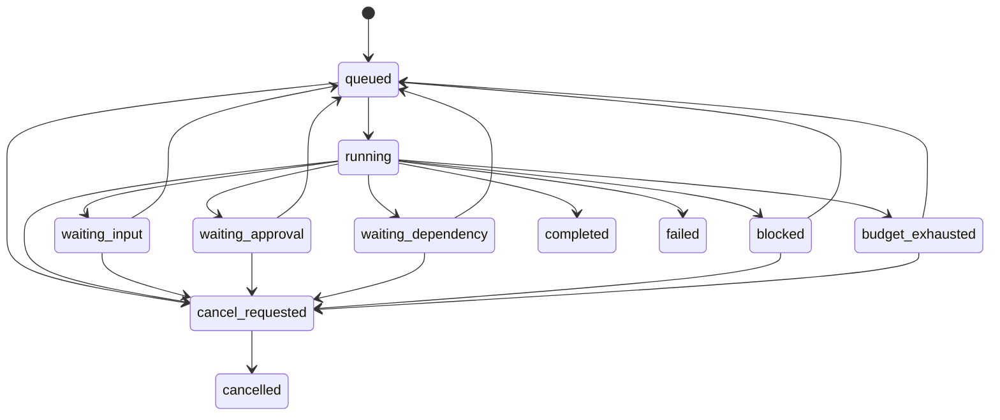
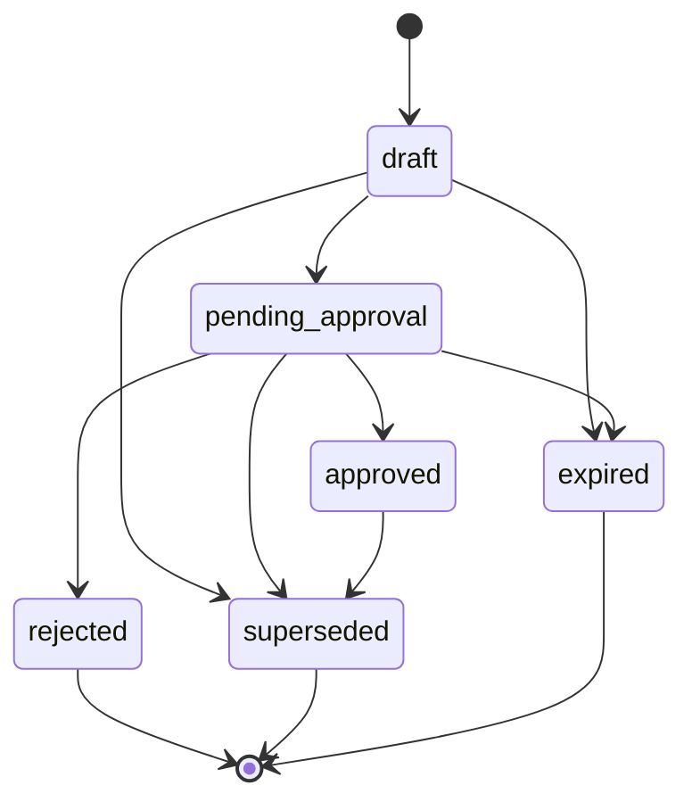
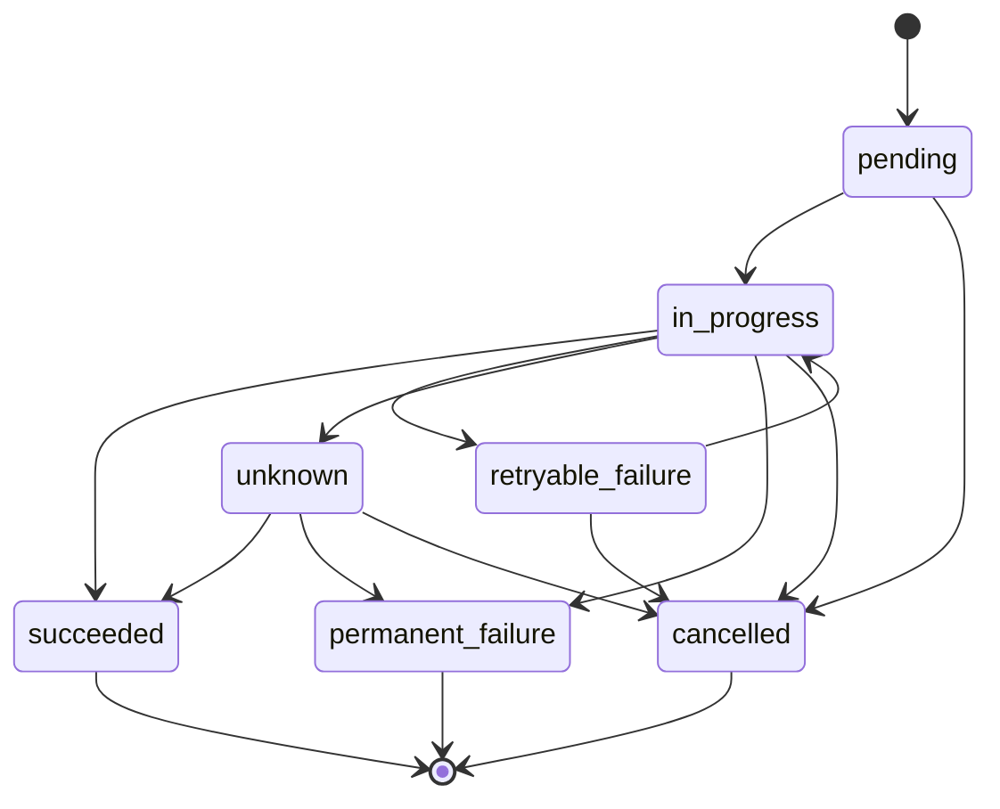

# NEXUS Stable Contracts

Status: F03 declares and freezes the shared wire contracts, domain primitives, state
vocabularies, event registry, action draft schemas, UI descriptors and OpenAPI catalog.
F03 adds no HTTP controller, persistence or provider call. The checked-in
`docs/openapi.json` is generated from these schemas and is marked declaration-only.

## Common value types

`packages/contracts/src/common.ts` is the only definition of the shared wire types.

| Type | Wire shape and rules |
|---|---|
| `EntityId` | Canonical UUID string |
| `Money` | `{ amountMinor: signed decimal string; currency: 'EUR' }`; absolute value at most `10^12` minor units; `-0`, exponents, fractions and overflowing values reject |
| `Cost` | `{ amountMicrousd: non-negative decimal string; basis: 'estimated' \| 'reported' \| 'replay' }` |
| `EntityRef` | `{ system: 'nexus' \| 'enterprise'; type; id: EntityId; version: integer }` |
| `Actor` | `{ kind: 'human' \| 'workflow' \| 'service'; id; roles: Role[] }` |
| `RequestContext` | Request/correlation IDs, sandbox ID and actor |
| `Problem` | `application/problem+json` body `{ code, message, requestId, issues?, retryAfterMs? }` |

`Role` is `viewer`, `operator`, `approver_ops`, `approver_finance` or `admin`. An action
revision has required role slots; actor roles are informational and never substitute for a
server-side authorization check.

Null and missing are distinct. A field that exists but has no value is `null`; an omitted
required field fails validation. Optional fields are used only where the contract truly
permits absence, such as an optional extraction bounding box or an event's optional linkage field.

## Errors

Errors use `application/problem+json` and one of the fixed codes:

| Code | HTTP status |
|---|---|
| `VALIDATION_FAILED` | 400 |
| `UNAUTHENTICATED` | 401 |
| `FORBIDDEN` | 403 |
| `NOT_FOUND` | 404 |
| `CONFLICT`, `STALE_STATE`, `IDEMPOTENCY_MISMATCH`, `APPROVAL_EXPIRED`, `BUDGET_EXHAUSTED` | 409 |
| `PAYLOAD_TOO_LARGE` | 413 |
| `UNSUPPORTED_MEDIA` | 415 |
| `RATE_LIMITED` | 429 |
| `DEPENDENCY_UNAVAILABLE` | 503 |

A failed mutation never returns a successful response. Validation issues are bounded
paths/messages and must not contain credentials, raw personal data or provider secrets.

## Money and tax

Currency calculation uses bigint only. The shared schemas serialize signed decimal
strings; JavaScript floating point is never used for currency. Tax rates are integer basis
points. Each line tax is rounded half-up once, including negative credit amounts. Half-up ties
are resolved away from zero, so a negative half-cent rounds to the next lower cent (for
example, -0.5 cent becomes -1 cent); line nets/taxes are summed after that rounding. Penalty is the minimum of the contractual
cap and late whole calendar days multiplied by the daily amount. Every operation checks
the absolute `10^12` minor-unit bound and rejects overflow.

## Versioning

Contract and event names carry a version. Additive fields cannot change an approved
payload, plan hash, action meaning or event payload meaning without a new contract/event
version and a reviewed migration. Approval decisions bind the whole-plan hash; a new
revision invalidates prior decisions. F03 originally generated a declaration catalog with no paths. F04 adds the four
implemented auth paths, and F05 adds the sandbox, case-list/detail/history and evidence
read paths; later owners add their paths. The
`x-nexus-implementation-status` marker names the current controller scope rather than
implying that every declared schema has a live endpoint.

## State machines

The domain state machines and contract status vocabularies are kept identical by the F03
unit suite.

Case states are `new`, `investigating`, `needs_input`, `needs_approval`, `executing`,
`resolved`, `escalated`, `cancelled`. Terminal case states cannot return to active work.
Proposal and execution states are separate. A proposal status is not proof of execution.
Terminal document states do not regress.

Document states are `uploaded`, `validating`, `extracting`, `needs_review`, `ready`,
`rejected`, `failed`.

## Action drafts and revisions

An `ActionDraftPlan` is a bounded AI-editable draft of one to six items. It contains only
target references, evidence IDs and closed action payloads, plus rationale. It cannot
express approval, approver roles, server-computed dependencies, base expected versions,
plan hashes, executable/proposal status, prices chosen from a model, supplier approval
flags or service credentials. Extra fields reject.

The server derives the immutable `ActionRevision`: stable item IDs, dependency DAG, base
expected versions, required roles, policy/config identity, aggregate impact and whole-plan
hash. The only deferred bindings are receipt-created entity IDs/versions and typed message
fact slots; there is no expression language or free interpolation. Execution state is a
separate record and cannot be written through the draft schema.

Closed action kinds are the ten in `packages/contracts/src/actions.ts`: internal note,
purchase order, message, invoice reconciled/hold, goods receipt, replacement shipment,
return authorization, credit-note draft and delivery-address change. Unknown kinds reject.

## Event registry

The envelope is strict: UUID event ID, nullable UUID causation ID, bounded correlation ID,
schema version `1`, ISO-UTC occurrence time, producer `api`/`worker`/`enterprise-sim`, and a
typed payload. F10 clarified that the correlation ID is a bounded identifier rather than a UUID
because HTTP requests and enterprise commands already use bounded correlation strings; event and
causation identities remain UUIDs. The registry accepts only these names:

- `nexus.case.created.v1`
- `nexus.case.completed.v1`
- `nexus.document.ready.v1`
- `nexus.workflow.resume.v1`
- `nexus.action.requested.v1`
- `nexus.knowledge.changed.v1`
- `enterprise.supplier.delay.v1`
- `enterprise.inventory.changed.v1`
- `enterprise.order.changed.v1`
- `enterprise.invoice.changed.v1`
- `enterprise.communication.created.v1`

Each registry entry declares its payload schema and allowed producers. Unknown names,
wrong producers and extra privileged fields reject. `case.completed` carries terminal run and trigger identities, terminal case version/status,
outcome evidence IDs and correlation. Enterprise change payloads identify entity type/ID/version, changed fields
and optional originating revision/item/receipt identity. Supplier delay carries supplier
and PO references plus optional existing document IDs; it never downloads an arbitrary URL.

Tool definitions declare a closed tool class, permission roles, scenario support, bounded
result/timeout/retry/budget values and a redaction mode with an allowlist. Gateway requests
carry the workflow and budget context; failures carry provider/model, attempt IDs, cost,
prompt/config revisions and redacted diagnostics alongside success responses.

## Workflow journal contracts (F11)

The declared `WorkflowRun` and `WorkflowStep` schemas remain the shared run/step shapes. F11
implements their durable backing tables and adds no HTTP route; F11B will expose bounded run and
SSE queries. Run statuses are the declared `queued`/`running`/`waiting_*`/`blocked`/
`budget_exhausted`/`completed`/`failed`/`cancel_requested`/`cancelled` set. Step statuses are
`pending`/`running`/`succeeded`/`retryable_failure`/`permanent_failure`/`waiting`/`cancelled`.

Each committed step attempt has a canonical input hash and output hash, a bounded redacted output
object, evidence IDs and model/policy/config/prompt revisions. The input hash covers definition
name/version, run ingress hash, step key and sorted dependency output hashes; a succeeded step is
reused only for the same hash. Attempts are immutable. A job claim has an owner, database-time
lease and monotonic fencing token; a commit with a stale token is rejected with a lease-lost
outcome, never a partial journal write.

Pure/read retries use `1s`/`5s`/`30s` for at most three attempts. External steps do not use the
generic retry path. A persistent wait stores a `WaitReason` and releases the lease. Unknown
workflow definition versions create a `blocked` run without a job; they do not silently fall back
to an older definition.

## Durable case intake and events (F10)

F10 adds `packages/contracts/src/ingress.ts`. `CaseIntakeRequest` carries a title, nullable
summary and exactly one source variant: `text` with a bounded printable identity, `email` with a
printable message ID that the server lower-cases, or `document` with a UUID that must resolve to
an existing document. Until F15 has a document store, document references reject as `NOT_FOUND`;
text and email ID-only events are valid. `CaseIntakeResponse` returns the created `CaseDetail`,
the `nexus.case.created.v1` event ID, `queued: true` and whether the response was deduplicated.
`IdempotencyKey` is a required bounded header.

The registry remains closed and strict. Nexus outbox rows may carry only the six Nexus event
names with an `api` or `worker` producer; enterprise outbox rows may carry only the five
enterprise names with the `enterprise-sim` producer. `enterprise.communication.created.v1` now
requires exactly one recipient identity: `customerId` for a customer communication or
`supplierId` for a supplier communication. This keeps the payload truthful for the simulator's
supplier messages while preserving the customer communication shape.

The accepted event envelope and payload are stored in `nexus.event_inbox`; `dispatch_state`
starts at `pending` and F11 owns the transition to scheduled work. A duplicate event is
acknowledged without a second inbox row. Schema poison and wrong producer/exchange data produce
a bounded `dead_letters` record and a DLQ message, not a business retry.

## Enterprise reads and the tool registry

F09 adds `packages/contracts/src/tools.ts` as the single source of the enterprise read wire
shapes and the registry invocation context. The purchase-order, inventory, affected-order
and supplier-alternative response schemas are shared by the private simulator and the
application client; they are not duplicated in the adapter. Exact identifiers are
reference-shaped, money is a decimal string, versions are non-negative integers and every
nested list has a schema cap. Unknown fields reject.

The four registered read tools are `enterprise.get_purchase_order`,
`enterprise.get_inventory`, `enterprise.get_affected_orders` and
`enterprise.list_alternatives`. Each registry entry declares the existing closed tool name,
schema version, permission roles, read class, supported scenarios, maximum results,
timeout, retry flag, redaction allowlist and budget weight, plus argument/result schema
identifiers and byte bounds. Tool metadata is code-owned; callers cannot add a tool or
change a bound at runtime.

`ToolInvocationContext` carries the request and correlation IDs, sandbox ID, actor,
scenario, registered workflow step and the workflow-step tool allowlist. The registry
enforces the intersection of role permission, scenario support and allowlist before
executing. It then validates strict argument schema and byte bounds, executes through the
enterprise read port, validates the untrusted result schema, byte and item bounds, and
requires the result sandbox to equal the invocation sandbox. Rejections and successes emit
a bounded trace containing identifiers, tool class, outcome, error/cause code, retry
classification, duration, byte counts and item count only; argument values and result
payloads are not traced. Registry errors use the closed `TOOL_*` codes with generic
messages and never include arguments, result payloads or credentials.

The executor-only command client is declared separately from the read port and is not a
tool. No `enterprise.create_*`, `enterprise.send_*` or other write action can enter the AI
registry; unknown and side-effect names reject.

## UI and SSE

`UiDescriptor` is closed to `clarification_form`, `alternatives_table`,
`discrepancy_list`, `evidence_list` and `approval_summary`. Labels are bounded plain text;
field keys are registered-name shaped; actions are closed identifiers with UUID targets.
HTML, scripts, executable expressions, arbitrary links, style strings and undeclared keys
reject.

SSE envelopes use a monotonically increasing non-negative ID and the closed event names
`step`, `status`, `text_delta`, `final`, `error`. Text deltas are explicitly provisional.
Only a final schema-validated result is actionable; disconnected browsers do not cancel a
run and private reasoning is never a stream payload.

## OpenAPI and verification

`node tools/generate-openapi.mjs` generates `docs/openapi.json` from the same Zod schemas;
`--check` verifies drift. `pnpm docs:check` runs that check. Recursive JSON-bearing
components are converted from the same Zod schemas with Zod's JSON Schema exporter and
merged as components; no hand-maintained duplicate DTOs are used. The F03 suite compiles
API/event examples, exercises money/tax/penalty vectors, canonical-hash ordering and
state-machine failures, and verifies that a draft cannot carry approval/execution fields.

Boundary enforcement: `packages/contracts` may import only Zod; `packages/domain` is pure
and may not import Nest, ORM/DB or model SDK packages. The checked-in invalid boundary
fixture covers a domain import of Nest and a domain import of a model SDK.
